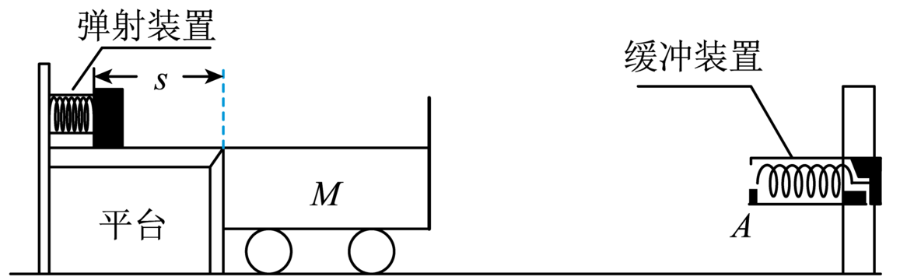

# Physics - 题目 1508

**ID**: 03dd765d13e74c8a8296f29684683d9e
**年级**: Grade 12
**难度**: Medium-Hard
**题型**: Calculation

## 题目
某工厂为了筛选一批质量在规定范围内的货物，设计如图所示装置，在可视为光滑的足够长的水平轨道上固定一长为s=0.8m平台，平台的左侧固定一弹射装置（其大小可以忽略），在紧靠平台的右侧放置一辆长度为L=2m，质量M=2kg的无动力小车，其右端有一固定挡板；在水平轨道的右侧固定一缓冲装置。​​​​​​​‌开始筛选时，将货物无初速度地放在平台弹射装置处，释放弹射装置，货物以 $v{{}_{0}}=6\sqrt {2}{\rm{m}}/{\rm{s}}$ 的速度被弹出，经过一段时间后滑上小车，若货物与挡板碰撞或在车上其他位置与小车共速都会被小车立即锁定，然后继续向右运动，与缓冲装置接触后，若货物质量2kg⩽m<6kg，则小车将被原速率弹回，车与平台碰撞瞬间货物立即解锁向平台滑动，车被锁定并在该次作业中不再解锁，滑回平台的货物若触碰到弹射装置则被原速率反弹，若货物质量6kg⩽m⩽14kg，则进入二级缓冲，小车向右运动直到停止时卸货，货物合格。已知货物与平台的动摩擦因数μ_{1}=0.5、与小车的摩擦因数为μ_{2}=0.4，重力加速度取g=10m/s^{2}，求：（1）求货物滑上小车前瞬间的速度v的大小；（2）求合格货物克服缓冲装置所做的功的大小范围；（3）若小车被反弹后返回平台，求货物最终静止的位置与车上挡板距离d的范围。

## 解答

1. （1）货物从被弹出到滑上小车，由动能定理得 $-μ{{}_{1}}mgS=\frac {1}{2}mv{^{2}}-\frac {1}{2}mv{{}_{0}^{2}}$
2. 解得 $v=8{\rm{m}}/{\rm{s}}$
3. （2）货物滑上小车后，系统动量守恒 $mv=(m+M)v{{}_{共}}$
4. 可得 $v{{}_{共}}=\frac {8m}{m+2}$
5. 设克服缓冲装置的功为W，由动能定理： $-W=0-\frac {1}{2}\left ({m+M}\right )v{{}_{共}}{^{2}}$
6. 可得 $W=\frac {1}{2}\left ({m+2}\right ){\left({\frac {8m}{m+2}}\right)^{2}}=\frac {32m{^{2}}}{m+2}$
7. 因 $6{\rm{k}}{\rm{g}}⩽m⩽14{\rm{k}}{\rm{g}}$ 代入上式可得 $144{\rm{J}}<W{\rm{<}}392{\rm{J}}$
8. （3）设货物与小车共速为v_{3}，货物与车相对位移为 $Δs$ ，由动量守恒定律得 $mv=(m+M)v{{}_{3}}$
9. 又 $μ{{}_{2}}mgΔS=\frac {1}{2}mv{^{2}}-\frac {1}{2}(m+M)v{{}_{3}^{2}}$
10. 由以上两式得 $ΔS=\frac {Mv{^{2}}}{2μ{{}_{2}}(M+m)g}$
11. 可知m越大， $ΔS$ 越小，当 $ΔS=L=2{\rm{m}}$ 时，上式代入数值可得 $m=6{\rm{k}}{\rm{g}}$
12. 此时货物刚好达到挡板处，所有小于6kg的货物均能与挡板碰后静止。
13. （a）当m=2kg时， $v{{}_{3}}=4{\rm{m}}/{\rm{s}}$
14. 车静止后货物返回过程，由动能定理： $-μ{{}_{1}}mgS{{}_{1}}-μ{{}_{2}}mgL=0-\frac {1}{2}mv{{}_{3}^{2}}$
15. 可得 $S{{}_{1}}=0$
16. 货物与挡板距离 $d=2{\rm{m}}$
17. （b）当m=6kg时， $v{{}_{3}}=6{\rm{m}}/{\rm{s}}$
18. 分析可知，当货物滑上平台后，再次返回平台右端时速度为v_{4}，由动能定理：
19. $-μ{{}_{1}}mg(2S)-μ{{}_{2}}mgL=\frac {1}{2}mv{{}_{4}^{2}}-\frac {1}{2}mv{{}_{3}^{2}}$ ， $-μ{{}_{2}}mgS{{}_{2}}=0-\frac {1}{2}mv{{}_{4}^{2}}$
20. 得： $S{{}_{2}}=0.5{\rm{m}}$
21. 则货物与小车挡板距离 $d=L-S{{}_{2}}=1.5{\rm{m}}$
22. 综上所述 $1.5{\rm{m}}⩽d⩽L+S=2.8{\rm{m}}$

## 知识点

**中文**:
  - 人船模型
  - 应用动能定理求解多阶段、多过程问题
  - 应用动能定理求解变力做功问题

**English**:
  - Man-Boat Model
  - Multi-stage/Multi-process Problems
  - Solving Work Done by Variable Force

---
