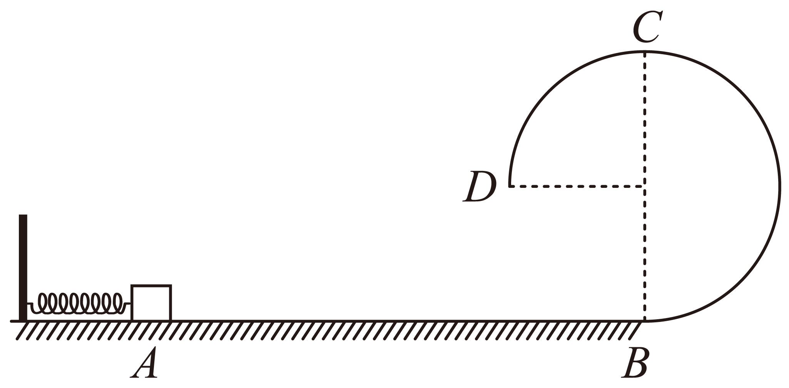

# Physics - 题目 984

**ID**: 04baa7e0987c4276918c41d1732da8f1
**年级**: Grade 12
**难度**: Medium-Hard
**题型**: Calculation

## 题目
如图所示，半径为R的四分之三光滑圆弧轨道BCD固定在竖直面内，最低点B与水平面平滑相切，BC为直径。​​​​​​​‌一根轻弹簧放在水平面上，左端与固定竖直挡板相连接，弹簧处于自然伸直时，右端刚好与水平面上的A点对齐，质量为m的物块放在A点，刚好与轻弹簧接触，水平面上AB段粗糙，物块与水平面间的动摩擦因数为0. 5，AB段长为3R，A点左侧水平面光滑，用物块压缩轻弹簧至一定的位置由静止释放，物块运动到B点时，对圆弧轨道的压力等于物块重力的3倍，重力加速度为g，不计物块的大小。求:（1）物块从A运动到B所用的时间;（2）若要使物块能沿轨道运动到D点，压缩弹簧的弹性势能至少为多大。

## 解答

1. （1）设物块运动到 $B$ 点时速度大小为 $v{{}_{1}}$ ，则
2. $3mg-mg=m\frac {v{{}_{1}^{2}}}{R}$
3. 解得
4. $v{{}_{1}}=\sqrt {2gR}$
5. 设物块运动到 $A$ 点时速度大小为 $v{{}_{0}}$ ，根据动能定理有
6. $-{\rm μm}g\times 3R=\frac {1}{2}mv{{}_{1}^{2}}-\frac {1}{2}mv{{}_{0}^{2}}$
7. 解得
8. $v{{}_{0}}=\sqrt {5gR}$
9. 设从 $A$ 运动到 $B$ 所用时间为 $t$ ，则
10. $3R=\frac {v{{}_{1}}+v{{}_{0}}}{2}t$
11. 解得
12. $t=2\left ({\sqrt {5}-\sqrt {2}}\right )\sqrt {\frac {R}{g}}$ ；
13. （2）物块只要能通过 $C$ 点，就能到达 $D$ 点，物块在 $C$ 点时对轨道的压力恰好为零时，速度最小，设最小速度为 $v{{}_{2}}$ ，则
14. $mg=m\frac {v{{}_{2}^{2}}}{R}$
15. 解得
16. $v{{}_{2}}=\sqrt {gR}$
17. 设弹簧的弹性势能至少为 $E{{}_{{\rm{p}}}}$ ，根据功能关系
18. $E{{}_{p}}={\rm μm}g\times 3R+mg\times 2R+\frac {1}{2}mv{^{2}}$
19. 解得
20. $E{{}_{p}}=4mgR$

## 知识点

**中文**:
  - 弹性势能的变化与弹力做功的关系
  - 竖直面内圆周运动问题

**English**:
  - Change in Elastic PE and Work Done by Elastic Force
  - Circular Motion in Vertical Plane

---
