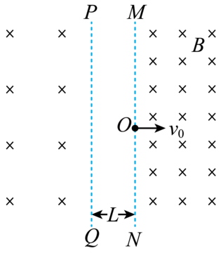

# Physics - 题目 2565

**ID**: 0548a286d1b54d8ab1aa373c39c498b9
**年级**: Grade 12
**难度**: Medium-Hard
**题型**: Calculation

## 题目
如图所示，PQ、MN是相互平行、间距为L的长直边界，在两边界外侧都存在匀强磁场，方向均垂直于纸面向内，右侧磁场的磁感应强度为B。​​​​​​​‌一质量为m、电荷量为 $q\left ({q>0}\right )$ 的带电粒子从MN边界的O点以大小为 $v{{}_{0}}$ 的初速度垂直于边界沿纸面射入右侧磁场区，一段时间后粒子再次经过O点，这过程中粒子有两次进入左侧磁场区运动。不计粒子的重力。（1）求左侧磁场的磁感应强度；（2）在PQ、MN边界之间的区域加上方向垂直于边界的匀强电场，然后使粒子从O点以同样的条件射出，结果粒子同样能返回O点，而且所用时间比原来变短。求匀强电场的场强E的可能值；（3）在第（2）问的前提下，讨论粒子从O点射出到返回O点的最短时间与磁感应强度B的关系。

## 解答

1. （1）粒子有两次进入左侧磁场区运动，最后再次经过O点，则轨迹如下图所示
2. 
3. 由几何关系可知，设粒子在左右两边磁场中运动的半径分别为R和r，则 $2R{\rm{=}}3r$
4. 根据 $qv{{}_{0}}B=m\frac {v{{}_{0}^{2}}}{R}$
5. 可得左侧磁场的磁感应强度 $B^{′}=\frac {2}{3}B$
6. （2）在PQ、MN边界之间的区域加上方向垂直于边界的匀强电场，若所加的匀强电场方向水平向左，要能返回O点，而且所用时间比原来变短。则运动轨迹可能如下图所示
7. 
8. 设粒子进入左侧磁场时的速度为v，则 $qv{{}_{1}}B^{′}=m\frac {v{{}_{1}^{2}}}{R{{}_{1}}}$ ， $qv{{}_{0}}B=m\frac {v{{}_{0}^{2}}}{r}{\rm ，\mathit{R}_{1}=2\mathit{r}}$
9. 可得 $v{{}_{1}}=\frac {4}{3}v{{}_{0}}$
10. 粒子在电场中加速的加速度为 $qE{{}_{1}}=ma{{}_{1}}$
11. 根据消时公式有 $v{{}_{1}^{2}}-v{{}_{0}^{2}}=2a{{}_{1}}L$
12. 解得 $E{{}_{1}}=\frac {7mv{{}_{0}^{2}}}{18qL}$ ，方向水平向左
13. 若所加的匀强电场方向水平向右。要能返回O点，而且所用时间比原来变短。则运动轨迹可能如下图所示
14. 
15. 设粒子进入左侧磁场时的速度为v，则 $qv{{}_{2}}B^{′}=m\frac {v{{}_{2}^{2}}}{R{{}_{2}}}$ ， $qv{{}_{0}}B=m\frac {v{{}_{0}^{2}}}{r}{\rm ，\mathit{R}_{2}=\mathit{r}}$
16. 可得 $v{{}_{2}}=\frac {2}{3}v{{}_{0}}$
17. 粒子在电场中减速的加速度为 $qE{{}_{2}}=ma{{}_{2}}$
18. 根据消时公式有 $v{{}_{0}^{2}}-v{{}_{2}^{2}}=2a{{}_{2}}L$
19. 解得 $E{{}_{2}}=\frac {5mv{{}_{0}^{2}}}{18qL}$ ，方向水平向右
20. （3）若所加的匀强电场方向水平向左，粒子从O点射出到返回O点运动的时间为 $t{{}_{1}}=\frac {2πm}{qB}+\frac {πm}{qB^{′}}+2\frac {L}{\frac {v{{}_{1}}+v{{}_{0}}}{2}}$
21. 其中 $v{{}_{1}}=\frac {4}{3}v{{}_{0}}$
22. 解得，粒子从O点射出到返回O点的时间为 $t{{}_{1}}=\frac {7πm}{2qB}+\frac {12L}{7v{{}_{0}}}$
23. 若所加的匀强电场方向水平向右，粒子运动的时间为 $t{{}_{2}}=\frac {πm}{qB}+\frac {πm}{qB^{′}}+2\frac {L}{\frac {v{{}_{2}}+v{{}_{0}}}{2}}$
24. 其中 $v{{}_{2}}=\frac {2}{3}v{{}_{0}}$
25. 解得，粒子从O点射出到返回O点的时间为 $t{{}_{2}}=\frac {5πm}{2qB}+\frac {12L}{5v{{}_{0}}}$
26. 若 $t{{}_{1}}=t{{}_{2}}$ ，则有 $\frac {5πm}{2qB}+\frac {12L}{5v{{}_{0}}}=\frac {7πm}{2qB}+\frac {12L}{7v{{}_{0}}}$
27. 解得 $B=\frac {35πmv{{}_{0}}}{24qL}$
28. 则最短时间为 $t=\frac {7πm}{2qB}+\frac {12L}{7v{{}_{0}}}=\frac {144L}{35v{{}_{0}}}$
29. 若 $t{{}_{1}}<t{{}_{2}}$ ，则有 $\frac {5πm}{2qB}+\frac {12L}{5v{{}_{0}}}>\frac {7πm}{2qB}+\frac {12L}{7v{{}_{0}}}$
30. 化简可得 $B>\frac {35πmv{{}_{0}}}{24qL}$
31. 因此，当 $B>\frac {35πmv{{}_{0}}}{24qL}$ 时，粒子从O点射出到返回O点的最短时间为 $t{{}_{1}}=\frac {7πm}{2qB}+\frac {12L}{7v{{}_{0}}}$
32. 当 $B<\frac {35πmv{{}_{0}}}{24qL}$ 时，粒子从O点射出到返回O点的最短时间为 $t{{}_{2}}=\frac {5πm}{2qB}+\frac {12L}{5v{{}_{0}}}$

## 知识点

**中文**:
  - 带电粒子在有界匀强磁场中的运动

**English**:
  - Motion in Bounded Uniform Magnetic Field

---
