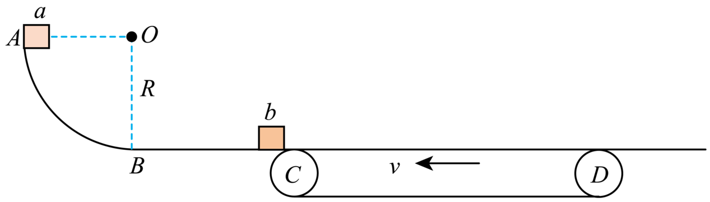

# Physics - 题目 2362

**ID**: 09d21c2d649e480e8a5a8a8a4f20dc1d
**年级**: Grade 12
**难度**: Medium-Hard
**题型**: Calculation

## 题目
如图所示，半径为 $R$ 的四分之一光滑圆弧轨道固定在竖直面内，圆弧轨道的最低点与光滑水平面 $BC$ 相切，光滑水平面 $BC$ 的右侧有一沿逆时针方向匀速转动的水平传送带，水平面 $BC$ 与传送带上表面在同一水平面内，质量为 $3m$ 的物块b放在水平面 $BC$ 的右端，质量为 $m$ 的物块a在圆弧轨道的上端 $\mathrm{A}$ 点由静止释放，物块a与b发生的是弹性碰撞，物块a、b第二次碰撞的位置仍在水平面 $BC$ 的右端，物块b在传送带上始终与传送带有相对滑动，物块与传送带间的动摩擦因数为 $μ$ ，不计物块的大小，重力加速度为 $g$ ，求：(1)物块a第一次滑到圆弧轨道的最低点时对轨道的压力多大；(2)传送带的长至少为多少；传达带的速度至少为多少；(3)若传送带的速度为 $\sqrt {2gR}$ ，从释放物块a开始，至物块a与b发生第4次碰撞时，物块b与传送带间因摩擦产生的热量为多少。​​​​​​​‌

## 解答

1. （1）设物块a第一次运动到 $B$ 点时的速度大小为 $v{{}_{1}}$ ，根据机械能守恒定律 $mgR=\frac {1}{2}mv{{}_{1}^{2}}$ ，
2. 在 $B$ 点，根据牛顿第二定律 $F-mg=m\frac {v{{}_{1}^{2}}}{R}$ ，
3. 解得 $F=3mg$ ，
4. 根据牛顿第三定律可知，物块a对圆弧轨道最低点的压力 $F^{′}=F=3mg$ 。
5. （2）由（1）知 $v{{}_{1}}=\sqrt {2gR}$  $a$ 与 $b$ 碰撞过程中，根据动量守恒 $mv{{}_{1}}=-mv{{}_{2}}+3mv{{}_{3}}$ ，
6. 根据能量守恒 $\frac {1}{2}mv{{}_{1}^{2}}=\frac {1}{2}mv{{}_{2}^{2}}+\frac {1}{2}\times 3mv{{}_{3}^{2}}$ ，
7. 解得 $v{{}_{2}}=v{{}_{3}}=\frac {1}{2}\sqrt {2gR}$ ，
8. 由于 $a、b$ 能第二次在 $BC$ 右端发生第二次碰撞，因此物块b不会从传送带右端滑离，设传送带的长至少为 $L$ ，根据动能定理 $-μ\times 3mgL=0-\frac {1}{2}\times 3mv{{}_{3}^{2}}$ ，
9. 解得 $L=\frac {R}{4μ}$ ，
10. 所以传送带的长至少为 $\frac {R}{4μ}$ ，物块b在传送带上始终与传送带有相对滑动，则传送带的速度至少为 $\frac {1}{2}\sqrt {2gR}$ 。
11. （3）a与b第二次碰撞后一瞬间，设a的速度大小为 $v{{}_{4}}、{\rm \mathit{b}}$ 的速度大小为 $v{{}_{5}}$ ，由于 $\sqrt {2gR}$ 大于 $\frac {1}{2}\sqrt {2gR}$ ，因此物块 $3mv{{}_{3}}-mv{{}_{2}}=3mv{{}_{5}}+mv{{}_{4}}$ ，
12. 根据能量守恒 $\frac {1}{2}\times 3mv{{}_{3}^{2}}+\frac {1}{2}mv{{}_{2}^{2}}=\frac {1}{2}\times 3mv{{}_{5}^{2}}+\frac {1}{2}mv{{}_{4}^{2}}$ ，
13. 解得 $v{{}_{5}}=0,v{{}_{4}}=\sqrt {2gR}$ ，
14. 由此可见，第二次碰撞后，从物块a滑到A点开始，a与b周期性重复之前的运动。物块b第一次在传送带上运动过程中，b与传送带间的相对运动位移： $s=\sqrt {2gR}\times \frac {\frac {1}{2}\sqrt {2gR}}{μg}+\frac {{\left({\frac {1}{2}\sqrt {2gR}}\right)^{2}}}{2μg}+\sqrt {2gR}\times \frac {\frac {1}{2}\sqrt {2gR}}{μg}-\frac {{\left({\frac {1}{2}\sqrt {2gR}}\right)^{2}}}{2μg}=\frac {2R}{μ}$ ，
15. 因此，从释放物块a开始，至物块a与b发生第4次碰撞时，物块b与传送带间因摩擦产生的热量为 $Q=μ\times 3mg\times \frac {4R}{μ}=12mgR$ 。

## 知识点

**中文**:
  - 动量和能量的综合应用

**English**:
  - Integration of Momentum and Energy

---
