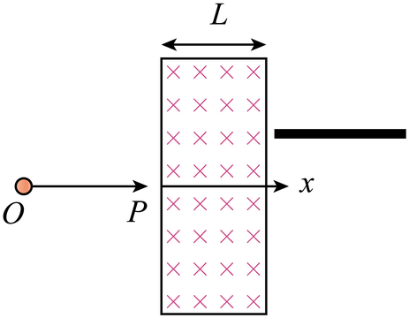

# Physics - 题目 1267

**ID**: 0d6fbd1088784e328919fea3f134720b
**年级**: Grade 12
**难度**: Medium-Hard
**题型**: Calculation

## 题目
科学家发现通过人工磁场可使光子晶体中的光发生偏转，打破了光学的对称性。​​​​​​​‌某实验室设计了一种新型光子晶体，能使光子在传播过程中受到类似洛伦兹力的作用。如图所示，一束激光（波长 $λ=442{\rm{n}}{\rm{m}}$ ，功率 $P=10{\rm{m}}{\rm{W}}$ ）从光源O点发出，从P点沿x轴入射，穿过宽度 $L=0.6{\rm{m}}$ 的平行光子晶体区域（区域中存在垂直平面向里的“人工磁场” $B{{}_{0}}=0.625\times 10{^{-8}}{\rm{T}}$ ）。已知光子在晶体中的速度 $v=2\times 10{^{8}}{\rm{m}}/{\rm{s}}$ ，等效电荷 $q=1.6\times 10{^{-19}}{\rm{C}}$ 。在光子晶体右侧平行x轴放置完全反射的探测面，经偏转后的光束以角度 $θ$ （未知）撞击探测面。普朗克常量 $h=6.63\times 10{^{-34}}{\rm{J}}\centerdot {\rm{s}}$ ，光速 $c=3\times 10{^{8}}{\rm{m}}/{\rm{s}}$ ，传播过程中激光能量不衰减。提示：单个光子等效质量 $m=\frac {E}{c{^{2}}}$ ，其中 $E$ 为单个光子能量。（ ${\rm{s}}{\rm{i}}{\rm{n}}37{}\degree =0.6$ ， ${\rm{c}}{\rm{o}}{\rm{s}}37{}\degree =0.8$ ）求：（1）单个光子的等效质量 $m$ ；（2）光子在晶体中的轨迹半径 $r$ 和偏转位移 $d$ ；（3）若磁场存在梯度分布：以P点为坐标原点， $B=B{{}_{0}}\left ({1-βx}\right )，β=1{\rm{m}}{^{-1}}$ ，求激光束打在探测板上对探测板的作用力F（仅考虑出射晶体时的折射情况）；（4）若可调节晶体折射率，使光子在晶体中速度可在 $0\sim 2\times 10{^{8}}{\rm{m}}/{\rm{s}}$ 范围内变化，光从P点进入一块上述光子晶体， $OP=1{\rm{m}}$ ，请你设计光子晶体的形状，使光子在以上速度范围内经过晶体内磁场偏转后都可以回到O点，画出晶体形状，并计算最小面积。（不考虑进出晶体界面处由于折射反射引起的方向改变）

## 解答

1. （1）光子的能量为 $E=hv=\frac {hc}{λ}$
2. 根据质能方程可知，光子的等效质量为 $m{}=\frac {E}{c{^{2}}}=\frac {h}{λc}$
3. 解得 $m=\frac {E}{c{^{2}}}=\frac {h}{λc}=\frac {6.63\times 10{^{-34}}}{442\times 10{^{-9}}\times 3\times 10{^{8}}}{\rm{k}}{\rm{g}}=5\times 10{^{-36}}{\rm{k}}{\rm{g}}$
4. （2）洛伦兹力充当向心力，有 $qvB{{}_{0}}=\frac {mv{^{2}}}{r}$
5. 解得 $r=\frac {mv}{qB{{}_{0}}}=\frac {5\times 10{^{-36}}\times 2\times 10{^{8}}}{1.6\times 10{^{-19}}\times 0.625\times 10{^{-8}}}{\rm{m}}=1{\rm{m}}$
6. 根据几何关系有 ${\rm{s}}{\rm{i}}{\rm{n}}θ=\frac {L}{r}=0.6$
7. $d=r\left ({1-{\rm{c}}{\rm{o}}{\rm{s}}θ}\right )=0.2{\rm{r}}=0.2{\rm{m}}$
8. （3）将粒子的速度分解，在 $y$ 方向上的洛伦兹力与水平分速度有关，列动量定理，有 $\sum Bqv{{}_{x}}·{\rm{Δ}}t=mv{{}_{y}}-0$
9. 即 $\sum B{{}_{0}}\left ({1-βx}\right )q·{\rm{Δ}}x=mv{{}_{y}}-0$
10. 可解得 $B{{}_{0}}qx-B{{}_{0}}q\frac {x{^{2}}}{2}=mv{{}_{y}}$
11. 所以 $v{{}_{y}}=0.84\times 10{^{8}}{\rm{m}}/{\rm{s}}$
12. 方向为 ${\rm{s}}{\rm{i}}{\rm{n}}θ=\frac {v{{}_{y}}}{v}=0.42$
13. 根据折射率公式，有 $n=\frac {{\rm{s}}{\rm{i}}{\rm{n}}α}{\sin θ}$
14. 碰撞时有动量定理，可知 $F=\frac {2P\sin α}{c}=\frac {2\times 10{^{-2}}\times 0.63}{3\times 10{^{8}}}{\rm{N}}=4.2\times 10{^{-11}}{\rm{N}}$
15. （4）由于 $r=\frac {mv}{qB{{}_{0}}}$
16. 当 $v=2\times 10{^{8}}{\rm{m}}{\rm{/}}{\rm{s}}$ 时， $r{{}_{{\rm{m}}{\rm{a}}{\rm{x}}}}=1{\rm{m}}$
17. 如图所示，曲线1为速度最大值时对应的轨迹，曲线2为速度为 $v$ 时对应的一般轨迹，假设出射点为 $A\left ({x，y}\right )$ 。
18. 
19. 由几何关系得 $r{^{2}}+{\left({x+1}\right)^{2}}+y{^{2}}=1+r{^{2}}$ ， ${\left({x+1}\right)^{2}}+y{^{2}}=1$
20. 即所有出射点连接起来为圆弧。所以满足题意可设计如下图所示形状的光子晶体。
21. 
22. 则光子晶体的最小面积为 $s{{}_{{\rm{m}}{\rm{i}}{\rm{n}}}}=\frac {3}{4}πr{{}_{{\rm{m}}{\rm{a}}{\rm{x}}}^{2}}+\left ({r{{}_{{\rm{m}}{\rm{a}}{\rm{x}}}^{2}}-\frac {1}{4}πr{{}_{{\rm{m}}{\rm{a}}{\rm{x}}}^{2}}}\right )=\left ({\frac {π}{2}+1}\right ){\rm{m}}{^{2}}$

## 知识点

**中文**:
  - 光的折射定律及其应用
  - 带电粒子在有界磁场中运动的临界极值问题
  - 动量定理及其应用

**English**:
  - Law of Refraction and Applications
  - Critical Extremum Problems in Bounded Magnetic Fields
  - Applications of Impulse-Momentum Theorem

---
