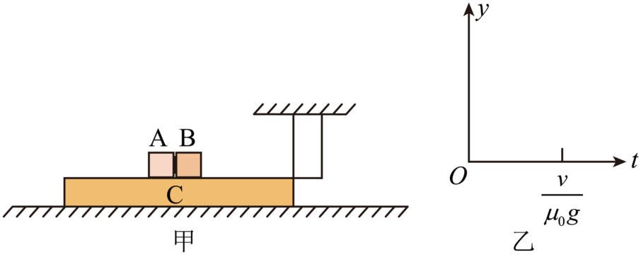

# Physics - 题目 2580

**ID**: 0e4f6152bf4d4c55a8a80176fee49c44
**年级**: Grade 12
**难度**: Medium-Hard
**题型**: Calculation

## 题目
如图甲所示，长木板C静止在光滑水平地面上，其右上端有固定的挡板，可视为质点的小物体A和B紧靠在一起静止在长木板C上，小物体A和B之间夹有少量火药。​​​​​​​‌某时刻点燃火药，火药瞬间燃爆后A获得的速度大小为 $v$ ，若长木板C固定，A和B会同时停在C的最左端。已知小物体A的质量为2m，小物体B的质量为m，长木板C的质量为3m，A和C之间的动摩擦因数为 $μ{{}_{0}}{\rm ，B}$ 和C之间的动摩擦因数为 $2μ{{}_{{{0}}}}$ ，重力加速度为 $g$ ，不计火药的质量和燃爆时间，不计B和挡板的碰撞时间，B和挡板碰撞时无机械能损失。（1）若点燃火药释放的能量全部转化为A和B的机械能，求点燃火药释放的能量；（2）求长木板C的长度；（3）若长木板不固定，求整个过程A和C之间由于摩擦产生的内能以及B和C之间由于摩擦产生的内能；（4）若长木板不固定，将B碰撞挡板时作为t=0时刻，自该时刻开始A的位移大小用 $x{{}_{{{1}}}}$ 表示，B的位移大小用 $x{{}_{{{2}}}}$ 表示，C的位移大小用 $x{{}_{{{3}}}}$ 表示，设 $y={{2}}x{{}_{1}}+x{{}_{{{2}}}}+{{3}}x{{}_{{{3}}}}$ ，在图乙中画出y随时间t变化的图像，并标明 $t=\frac {v}{μ{{}_{{{0}}}}g}$ 时的y值。

## 解答

1. （1）设火药瞬间燃爆后B获得的速度大小为 $v^{′}$ ，火药爆炸瞬间A和B系统的动量守恒，由动量守恒定律有 ${{2}}mv-mv^{′}={{0}}$ ，
2. 解得 $v^{′}={{2}}v$ ，
3. 则火药爆炸释放的能量 $E=\frac {{{1}}}{{{2}}}\times {{2}}mv{^{{{2}}}}+\frac {{{1}}}{{{2}}}\times mv^{′}{{^{{{2}}}}}$ ，
4. 联立可得 $E={{3}}mv{^{{{2}}}}$ 。
5. （2）若长木板固定，A和B的速度同时减小到0，对二者获得速度到速度减为0的过程中，对于物体A有 $μ{{}_{{{0}}}}\times {{2}}mg={{2}}ma{{}_{{{1}}}}$ ，
6. 解得 $a{{}_{{{1}}}}=μ{{}_{{{0}}}}g$ ，
7. 由运动学公式有 ${{0}}=v-a{{}_{{{1}}}}t{{}_{{{0}}}}$ ，
8. 解得 $t{{}_{{{0}}}}=\frac {v}{μ{{}_{{{0}}}}g}$ ，
9. A和B的路程差 $x=\frac {{{1}}}{{{2}}}v^{′}t{{}_{{{0}}}}-\frac {{{1}}}{{{2}}}vt{{}_{{{0}}}}=\frac {v{^{{{2}}}}}{{{2}}μ{{}_{{{0}}}}g}$ ，
10. 长木板的长度 $L=\frac {x}{{{2}}}+\frac {vt{{}_{{{0}}}}}{{{2}}}=\frac {{{3}}v{^{{{2}}}}}{{{4}}μ{{}_{{{0}}}}g}$ 。
11. （3）由第二问可知，A和B的初始位置距挡板的距离为 $\frac {{{1}}}{{{2}}}x=\frac {v{^{{{2}}}}}{{{4}}μ{{}_{{{0}}}}g}$ ，
12. B与挡板碰撞前C静止，对B自开始运动到与挡板碰撞的过程中，有 ${{2}}μ{{}_{{{0}}}}mg=ma{{}_{{{2}}}}$ ，
13. 解得 $a{{}_{{{2}}}}={{2}}μ{{}_{{{0}}}}g$ ，
14. 设物体B与挡板碰前瞬间的速度 $v{{}_{{{2}}}}$ ，则 $v{{}_{{{2}}}^{{{2}}}}-v^{′}{{^{{{2}}}}}={{2}}a{{}_{{{2}}}}\frac {x}{{{2}}}$ ，
15. 解得 $v{{}_{{{2}}}}=\sqrt {{{3}}}v$ ，
16. 设该过程的时间间隔为 $t{{}_{{{1}}}}$ ，则 $\frac {x}{{{2}}}=\frac {v^{′}+v{{}_{{{2}}}}}{{{2}}}t{{}_{{{1}}}}$ ，
17. 解得 $t{{}_{{{1}}}}=({{1}}-\frac {\sqrt {3}}{{{2}}})\frac {v}{μ{{}_{{{0}}}}g}$ ，
18. B与挡板碰撞时A的速度大小 $v{{}_{{{1}}}}=v-a{{}_{{{1}}}}t{{}_{{{1}}}}=\frac {\sqrt {{{3}}}}{{{2}}}v$ ，
19. 以水平向左的方向为正方向，B与挡板碰撞后对A、B和C组成的系统动量守恒，设三者的共同速度为 $v{{}_{0}}$ ，则有 ${{2}}mv{{}_{{{1}}}}+mv{{}_{{{2}}}}=({{2}}m+m+{{3}}m)v{{}_{{{0}}}}$ ，
20. 解得 $v{{}_{{{0}}}}=\frac {\sqrt {{{3}}}}{{{3}}}v$ ，
21. 对C由牛顿第二定律有 $μ{{}_{{{0}}}}\cdot {{2}}mg+{{2}}μ{{}_{{{0}}}}mg={{3}}ma{{}_{{{3}}}}$ ，
22. 解得 $a{{}_{{{3}}}}=\frac {{{4}}}{{{3}}}μ{{}_{{{0}}}}g$ ，
23. 计算可知，B撞击挡板后A先与C共速，A与C共速后不再有相对运动，然后B再与A和C共速，自B撞击挡板至A和C共速，有 $v^{′}{{{}_{0}}}=v{{}_{{{1}}}}-a{{}_{{{1}}}}t{{}_{{{2}}}}=a{{}_{{{3}}}}t{{}_{{{2}}}}$ ，
24. 解得 $t{{}_{{{2}}}}=\frac {3\sqrt {3}v}{{{1}}{{4}}μ{{}_{{{0}}}}g}$ ， $v^{′}{{{}_{0}}}=\frac {{{2}}\sqrt {{{3}}}v}{{{7}}}$ ，
25. 自B开始运动至A和C共速之间的相对路程 $x{{}_{{\rm{A}}{\rm{C}}}}=\frac {v+v{{}_{{{1}}}}}{{{2}}}t{{}_{{{1}}}}+\frac {v{{}_{{{1}}}}+v^{′}{{{}_{0}}}}{{{2}}}t{{}_{{{2}}}}-\frac {{{0}}+v^{′}{{{}_{0}}}}{{{2}}}t{{}_{{{2}}}}=\frac {{{2}}v{{}_{{{0}}}^{{{2}}}}}{{{7}}μ{{}_{{{0}}}}g}$ ，
26. A和C之间由于摩擦产生的热量 $Q{{}_{{\rm{A}}{\rm{C}}}}=μ{{}_{{{0}}}}\cdot {{2}}mgx{{}_{{\rm{A}}{\rm{C}}}}=\frac {{{4}}}{{{7}}}mv{^{{{2}}}}$ ，
27. B和C间由于摩擦产生的热量 $Q{{}_{{\rm{B}}{\rm{C}}}}=E-Q{{}_{{\rm{A}}{\rm{C}}}}-\frac {{{1}}}{{{2}}}({{2}}m+m+{{3}}m)v{{}_{{{0}}}^{{{2}}}}=\frac {{{1}}{{0}}}{{{7}}}mv{^{{{2}}}}$ 。
28. （4）以水平向左为正方向，对A、B和C组成的系统自B与挡板碰撞以后的任意时刻，由动量守恒定律可得 ${{2}}mv{{}_{{{1}}}}+mv{{}_{{{2}}}}={{2}}mv^{′}{{{}_{1}}}+mv^{′}{{{}_{2}}}+{{3}}mv^{′}{{{}_{3}}}={{2}}mv^{′′}{{{}_{1}}}+mv^{′′}{{{}_{2}}}+{{3}}mv^{′′}{{{}_{3}}}=$ …
29. 其中 $v{{}_{{{1}}}}=\frac {\sqrt {{{3}}}}{{{2}}}v$ ， $v{{}_{{{2}}}}=\sqrt {{{3}}}v$ ，
30. 且将该过程得时间分为 $t^{′}$ 、 $t^{′′}$ 、 $t^{′′′}$ …无穷段，则有 ${{2}}\sqrt {{{3}}}mvt^{′}={{2}}mv^{′}{{{}_{1}}}t^{′}+mv^{′}{{{}_{2}}}t^{′}+{{3}}mv^{′}{{{}_{3}}}t^{′}$ ， ${{2}}\sqrt {{{3}}}mvt^{′′}={{2}}mv^{′′}{{{}_{1}}}t^{′′}+mv^{′′}{{{}_{2}}}t^{′′}+{{3}}mv^{′′}{{{}_{3}}}t^{′′}$ ， ${{2}}\sqrt {{{3}}}mvt^{′′′}={{2}}mv^{′′′}{{{}_{1}}}t^{′′′}+mv^{′′′}{{{}_{2}}}t^{′′′}+{{3}}mv^{′′′}{{{}_{3}}}t^{′′′}$ …
31. 以上各式相加，又 $t=t^{′}+t^{′′}+t^{′′′}$ … $x{{}_{{{1}}}}=v^{′}{{{}_{1}}}t^{′}+v^{′′}{{{}_{1}}}t^{′′}+v^{′′′}{{{}_{1}}}t^{′′′}$ … $x{{}_{{{3}}}}=v^{′}{{{}_{3}}}t^{′}+v^{′′}{{{}_{3}}}t^{′′}+v^{′′}{{{}_{3}}}t^{′′′}$ …
32. 即有 ${{2}}\sqrt {{{3}}}vt={{2}}x{{}_{{{1}}}}+x{{}_{{{2}}}}+{{3}}x{{}_{{{3}}}}$ ， $y={{2}}\sqrt {{{3}}}vt$ ，
33. 其图像如图所示，当 $t=\frac {v}{μ{{}_{{{0}}}}g}$ ， $y=\frac {{{2}}\sqrt {{{3}}}v{^{{{2}}}}}{μ{{}_{{{0}}}}g}$ 。
34. 

## 知识点

**中文**:
  - 求解弹性碰撞问题
  - 爆炸问题

**English**:
  - Solving Elastic Collision Problems
  - Explosion Problems

---
