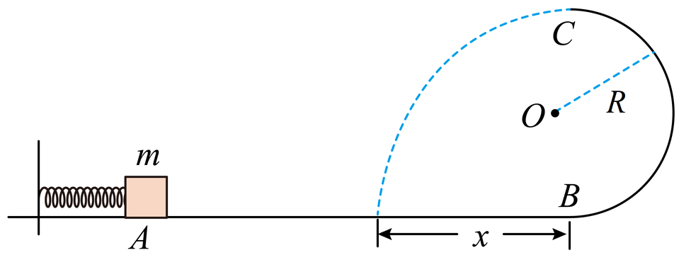

# Physics - 题目 1814

**ID**: 108deeb91971409aac3856a4a61acd9d
**年级**: Grade 12
**难度**: Medium-Hard
**题型**: Calculation

## 题目
如图所示，粗糙水平面 $AB$ 与竖直面内的光滑半圆形轨道在B点平滑相接，一质量m的小滑块（可视为质点）将弹簧压缩至A点后由静止释放，经过B点后恰好能通过最高点C作平抛运动。​​​​​​​‌已知：导轨半径 $R=0.{{4}}{\rm{m}}$ ，小滑块的质量 $m=0.{{1}}{\rm{k}}{\rm{g}}$ ，小滑块与轨道 $AB$ 间的动摩擦因数 $μ=0.2$ ， $AB$ 的长度 $L=2.0{\rm{m}}$ ，重力加速度取 ${{1}}{{0}}{\rm{m}}{\rm{/}}{\rm{s}}{^{{{2}}}}$ 。求：（1）小滑块在最高点C的速率；（2）小滑块对圆轨道最低处B点的压力大小；（3）弹簧压缩至A点时弹簧的弹性势能：（4）若仅改变 $AB$ 的长度L，其他不变，滑块在半圆轨道运动时不脱离轨道，求出L的可能值。

## 解答

1. （1）在C点，根据牛顿第二定律则有 $mg=m\frac {v{{}_{C}^{2}}}{R}$
2. 代入数据解得 $v{{}_{C}}=2{\rm{m}}/{\rm{s}}$
3. （2）在B点，根据牛顿第二定律则有 $F{{}_{{\rm{N}}}}-mg=m\frac {v{{}_{B}^{2}}}{R}$
4. 小滑块从B至C根据动能定理则有 $-mg\cdot 2R=\frac {1}{2}mv{{}_{C}^{2}}-\frac {1}{2}mv{{}_{B}^{2}}$
5. 代入数据解得 $F{{}_{{\rm{N}}}}=6{\rm{N}}$
6. 根据牛顿第三定律可知，小滑块对圆轨道最低处B点的压力大小 ${{6}}{\rm{N}}$ ；
7. （3）小滑块A至B根据功能关系则有 $E{{}_{{\rm{p}}A}}-{\rm μm}gL=\frac {1}{2}mv{{}_{B}^{2}}$
8. 由上述结论可得 $v{{}_{{\rm{B}}}}=\sqrt {20}{\rm{m}}/{\rm{s}}$
9. 代入数据解得 $E{{}_{{\rm{p}}A}}=1.4{\rm{J}}$
10. （4）物块滑上圆轨道，但不越过 $\frac {1}{4}$ 圆弧，设刚好到达 $\frac {1}{4}$ 圆弧时，轨道长 $L{{}_{1}}$ ，刚好到达B点时，轨道长为 $L{{}_{2}}$ ，则有 $E{{}_{{\rm{p}}A}}-{\rm μm}gL{{}_{1}}=mgR$ ， $E{{}_{{\rm{p}}A}}-{\rm μm}gL{{}_{2}}=0$
11. 代入数据解得 $L{{}_{1}}=5.0{\rm{m}}$ ， $L{{}_{2}}=7.0{\rm{m}}$
12. 物块滑上圆轨道，但不越过 $\frac {1}{4}$ 圆弧的条件为 $5{\rm{m}}⩽L⩽7{\rm{m}}$ ；
13. 依题意， $L=2.0{\rm{m}}$ 时，刚好不脱离最高点；物块要在整个圆弧运动要求 $L⩽2{\rm{m}}$ ；
14. 综上述二种情况可得 $5{\rm{m}}⩽L⩽7{\rm{m}}$ 或者 $L⩽2{\rm{m}}$

## 知识点

**中文**:
  - 功能关系与能量守恒定律的综合应用
  - 应用动能定理求解多阶段、多过程问题

**English**:
  - Comprehensive Applications of Work-Energy Relation and Energy Conservation
  - Multi-stage/Multi-process Problems

---
