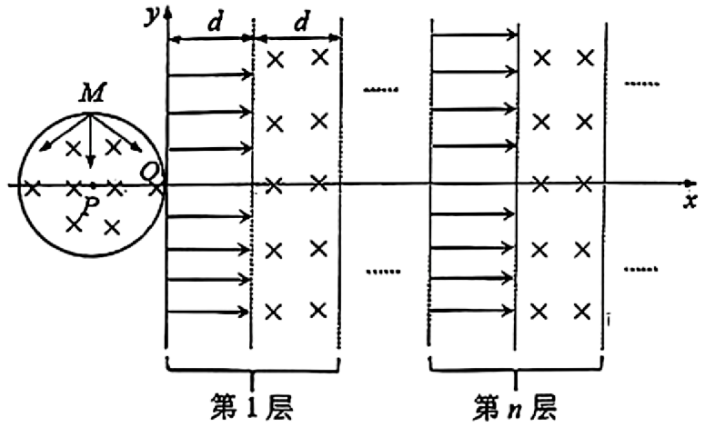

# Physics - 题目 3004

**ID**: 128d529ade3b46dcac906d72bbd5bce1
**年级**: Grade 12
**难度**: Medium-Hard
**题型**: Calculation

## 题目
现代科学仪器常利用电场、磁场控制带电粒子的运动。​​​​​​​‌如图所示，位于真空中的xOy平面内，x＜0区域有一个圆心为P、半径为r的圆形区域，其内部存在方向垂直纸面向里的匀强磁场。x＞0区域存在多层紧密相邻的匀强电场和匀强磁场，电场与磁场的宽度均为d，纵向尺寸足够大。电场强度大小为E，方向水平向右；磁感应强度大小为B，方向垂直纸面向里，电场、磁场的边界互相平行且与电场方向垂直。质量为m、电荷量为＋q的大量同种粒子，从圆形区域的最高点M以相同速率v沿不同方向垂直射入圆形磁场区域，在圆形区域磁场中做匀速圆周运动的半径等于r。不计粒子的重力及粒子间相互作用的影响。(1)证明所有粒子均平行于x轴射出圆形磁场区域；(2)求粒子在第1层磁场中运动的速度大小 $v{{}_{1}}$ 和轨迹半径 $r{{}_{1}}$ ；(3)粒子从第n层磁场右侧边界穿出时，速度的方向与水平方向的夹角为 $θ{{}_{n}}$ ，求 $\sin θ{{}_{n}}$ 。

## 解答

1. （1）研究从M点沿图1中射入的粒子。
2. 
3. 粒子做圆周运动的圆心为N，假设粒子从Q点射出圆形磁场，图中 $MN=NQ=MP=PQ=r$
4. 四边形MPQN为菱形；
5. 则NQ平行于MP，NQ垂直于x轴，所以粒子平行于x轴射出圆形磁场区域；
6. 题中所有粒子运动规律均与图示粒子相同，所有粒子均平行于x轴射出圆形磁场区域。
7. （2）粒子从第1层电场中射出时，据动能定理有 $qEd=\frac {1}{2}mv{{}_{1}^{2}}-\frac {1}{2}mv{^{2}}$
8. 解得 $v{{}_{1}}=\sqrt {\frac {2qEd}{m}+v{^{2}}}$
9. 粒子在第1层磁场中受到的洛伦兹力充当向心力，有 $qv{{}_{1}}B=m\frac {v{{}_{1}^{2}}}{r{{}_{1}}}$
10. 解得 $r{{}_{1}}=\frac {\sqrt {2mqEd+m{^{2}}v{^{2}}}}{qB}$
11. （3）设粒子在第n层磁场中运动的速度为 $v{{}_{n}}$ ，轨迹半径为 $r{{}_{n}}$ （各量的下标均代表粒子所在层数，下同） $nqEd=\frac {1}{2}mv{{}_{n}^{2}}-\frac {1}{2}mv{^{2}}$
12. $qv{{}_{n}}B=m\frac {v{{}_{n}^{2}}}{r{{}_{n}}}$
13. 粒子进入第n层磁场时，速度的方向与水平方向的夹角为 $α{{}_{n}}$ ，从第n层磁场右侧边界穿出时速度方向与水平方向的夹角为 $θ{{}_{n}}$ ，粒子在电场中运动时，垂直于电场线方向的速度分量不变，有 $v{{}_{n-1}}\sin θ{{}_{n-1}}=v{{}_{n}}\sin α{{}_{n}}$
14. $r{{}_{n-1}}\sin θ{{}_{n-1}}=r{{}_{n}}\sin α{{}_{n}}$
15. 
16. 由图2可知出 $r{{}_{n}}\sin θ{{}_{n}}-r{{}_{n}}\sin α{{}_{n}}=d$
17. 有 $r{{}_{n}}\sin θ{{}_{n}}-r{{}_{n-1}}\sin θ{{}_{n-1}}=d$
18. 由上式看出 $r{{}_{1}}\sin θ{{}_{1}}$ ， $r{{}_{2}}\sin θ{{}_{2}}$ ，…， $r{{}_{n}}\sin θ{{}_{n}}$ 为一等差数列，公差为d，可得 $r{{}_{n}}\sin θ{{}_{n}}=r{{}_{1}}\sin θ{{}_{1}}+\left ({n-1}\right )d$
19. 由图3得出，当 $n=1$ 时， $r{{}_{1}}\sin θ{{}_{1}}=d$
20. 解得 $\sin θ{{}_{n}}=\frac {ndqB}{\sqrt {2nmqEd+m{^{2}}v{^{2}}}}$
21. 

## 知识点

**中文**:
  - 带电粒子在组合场中的运动

**English**:
  - Motion in Combined Fields

---
