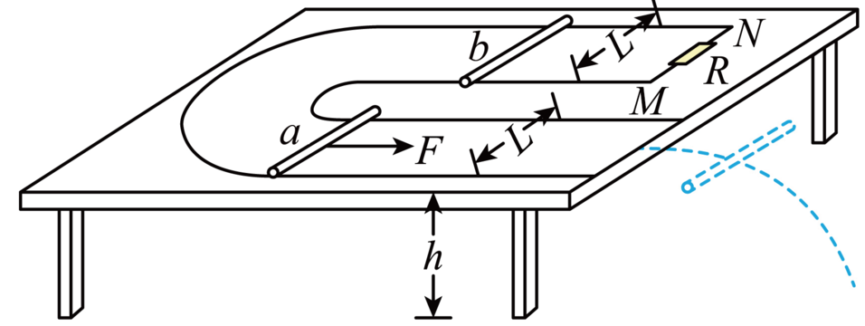

# Physics - 题目 2035

**ID**: 1506b32bc0f54bf1adfcbbce04338a6f
**年级**: Grade 12
**难度**: Medium-Hard
**题型**: Calculation

## 题目
如图，间距L=1m的U形金属导轨，一端M、N之间接有R=0.1Ω的定值电阻，固定在高h=0.8m的绝缘水平桌面上。​​​​​​​‌质量均为m=0.1kg的匀质导体棒a和b静止在导轨上，两导体棒与导轨接触良好且始终与导轨垂直，接入电路的阻值均为R=0.1Ω，与导轨间的动摩擦因数处处相同（设最大静摩擦力等于滑动摩擦力），导体棒a距离导轨最右端1.74m。整个空间存在竖直向下的匀强磁场（图中未画出），磁感应强度B=0.1T。用F=0.5N沿导轨水平向右的恒力拉导体棒a，当导体棒a运动到导轨最右端时，导体棒b刚要滑动，撤去F，导体棒a离开导轨后落到水平地面上，落地点与桌子边缘的水平距离为1.2m。重力加速度取10m/s^{2}，不计空气阻力，不计其他电阻，求：(1)通过电阻R的电流方向以及导体棒a离开导轨时的速度大小v；(2)导体棒与导轨间的动摩擦因数μ；(3)导体棒a在导轨上运动的过程中，通过电阻R的电荷量q和电阻R上产生的焦耳热Q。

## 解答

1. （1）导体棒a在导轨上向右运动，由右手定则可知通过电阻R的电流方向为从M到N。离开导轨后a棒做平抛运动
2. $x{{}_{水平}}=vt$ ， $h=\frac {1}{2}gt{^{2}}$
3. 解得
4. v=3m/s
5. （2）导体棒b与电阻R并联，有
6. $I=\frac {BLv}{R+\frac {R}{2}}$
7. 当a运动到导轨最右端时，导体棒b刚要滑动，有
8. $B\cdot \frac {I}{2}\cdot L={\rm μm}g$
9. 解得
10. μ=0.1
11. （3）导体棒a在导轨上运动的过程中，通过电路的电量为
12. $q=\bar I\cdot {\rm{Δ}}t=\frac {\bar E}{R+\frac {1}{2}R}·Δt=\frac {BL\cdot {\rm{Δ}}x}{R+\frac {1}{2}R}=1.16{\rm{C}}$
13. 导体棒b与电阻R并联，流过的电流与电阻成反比，则通过电阻R的电荷量为
14. $q{{}_{R}}=\frac {q}{2}=0.58{\rm{C}}$
15. 导体棒a在导轨上运动的过程中，由能量守恒，可得
16. $Fx-{\rm μm}gx=Q{{}_{总}}+\frac {1}{2}mv{^{2}}$
17. 设通过电阻R的电流为I，由焦耳定律，可知
18. $Q{{}_{总}}={\left({2I}\right)^{2}}Rt+I{^{2}}Rt+I{^{2}}Rt$
19. 电阻R上产生的焦耳热
20. $Q=I{^{2}}Rt$
21. 联立，解得
22. $Q=0.041{\rm{J}}$

## 知识点

**中文**:
  - 电磁感应现象中的功能问题

**English**:
  - Work-Energy Problems in EM Induction

---
