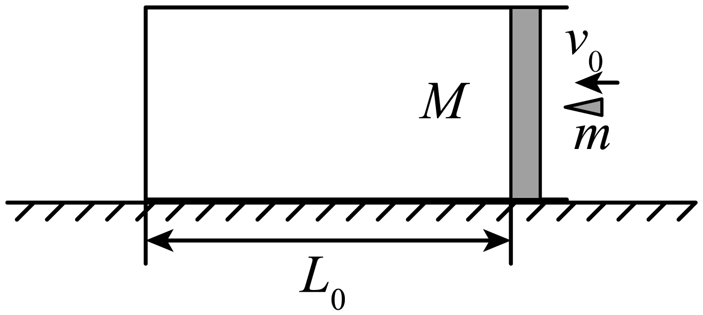

# Physics - 题目 547

**ID**: 165485b0e2dc4da4be6bc5921bf3d213
**年级**: Grade 12
**难度**: Medium-Hard
**题型**: Calculation

## 题目
如图所示，一导热性能良好的汽缸水平放置在地面上，一质量为M的活塞将一定质量的理想气体密封在汽缸内，系统平衡时，活塞与汽缸底部之间的距离为 $L_{0}$ 。​​​​​​​‌现有一颗质量为m的子弹以速度 $v_{0}$ 射向活塞并留在其中，活塞向左运动 $L_{1}$ 后速度变为零。已知不计活塞与汽缸间的摩擦，活塞横截面积为S，大气压强为 $p_{0}$ ，环境温度保持不变，汽缸始终处于静止状态，求：（1）活塞距离汽缸底部最近时，封闭气体的压强；（2）活塞从开始运动到活塞距离汽缸底部最近的过程中，封闭气体放出的热量。

## 解答

1. （1）由玻意耳定律得
2. $p_{0}L_{0}S=p_{1}\left ({L_{0}-L_{1}}\right )S$
3. 解得
4. $p_{1}=\frac {p_{0}L_{0}}{L_{0}-L_{1}}$
5. （2）子弹击中木块时，对活塞与子弹由动量守恒定律有
6. $mv_{0}=\left ({m+M}\right )v_{1}$
7. 活塞压缩气体的过程中，由动能定理得
8. $p_{0}SL_{1}-W=0-\frac {1}{2}\left ({m+M}\right )v_{1}^{2}$
9. 由热力学第一定律得
10. $ΔU=W-Q=0$
11. 解得
12. $Q=p_{0}SL_{1}+\frac {m^{2}v_{0}^{2}}{2\left ({M+m}\right )}$

## 知识点

**中文**:
  - 气体等温变化与玻意耳定律
  - 热力学第一定律及其应用

**English**:
  - Isothermal Change and Boyle's Law
  - First Law of Thermodynamics and Applications

---
