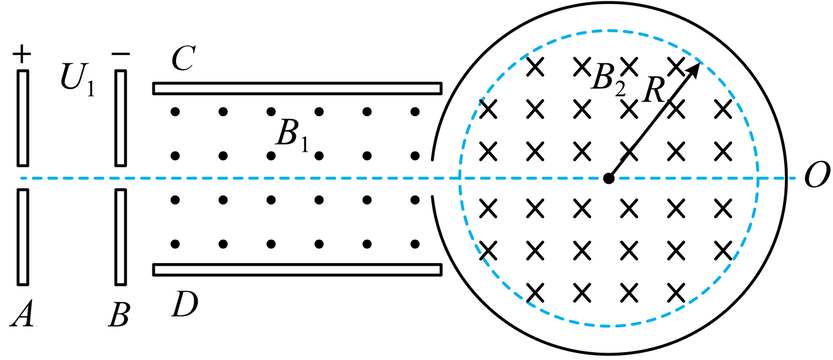

# Physics - 题目 2176

**ID**: 1789c15a82f2483bb7038d2537c9d525
**年级**: Grade 12
**难度**: Medium-Hard
**题型**: Calculation

## 题目
如图所示的装置为一种新型质谱仪的理论模型图，该装置由A、B板间的加速电场区和C、D板间的直线运动区及圆形磁场偏转区组成。​​​​​​​‌已知平行板A、B间的加速电压为 $U{{}_{1}}$ ，平行板C、D间距为d，其中存在垂直纸面向外磁感应强度大小为 $B{{}_{1}}$ 的匀强磁场，圆形匀强磁场区域的半径为R，磁感应强度大小为 $B{{}_{2}}$ ，方向垂直于纸面向里。圆形感光弧面与圆形磁场的圆心相同，其左端的小孔与A、B板上的小孔在同一直线上。现有一比荷为 $k{{}_{0}}$ 的原子核经A、B板加速后，沿C、D板的中央直线进入圆形磁场区域，经磁场偏转后打到感光弧面上，不计粒子重力。求：（1）原子核经加速电场加速后的速度大小v；（2）直线运动区C、D板间的电势差 $U{{}_{CD}}$ ；（3）对于比荷k不同的原子核，根据它在感光弧面上的位置可测得其偏转角度 $θ$ ，试求比荷k与粒子偏转角度 $θ$ 之间的关系（用 $θ$ 的三角函数表示）。

## 解答

1. （1）在加速电场中根据动能定理有 $qU{{}_{1}}=\frac {1}{2}mv{^{2}}-0$ ，解得原子核经加速电场加速后的速度大小 $v=\sqrt {\frac {2qU{{}_{1}}}{m}}=\sqrt {2k{{}_{0}}U{{}_{1}}}$ 。
2. （2）直线运动区，由粒子受力平衡，有 $qvB{{}_{1}}=q\frac {U{{}_{2}}}{d}$ ，因为原子核带正电，根据左手定则可知洛伦兹力向下，电场力向上，则C、D板间的电势差为 $U{{}_{CD}}=-U{{}_{2}}=-dvB{{}_{1}}=-{\rm dB}{{}_{1}}\sqrt {2k{{}_{0}}U{{}_{1}}}$ 。
3. （3）在圆形磁场区域，根据洛伦兹力提供向心力，有 $qvB{{}_{2}}=m\frac {v{^{{{2}}}}}{r}$ ，如图所示，
4. 
5. 由几何关系有 ${\tan}β=\frac {r}{R}$ ，其中 ${\tan}β=\frac {1}{{\tan}\frac {θ}{2}}$ ，联立可得，比荷k与粒子偏转角度θ之间的关系为 $k=\frac {2U{{}_{1}}{\tan}{^{2}}\frac {θ}{2}}{B{{}_{2}^{2}}R{^{2}}}$ 。

## 知识点

**中文**:
  - 质谱仪

**English**:
  - Mass Spectrometer

---
