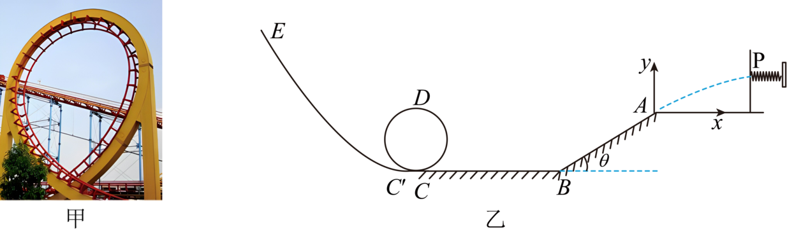

# Physics - 题目 1019

**ID**: 188b706fc5cf4027a964ca1bde0c0606
**年级**: Grade 12
**难度**: Medium-Hard
**题型**: Calculation

## 题目
某科技小组参加了过山车游戏项目研究，如图甲所示，为了研究其中的物理规律，科技组成员设计出如图乙所示的装置。​​​​​​​‌ ${\rm P}$ 为弹性发射装置， $AB$ 为倾角 $θ=37{}\degree $ 的倾斜轨道， $BC$ 为水平轨道， $CDC^{′}$ 为竖直圆轨道， $C^{′}E$ 为足够长的倾斜轨道，各段轨道均平滑连接。以A点为坐标原点，水平向右为 $x$ 轴正方向，竖直向上为 $y$ 轴正方向建立平面直角坐标系。已知滑块质量为 $m$ ，圆轨道半径 $R=1{\rm{m}}$ ， $BC$ 长为 $3{\rm{m}}$ ， $AB$ 、 $BC$ 段动摩擦因数均为 $μ=0.25$ ，其余各段轨道均光滑。现滑块从弹射装置 ${\rm P}$ 弹出的速度为 $4{\rm{m}}/{\rm{s}}$ ，且恰好从A点沿 $AB$ 方向进入轨道，滑块可视为质点。重力加速度 $g=10{\rm{m}}/{\rm{s}}{^{2}}$ ， $\sin 37\mathrm{°}=0.6$ ， ${\cos}37\mathrm{°}=0.8$ 。求：（1）求滑块从弹射装置 $P$ 弹出时的坐标值；（2）若滑块恰好能通过 $D$ 点，求轨道 $AB$ 的长度；（3）若滑块能进入圆轨道且不脱轨，求轨道 $AB$ 的长度；（4）若轨道 $AB$ 的长度为 $3.5{\rm{m}}$ ，试判断滑块在圆轨道是否脱轨；若发生脱轨，计算脱轨的位置。

## 解答

1. （1）对滑块由 ${\rm P}$ 到A的运动，根据平抛规律有
2. $v{{}_{y}}=v{{}_{0}}{\tan}θ=3{\rm{m}}/{\rm{s}}$
3. 平抛运动的竖直方向有
4. $v{{}_{y}^{2}}=2gy$
5. 解得
6. $y=0.45{\rm{m}}$
7. 运动时间
8. $t=\frac {v{{}_{y}}}{g}=0.3{\rm{s}}$
9. 则
10. $x=v{{}_{0}}t=1.2{\rm{m}}$
11. 即弹出时位置的坐标值为 $\left ({1.2{\rm{m}},0.45{\rm{m}}}\right )$
12. （2）滑块恰好能通过 $D$ 点，在最高点有
13. $mg=m\frac {v{{}_{1}^{2}}}{R}$
14. 从 ${\rm P}$ 到圆轨道最高点，由动能定理得
15. $mg\left ({y+x{{}_{AB}}\sin θ-2R}\right )-{\rm μm}g{\cos}θx{{}_{AB}}-{\rm μm}gx{{}_{BC}}=\frac {1}{2}mv{{}_{1}^{2}}-\frac {1}{2}mv{{}_{0}^{2}}$
16. 联立解得
17. $x{{}_{AB}}=5{\rm{m}}$
18. （3）滑块刚好不脱离轨道，有两种临界情况，一是刚好在圆轨道最高点压力为零时，二是刚好到达与圆轨道圆心等高的地方。由（2）知，滑块刚好能够到达圆轨道最高点时
19. $x{{}_{AB}}=5{\rm{m}}$
20. 滑块刚好到达与圆轨道圆心等高的地方时，从 ${\rm P}$ 到与圆心等高的位置，由动能定理得
21. $mg\left ({y+x{{}_{AB}}\sin θ-R}\right )-{\rm μm}g{\cos}θx{{}_{AB}}-{\rm μm}gx{{}_{BC}}=0-\frac {1}{2}mv{{}_{0}^{2}}$
22. 解得
23. $x{{}_{AB}}=1.25{\rm{m}}$
24. 滑块从A点切入后不脱离轨道时 $AB$ 的长度应满足
25. $x{{}_{AB}}⩾5{\rm{m}}$
26. 或
27. $x{{}_{AB}}⩽1.25{\rm{m}}$
28. （4）由（3）知， $x{{}_{AB}}=3.5{\rm{m}}$ 时，滑块在圆轨道发生脱轨，设脱轨地点和圆心的连线与水平方向的夹角为 $α$ ，则脱轨时
29. $mg\sin α=\frac {mv{{}_{2}^{2}}}{R}$
30. 从 ${\rm P}$ 到脱轨的位置，由动能定理得
31. $mg\left ({y+x{{}_{AB}}\sin θ-R-R\sin α}\right )-{\rm μm}g{\cos}θx{{}_{AB}}-{\rm μm}gx{{}_{BC}}=\frac {1}{2}mv{{}_{2}^{2}}-\frac {1}{2}mv{{}_{0}^{2}}$
32. 联立解得
33. $\sin α=0.6$
34. 即滑块在圆心以上
35. $R\sin α=0.6{\rm{m}}$
36. 处脱轨。

## 知识点

**中文**:
  - 应用动能定理求解多阶段、多过程问题

**English**:
  - Multi-stage/Multi-process Problems

---
