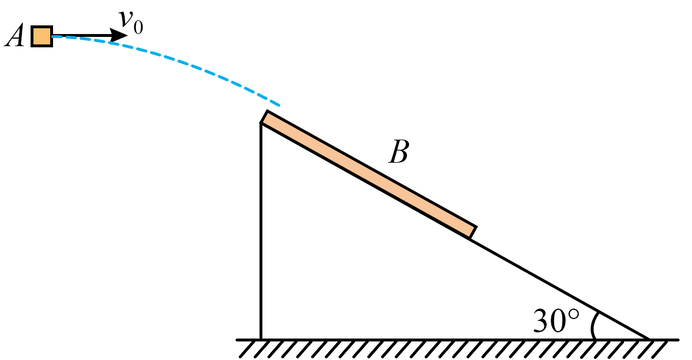

# Physics - 题目 2652

**ID**: 1915d4f561f74a8f815ee283d7df85da
**年级**: Grade 12
**难度**: Medium-Hard
**题型**: Calculation

## 题目
如图所示，一足够长斜面体固定在水平地面上，倾角θ=30°。​​​​​​​‌一质量M=1kg、长度L=2m的薄木板B置于斜面顶端，恰好能保持静止。质量m=3kg的小物块A从某一高处以 $v{{}_{0}}=2\sqrt {3}{\rm m}$ /s的初速度水平向右抛出，恰好沿木板方向落到薄木板的最上端。已知A、B之间的动摩擦因数为 $μ{{}_{1}}=\frac {\sqrt {3}}{2}$ 。最大静摩擦力等于滑动摩擦力，重力加速度g=10m/s^{2}，不计空气阻力。求∶（1）物块落到薄木板上瞬间的速度大小；（2）斜面与薄木板间的动摩擦因数μ_{2}；（3）判断物块能否从薄木板上滑下。若能滑下请分别求出滑下瞬间物块和薄木板的速度；若不能滑下，请求出二者间的相对位移。

## 解答

1. （1）小物块A从某一高处以初速度水平向右抛出，则小物块做平抛运动；恰好沿木板方向落到薄木板上，则 ${\cos}{{3}}{{0}}{^{\circ }}{\rm{=}}\frac {v{{}_{0}}}{v}$
2. 解得，物块落到薄木板上瞬间的速度大小 $v=\frac {v{{}_{0}}}{{\cos}30{}\degree }=\frac {2\sqrt {3}}{\frac {\sqrt {3}}{2}}{\rm{m}}{\rm{/}}{\rm{s}}=4{\rm{m}}{\rm{/}}{\rm{s}}$
3. （2）由薄木板恰好静止在斜面上，由平衡条件得 $Mg\sin 30{}\degree =μ{{}_{2}}Mg{\cos}30{}\degree $
4. 解得，斜面与薄木板间的动摩擦因数 $μ{{}_{2}}=\frac {\sqrt {3}}{3}$
5. （3）物块A刚滑上B时，对A，由牛顿第二定律得 $μ{{}_{1}}mg{\cos}30{}\degree -mg\sin 30{}\degree =ma{{}_{{\rm A}}}$
6. 对B，由牛顿第二定律得 $Mg\sin 30{}\degree +μ{{}_{1}}mg{\cos}30{}\degree -μ{{}_{2}}\left ({M+m}\right )g{\cos}30{}\degree =Ma{{}_{{\rm B}}}$
7. 代入数据解得 $a{{}_{{\rm A}}}=2.5{\rm m}/{\rm s}{^{2}}$
8. 方向沿斜面向上 $a{{}_{{\rm B}}}=7.5{\rm m}/{\rm s}{^{2}}$
9. 方向沿斜面向下
10. 设经过时间t_{1}物块A与木板B到达共速v，此时A还没有到达木板B的底端，则 $v=a{{}_{{\rm B}}}t{{}_{1}}=v{{}_{0}}-a{{}_{{\rm A}}}t{{}_{1}}$
11. 代入数据解得 $t{{}_{1}}=0.4{\rm s}$ ， $v=3{\rm{m}}{\rm{/}}{\rm{s}}$
12. 该过程中A的位移 $x{{}_{{\rm{A}}}}{\rm{=}}\frac {v{{}_{0}}+v}{2}t{{}_{1}}=\frac {4+3}{2}\times 0.4{\rm m}=1.4{\rm m}$
13. 该过程中B的位移 $x{{}_{{\rm{B}}}}{\rm{=}}\frac {v}{2}t{{}_{1}}=\frac {3}{2}\times 0.4{\rm m}=0.6{\rm m}＜\frac {h}{\sin 30{}\degree }=\frac {1.6}{0.5}{\rm m}=3.2{\rm m}$
14. 物块A、木板B的相对位移 $\Delta x=x{{}_{{\rm A}}}-x{{}_{{\rm B}}}=1.4{\rm m}-0.6{\rm m}=0.8{\rm m}＜L=2{\rm m}$
15. 假设正确，所以物块不从薄木板上滑下，A、B的相对位移 $\Delta x=0.8{\rm m}$

## 知识点

**中文**:
  - 平抛运动与斜面、圆轨道相结合问题
  - 板块模型

**English**:
  - Horizontal Projectile on Inclined Planes and Circular Tracks
  - Plate Model

---
