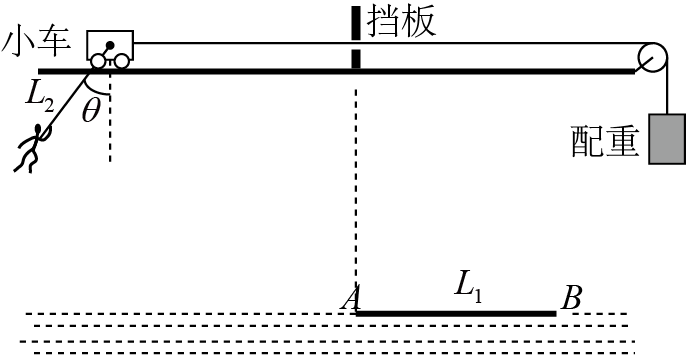

# Physics - 题目 693

**ID**: 19c9bbdf795f48a8aa82d6ee9cebfdb9
**年级**: Grade 12
**难度**: Medium-Hard
**题型**: Calculation

## 题目
如图为某闯关游戏装置部分示意图，水平轨道上的小车用轻绳绕过定滑轮与配重连接，轨道上方的轻绳穿过固定挡板并保持水平，轨道下方有一长 $L{{}_{1}}=3.1{\rm{m}}$ 的软垫 ${\rm{A}}{\rm{B}}$ 静止在水面上，A端在挡板正下方。​​​​​​​‌质量 $m=60{\rm{k}}{\rm{g}}$ 的闯关者抓住轻绳的一端悬挂在小车上，其重心到悬点的距离 $L{{}_{2}}=1.5{\rm{m}}$ 。在配重作用下，闯关者随小车一起向右运动，运动过程中轻绳与竖直线的夹角恒为 $θ=37{}\degree $ 。当小车碰到挡板时闯关者立即松手，重心下降 $h=3.2{\rm{m}}$ 时恰好落在软垫的右端B点．不计小车的大小、质量和一切摩擦阻力，取重力加速度大小 $g=10{\rm{m}}{\rm{/}}{\rm{s}}{^{{{2}}}}$ ， $\sin 37\mathrm{°}=0.6$ ， ${\cos}37\mathrm{°}=0.8$ 。求：（1）闯关者松手时的速度大小v；（2）配重的质量M。

## 解答

1. （1）设闯关者松手时重心与B点的水平距离为x，下落运动的时间为t，有 $x=L{{}_{2}}\sin θ+L{{}_{1}}$ ， $x=vt$ ， $h=\frac {1}{2}gl{^{2}}$ ，解得 $v=5{\rm{m}}{\rm{/}}{\rm{s}}$
2. （2）设运动过程中闯关者与配重的加速度大小为a，与配重连接的轻绳拉力大小为 $F{{}_{1}}$ ，轻绳 $L{{}_{2}}$ 的拉力大小为 $F{{}_{2}}$ ，则以配重为研究对象有 $Mg-F{{}_{1}}=Ma$ ，以轻质小车为研究对象，有 $F{{}_{1}}=F{{}_{2}}\sin θ$ ，以闯关者为研究对象，有 $F{{}_{2}}\sin θ=ma$ ， $F{{}_{2}}{\cos}θ=mg$ ，解得 $M=180{\rm{k}}{\rm{g}}$

## 知识点

**中文**:
  - 求解平抛运动、类平抛运动问题

**English**:
  - Solving Horizontal and Quasi-Horizontal Projectile Problems

---
