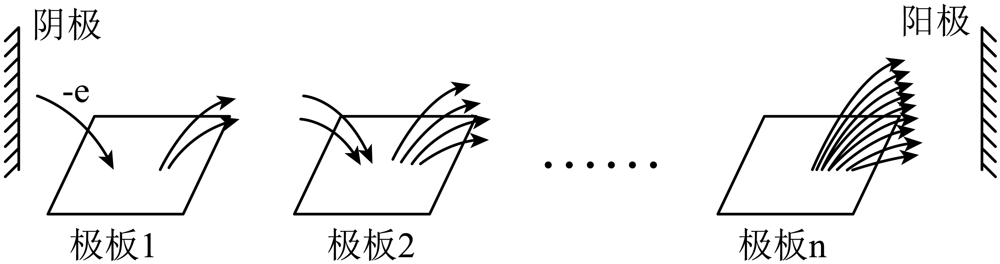
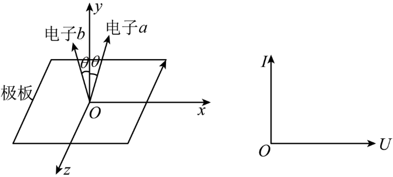

# Physics - 题目 964

**ID**: 1ac7159705c143cb961fddd7314928ac
**年级**: Grade 12
**难度**: Medium-Hard
**题型**: Calculation

## 题目
信号放大器是一种放大电信号的仪器，如图1，其可以通过在相邻极板间施加电压，使阴极逸出的电子，击中极板时，激发出更多电子，从而逐级放大电信号。​​​​​​​‌已知电子质量m，带电量e。（1）如图2，在极板上建系。极板上方空间内存在磁场，其强度为B，方向平行z轴。极板间电压U极小，几乎不影响电子运动。如图，某次激发中，产生了2个电子a和b，其初速度方向分别在xOy与zOy平面内，且与y轴正方向成 $θ$ 角，则：（i）判断B的方向；（ii）a、b两个电子运动到下一个极板的时间 $t{{}_{1}}$ 和 $t{{}_{2}}$ ；（2）若单位时间内阴极逸出的电子数量不变，每个电子打到极板上可以激发出 $δ$ 个电子，且 $δ\propto U{\rm ，}$ 阳极处接收电子产生的电流为I，在答题纸给出坐标系里画出表示U和I关系的图像并说出这样画的理由。图1图2

## 解答

1. （1）（ⅰ）a电子，初速度方向在xoy平面内，与y轴正方向成θ角；若磁场方向沿z轴正方向，a电子在洛伦兹力作用下向x轴负方向偏转，不符合题题意；若磁场方向沿z轴反方向，a电子在洛伦兹力作用下向x轴正方向偏转，符合题意；
2. b电子，初速度方向在zoy平面内，与y轴正方向成θ角。将b电子初速度沿坐标轴分解，沿z轴的分速度与磁感线平行不受力，沿y轴方向的分速度受到洛伦兹力使得电子沿x轴正方向偏转，根据左手定则可知，磁场方向沿z轴反方向。符合题意；
3. 综上可知，磁感应强度B的方向沿z轴反方向。
4. （ⅱ）a电子在洛伦兹力作用下运动轨迹如图，
5. 
6. 由图可知电子运动到下一个极板的时间 $t{{}_{1}}=\frac {2(\frac {{\rm{π}}}{2}-θ)}{2{\rm{π}}}T=\frac {(\frac {{\rm{π}}}{2}-θ)}{{\rm{π}}}\frac {2{\rm{π}}m}{eB}=\frac {({\rm{π}}-2θ)m}{eB}$ ；
7. b电子，沿z轴的分速度与磁感线平行不受力，对应匀速直线运动；沿y轴方向的分速度受到洛伦兹力使电子向右偏转，电子运动半个圆周到下一个极板的时间 $t{{}_{2}}=\frac {{\rm{π}}}{2{\rm{π}}}T=\frac {{\rm{π}}m}{eB}$ 。
8. （2）设 $δ=kU{\rm ，}$ 单位时间内阴极逸出的电子数量N_{0}不变，每个电子打到极板上可以激发δ个电子，经过n次激发阳极处接收电子数量 $N=N{{}_{0}}δ{^{n}}=N{{}_{0}}(kU){^{n}}=N{{}_{0}}k{^{n}}U{^{n}}{\rm ，}$ 对应的电流 $I=Ne=eN{{}_{0}}k{^{n}}U{^{n}}=(eN{{}_{0}}k{^{n}})U{^{n}}=AU{^{n}}{\rm ，}$ 可得I-U图像如图。
9. 

## 知识点

**中文**:
  - 带电粒子在匀强磁场中的运动

**English**:
  - Motion of Charged Particles in Uniform Magnetic Field

---
