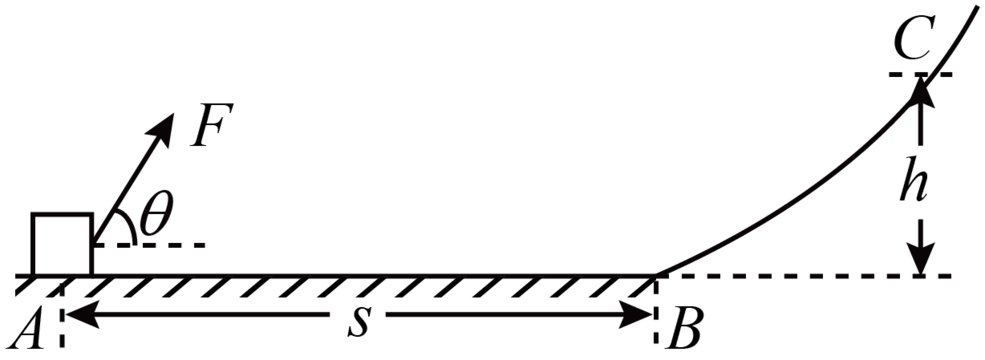

# Physics - 题目 1694

**ID**: 1b03a0df4f1c441d838912ed1b8755ff
**年级**: Grade 12
**难度**: Medium-Hard
**题型**: Calculation

## 题目
如图所示，长s的粗糙水平面AB与足够高的光滑曲面BC平滑连接，一质量m的小物块静止于A点，对小物块施加与水平方向成θ角、大小为F的恒力，当小物块到达曲面底端B点时撤去F，小物块与水平面间的动摩擦因数为μ。​​​​​​​‌（1）求小物块在水平面AB上运动时的加速度a；（2）求小物块在曲面BC上能到达的最大高度h；（3）当恒力F满足什么条件时，小物块能回到A点（F与m、θ、μ的关系）?

## 解答

1. （1）物块在水平面上运动时的受力图如图所示
2. 
3. 水平方向：
4. $F{\cos}θ{\rm{-}}f=ma{{}_{1}}$
5. 竖直方向：
6. $F{\sin}θ+N=mg$
7. 又：
8. $f=μN$
9. 由上面三式得：
10. $a{{}_{1}}=\frac {F{\cos}θ{\rm{-}}μ(mg-F{\sin}θ）}{m}$
11. （2）A到B过程，匀加速：
12. $v{{}_{B}^{2}}=2a{{}_{1}}s$
13. B到C，机械能守恒：
14. $\frac {1}{2}mv{{}_{B}^{2}}=mgh$
15. $h=\frac {v{{}_{B}^{2}}}{2g}=\frac {Fs{\cos}θ{\rm{-}}{\rm μs}(mg{\rm{-}}F{\sin}θ）}{mg}$
16. （3）小物块从B向A运动的过程中，有
17. $f=ma{{}_{2}}$
18. $f=μN$
19. $N=mg$
20. 推得，
21. $a{{}_{2}}=μg$
22. 设小物块滑行的位移为 $s^{′}$ ，则有：
23. $v{{}_{B}^{2}}=2a{{}_{2}}s^{′}$
24. $s^{′}=\frac {v{{}_{B}^{2}}}{2a{{}_{2}}}=\frac {2a{{}_{1}}s}{2μg}=\frac {F{\cos}θ{\rm{-}}μ（mg{\rm{-}}F{\sin}θ)}{{\rm μm}g}s$
25. 小物块能回到A点需满足：
26. $s^{′}{\geqslant }s$
27. 即：
28. $\frac {F{\cos}θ{\rm{-}}μ（mg{\rm{-}}F{\sin}θ)}{{\rm μm}g}\geqslant 1$
29. 解得：
30. $F\geqslant \frac {2{\rm μm}g}{{\cos}θ+μ{\sin}θ}$
31. （若考虑物体不脱离平面，应加上： $F{\sin}θ\leqslant mg$ ）

## 知识点

**中文**:
  - 动能定理在往返运动中的应用
  - 单一物体机械能守恒定律的应用

**English**:
  - Applications in Reciprocating Motion
  - Applications for Single Body

---
