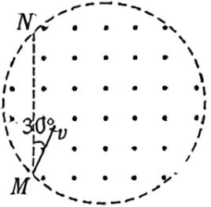

# Physics - 题目 1148

**ID**: 1c511bc955d34f2aa77b63e144babff0
**年级**: Grade 12
**难度**: Medium-Hard
**题型**: Calculation

## 题目
如图所示，平面内存在一个圆形匀强磁场，磁感应强度为 $B$ ，方向垂直纸面向外，圆外某点 $O$ （未画出，在 $MN$ 左侧）固定了一正点电荷 $Q$ 。​​​​​​​‌现将一带电荷量为 $-q$ （ $q>0$ ）的粒子从圆上的 $M$ 点以某一速度射入磁场，速度方向与 $MN$ 成） $30{}\degree $ ，粒子恰好在磁场中做匀速圆周运动到 $N$ 点离开磁场，之后粒子做椭圆运动到 $P$ 点（未画出），粒子在 $P$ 点的速度方向与 $N$ 点的速度方向相反。已知电荷量为 $Q$ 的点电荷产生的电场中，取无穷远处的电势为0，与该点电荷距离为 $r$ 处的电势 $φ=k\frac {Q}{r}$ ， $Q=30q$ ，粒子的质量为 $\frac {B{^{2}}d{^{3}}}{8k}$ ， $M$ 、 $N$ 两点的距离为 $d$ ， $k$ 为静电力常量，求：（1）粒子射入磁场的速度大小 $v$ ；（2）粒子离开 $N$ 后做椭圆运动的半长轴 $a$ ；（3）粒子从 $N$ 点运动到 $P$ 点的时间 $t$ 。

## 解答

1. （1）根据题意，作出运动轨迹，如图所示
2. 
3. 根据几何关系可得 $\angle MON=60{}\degree $
4. 所以粒子做匀速圆周运动的半径 $r=d$
5. 根据牛顿第二定律有 ${qvB+\frac {kQq}{r{^{2}}}=m\frac {v{^{2}}}{r}}$
6. 解得 $v=\frac {20kq}{Bd{^{2}}}$
7. （2）粒子从 $N$ 运动到 $P$ 只受电场力作用做椭圆运动，粒子电势能和动能总和不变，有 ${\frac {1}{2}mv{^{2}}+\left ({-qφ{{}_{N}}}\right )=\frac {1}{2}mv{{}_{P}^{2}}+\left ({-qφ{{}_{P}}}\right )}$
8. 由题意可知 ${φ{{}_{N}}=\frac {30kq}{d}}$ ， $φ{{}_{P}}=\frac {30kq}{x{{}_{OP}}}$
9. 类比开普勒第二定律可知粒子在近点和远点，满足 ${\frac {1}{2}vΔt\cdot d=\frac {1}{2}v{{}_{P}}Δt\cdot x{{}_{OP}}}$
10. 解得 $x{{}_{OP{{}_{1}}}}=5d$ ， $x{{}_{OP{{}_{2}}}}=d$
11. 粒子椭圆运动的半长轴 ${a=\frac {d+x{{}_{OP}}}{2}}$
12. 解得 $a{{}_{1}}=3d$ ， $a{{}_{2}}=d$ （舍去）
13. （3）将粒子的运动类比为半径 $R=a=3d$ 的圆周运动，类比开普勒第三定律可得 ${\frac {a{^{3}}}{T{^{2}}}=\frac {R{^{3}}}{T^{′}{{^{2}}}}}$
14. 其中 $\frac {kQq}{R{^{2}}}=m\frac {4{\rm{π}}{^{2}}}{T^{′}{{^{2}}}}R$
15. 解得： $T=T^{′}=\frac {3\sqrt {5}{\rm{π}}Bd{^{3}}}{10kq}$
16. 则粒子运动的时间 ${t=\frac {1}{2}T=\frac {3\sqrt {5}{\rm{π}}Bd{^{3}}}{20kq}}$

## 知识点

**中文**:
  - 带电体在库仑力作用下的平衡问题
  - 带电粒子在有界磁场中运动的临界极值问题

**English**:
  - Equilibrium under Coulomb Force
  - Critical Extremum Problems in Bounded Magnetic Fields

---
