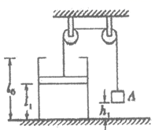

# Physics - 题目 2382

**ID**: 1d5c9586df1d4315990c9d874d3920b0
**年级**: Grade 12
**难度**: Medium-Hard
**题型**: Calculation

## 题目
底面积，S=40 cm^{2}、高L_{0}=15 cm的圆柱形汽缸开口向上固定在水平地面上，开口处两侧有挡板，如图所示．缸内有一可自由移动的质量为m=2kg的活塞封闭了一定质量的理想气体，不可伸长的细线一端固定在活塞上，另一端跨过两个光滑定滑轮拉着质量为M=10kg的物体A．开始时，气体温度t_{l}：27℃，活塞到缸底的距离L_{1}=10cm,物体A的底部离地面高h_{1}=4cm，对汽缸内的气体缓慢加热使活塞缓慢上升．已知大气压强P_{0}=1.​​​​​​​‌0 $\times $ 10^{5}Pa， g=10m·s^{-2}．求:(1)物体A刚着地时气体的温度；(2)活塞刚到达汽缸顶部时气体的温度．

## 解答

1. （1）初始活塞受力平衡：P_{0}S+mg=P_{1}S+T，T=Mg
2. 被封闭气体压强 $P{{}_{1}}=P{{}_{0}}+\frac {(m-M)g}{S}=0.8\times 10{^{5}}Pa$
3. 初状态：V_{1}=l_{1}S，T_{1}=300K
4. A触地时：P_{1}=P_{2}，V_{2}=（l_{1}+h_{1}）S
5. 等压变化， $ \frac {l{{}_{1}}S}{T{{}_{1}}}=\frac {\left ({l{{}_{1}}+h{{}_{1}}}\right )S}{T{{}_{2}}}$
6. 代入数据，得T_{2}=420K，即t_{2}=147℃
7. （2）活塞恰好到顶部时，P_{3}=P_{0}+ $\frac {mg}{S}$ =1.05×10^{5}Pa
8. V_{3}=l_{0}S
9. 根据理想气体状态方程， $ \frac {P{{}_{1}}l{{}_{1}}S}{T{{}_{1}}}=\frac {P{{}_{3}}l{{}_{0}}S}{T{{}_{3}}}$
10. 代入数据，得T_{3}=590.6K，即t_{2}=317.6℃

## 知识点

**中文**:
  - 利用理想状态方程解决问题

**English**:
  - Problem Solving using Ideal Gas Law

---
