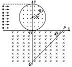

# Physics - 题目 1852

**ID**: 1e4daed139284f5f9fc6858c27256228
**年级**: Grade 12
**难度**: Medium-Hard
**题型**: Calculation

## 题目
如图所示，在xOy平面内，以O′(0，R)为圆心，R为半径的圆内有垂直平面向外的匀强磁场，x轴下方有垂直平面向里的匀强磁场，两区域磁感应强度大小相等．第四象限有一与x轴成45°角倾斜放置的挡板PQ，P，Q两点在坐标轴上，且O，P两点间的距离大于2R，在圆形磁场的左侧0<y<2R的区间内，均匀分布着质量为m，电荷量为＋q的一簇带电粒子，当所有粒子均沿x轴正向以速度v射入圆形磁场区域时，粒子偏转后都从O点进入x轴下方磁场，结果有一半粒子能打在挡板上．不计粒子重力，不考虑粒子间相互作用力．求：(1)磁场的磁感应强度B的大小；​​​​​​​‌(2)挡板端点P的坐标；(3)挡板上被粒子打中的区域长度．

## 解答

1. （1）设一粒子自磁场边界A点进入磁场，该粒子由O点射出圆形磁场，轨迹如图甲所示，过A点做速度的垂线长度为r,C为该轨迹圆的圆心.连接AOˊ、CO，可证得ACOOˊ为菱形，根据图中几何关系可知：粒子在圆形磁场中的轨道半径r=R，
2. 由 ${\rm qvB=m\frac {v{^{2}}}{r}}$
3. 得： ${\rm B=\frac {mv}{qR}}$
4. 
5. （2）有一半粒子打到挡板上需满足从O点射出的沿x轴负方向的粒子、沿y轴负方向的粒子轨迹刚好与挡板相切，如图乙所示，过圆心D做挡板的垂线交于E点
6. ${\rm DP=\sqrt {2}R}$  ${\rm OP=(\sqrt {2}+1)R}$
7. P点的坐标为（ ${\rm (\sqrt {2}+1)R}$ ，0 ）
8. （3）设打到挡板最左侧的粒子打在挡板上的F点，如图丙所示，OF=2R   ①
9. 
10. 过O点做挡板的垂线交于G点，
11. ${\rm OG=(\sqrt {2}+1)R\cdot \frac {\sqrt {2}}{2}=(1+\frac {\sqrt {2}}{2})R}$ ②
12. ${\rm FG=\sqrt {OF{^{2}}-OG{^{2}}}{\rm{=}}\sqrt {\frac {5{\rm{-}}2\sqrt {2}}{2}}R}$ ③
13. ${\rm EG=\frac {\sqrt {2}}{2}R}$ ④
14. 挡板上被粒子打中的区域长度l=FE= ${\rm \frac {\sqrt {2}}{2}R}$ + ${\rm \sqrt {\frac {5{\rm{-}}2\sqrt {2}}{2}}R}$ = ${\rm \frac {\sqrt {2}{\rm{+}}\sqrt {10{\rm{-}}4\sqrt {2}}}{2}R}$ ⑤

## 知识点

**中文**:
  - 带电粒子在有界匀强磁场中的运动

**English**:
  - Motion in Bounded Uniform Magnetic Field

---
