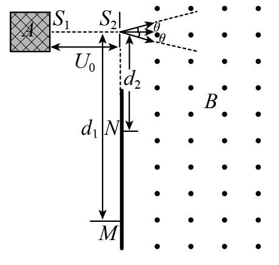

# Physics - 题目 2939

**ID**: 216a837b2c7b4ca6a39fdcd5b0179071
**年级**: Grade 12
**难度**: Medium-Hard
**题型**: Calculation

## 题目
一台质谱仪的工作原理如图所示。​​​​​​​‌比荷分别为 $k{{}_{1}}$ 、的两种带电粒子从容器 $A$ 右侧的狭缝 $S{{}_{1}}$ 飘入电势差为 $U{{}_{0}}$ 的加速电场，其初速度几乎为0，然后经过狭缝 $S{{}_{2}}$ 沿着与磁场垂直的方向进入磁感应强度为 $B$ 的匀强磁场中，最后打到底片上。已知带电粒子从狭缝 $S{{}_{2}}$ 进入磁场时与垂直磁场边界方向存在一个很小的散射角 $θ$ ，所有粒子均打在底片的 $MN$ 区域内。比荷为 $k{{}_{1}}$ 的粒子能打在底片上的最远点为 $M$ ，比荷为 $k{{}_{2}}$ 的粒子能打在底片上的最近点为 $N$ ，点 $M$ 、 $N$ 到狭缝 $S{{}_{2}}$ 的距离分别为 $d{{}_{1}}$ 、 $d{{}_{2}}$ 。若忽略带电粒子的重力及相互间作用力，求：（1）两种粒子的比荷的比值 $\frac {k{{}_{1}}}{k{{}_{2}}}$ ；（2）比荷为 $k{{}_{1}}$ 的粒子在磁场中运动的最短时间 $t$ ；（3）若考虑加速电压有波动，在到之间变化，该两种粒子在底片重叠的长度 $L$ 与 $\Delta U$ 的关系。

## 解答

1. （1）比荷分别为 $k{{}_{1}}$ 、 $k{{}_{2}}$ 的两种粒子在磁场中都偏转了半个圆周，则有
2. $r{{}_{1}}=\frac {d{{}_{1}}}{2}$ ， $r{{}_{2}}=\frac {d{{}_{2}}}{2{\cos}θ}$
3. $U{{}_{0}}q=\frac {1}{2}mv{^{2}}$
4. $Bqv=\frac {mv{^{2}}}{r}$
5. 解得
6. $\frac {k{{}_{1}}}{k{{}_{2}}}=\frac {d{{}_{2}^{2}}}{d{{}_{1}^{2}}{\cos}{^{2}}θ}$
7. （2）比荷为 $k{{}_{1}}$ 的粒子打在底片上的最远点为 $M$ ，则
8. $2r{{}_{1}}=d{{}_{1}}$
9. 又
10. $U{{}_{0}}q{{}_{1}}=\frac {1}{2}m{{}_{1}}v{{}_{1}^{2}}$
11. $Bq{{}_{1}}v{{}_{1}}=\frac {m{{}_{1}}v{{}_{1}^{2}}}{r{{}_{1}}}$
12. 该粒子在磁场中的偏转角为时，运动的时间最短，则
13. 
14. 解得
15. 
16. （3）由于
17. $r{^{2}}=\frac {m{^{2}}v{^{2}}}{q{^{2}}B{^{2}}}=\frac {2U{{}_{0}}}{kB{^{2}}}$
18. 且 $k{{}_{1}}<k{{}_{2}}$ ，所以 $r{{}_{1}}>r{{}_{2}}$
19. 若这两种粒子在底片上重叠，则
20. $L=2r{{}_{2{\rm \max }}}-2r{{}_{1{\rm \min }}}{\cos}θ$
21. $r{{}_{2{\rm \max }}}=\frac {m{{}_{2}}v{{}_{2{\rm \max }}}}{q{{}_{2}}B}$ ， $r{{}_{1{\rm \min }}}=\frac {m{{}_{1}}v{{}_{1{\rm \min }}}}{q{{}_{1}}B}$
22. ，
23. 解得
24. $L=\frac {d{{}_{2}}}{{\cos}θ}\sqrt {\frac {U{{}_{0}}+\Delta U}{U{{}_{0}}}}-d{{}_{1}}{\cos}θ\sqrt {\frac {U{{}_{0}}-\Delta U}{U{{}_{0}}}}$

## 知识点

**中文**:
  - 质谱仪

**English**:
  - Mass Spectrometer

---
