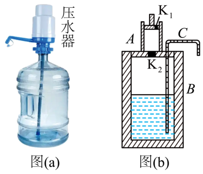

# Physics - 题目 1152

**ID**: 2494e866f0144e3fbc71a1486254f29e
**年级**: Grade 12
**难度**: Medium-Hard
**题型**: Calculation

## 题目
军训是学生接受国防教育的基本形式，学生在军训时刻苦训练，会消耗大量水分。​​​​​​​‌为解决学生用水问题，小刚同学采用压水器结合桶装水进行供水，装置如图（a）所示，同学们通过按压压水器，就可以将水从出水口压出。上述过程可简化为如图（b）所示模型。大气缸B可当做水桶，可认为是内径一定的圆桶，容积为16升，高度为80cm（桶壁厚度不计）；带活塞的小气缸A可当做压水器，每次最多可将0.8升1标准大气压空气压入水桶中，出水管C的出水口与水桶B上部等高， $K_{1}$ 和 $K_{2}$ 为单向阀门。已知，外界大气压为标准大气压，大小为 $P_{0}=1.01\times 10^{5}{\rm{P}}{\rm{a}}$ ，水的密度为 $ρ=1.00\times 10^{3}{\rm{k}}{\rm{g}}/{\rm{m}}^{3}$ ，重力加速度为 $g=10{\rm{m}}/{\rm{s}}^{2}$ ，出水管中的水所占体积可以忽略，外界温度保持不变，某次使用后桶内还剩余有8升水，如图。求：（1）此时桶内封闭气体的压强；（2）若要再压出4升水，至少需按压几次？

## 解答

1. （1）对出水管中的水受力分析可知
2. $p_{1}=p_{0}+ρgh$
3. 而
4. $h=\frac {80}{2}{\rm{c}}{\rm{m}}=0.40{\rm{m}}$
5. 代入可得
6. $p_{1}=1.05\times 10^{5}{\rm{P}}{\rm{a}}$
7. （2）假设至少需按压N次，对气体分析可知
8. $p_{1}V_{1}+Np_{0}V_{0}=p_{2}V_{2}$
9. 其中： $V_{1}=8$ 升， $V_{0}=0.8$ 升， $V_{2}=12$ 升
10. 而
11. $p_{2}=p_{0}+ρg(h+Δh)$
12. 且
13. $Δh=\frac {80}{16}\times 4{\rm{c}}{\rm{m}}=20{\rm{c}}{\rm{m}}=0.2{\rm{m}}$
14. 代入可得
15. $N=5.49$
16. 故至少需要按压6次。

## 知识点

**中文**:
  - 充气、抽气和灌气等问题
  - 气体实验定律

**English**:
  - Inflation, Evacuation, and Filling Problems
  - Experimental Laws of Gases

---
