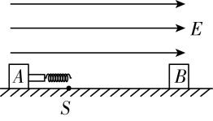
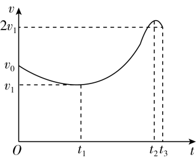

# Physics - 题目 2302

**ID**: 25e4d1b2fb7f470b85a1daf84b811b7f
**年级**: Grade 12
**难度**: Medium-Hard
**题型**: 解答题：本题共39分，根据要求作答。

## 题目
（16分）如图（a），一粗糙、绝缘水平面上有两个质量均为m的小滑块A和B，其电荷量分别为q（q＞0）和－q。​​​​​​​‌A右端固定有轻质光滑绝缘细杆和轻质绝缘弹簧，弹簧处于原长状态。整个空间存在水平向右、场强大小为E的匀强电场。A、B与水平面间的最大静摩擦力等于滑动摩擦力，其大小均为2qE。t＝0时，A以初速度v_{0}向右运动，B处于静止状态。在t_{1}时刻，A到达位置S，速度为v_{1}，此时弹簧未与B相碰；在t_{2}时刻，A的速度达到最大，此时弹簧的弹力大小为3qE；在细杆与B碰撞前的瞬间，A的速度为2v_{1}，此时t＝t_{3}。0～t_{3}时间内A的v－t图像如图（b）所示，v_{1}为图线中速度的最小值，t_{1}、t_{2}、t_{3}均为未知量。运动过程中，A、B处在同一直线上，A、B的电荷量始终保持不变，它们之间的库仑力等效为真空中点电荷间的静电力，静电力常量为k；B与弹簧接触瞬间没有机械能损失，弹簧始终在弹性限度内。（1）求0～t_{1}时间内，合外力对A所做的功；（2）求t_{1}时刻A与B之间的距离；（3）求t_{1}～t_{2}时间内，匀强电场对A和B做的总功；（4）若增大A的初速度，使其到达位置S时的速度为2v_{1}，求细杆与B碰撞前瞬间A的速度大小。图（a）    	    	图（b）

## 解答

1. （1）0～t_{1}时间内，根据动能定理可得合外力对A所做的功为 ${\rm \mathit{W}＝}\frac{1}{2}{\rm \mathit{mv}}$  ${\mathrm{ }}_{1}^{2}{\rm －}$  $\frac{1}{2}{\rm \mathit{mv}}$  ${\mathrm{ }}_{0}^{2}$（3分）
2. （2）设t_{1}时刻A与B之间的距离为x，根据题图（b）可知在t_{1}时刻A的速度最小，其加速度为零，对A根据平衡条件有 ${\rm \mathit{qE}＋}\frac{k{q}^{2}}{{x}^{2}}$ ＝f_{摩}_{    	}_{    	}_{    	}（1分）
3. 其中f_{摩}＝2qE（1分）
4. 联立解得 ${\rm \mathit{x}＝}\sqrt{\frac{kq}{E}}$     	    	    	    	    	    	    	    	（2分）
5. （3）设t_{2}时刻A与B之间的距离为x'，在t_{2}时刻A的速度达到最大，其加速度为零，此时弹簧的弹力大小为3qE，对A根据平衡条件有 ${\rm \mathit{qE}＋}\frac{k{q}^{2}}{x{\text{'}}^{2}}$ ＝f_{摩}＋3qE（1分）
6. 解得 ${\rm \mathit{x~'}＝}\frac{1}{2}\sqrt{\frac{kq}{E}}$     	    	    	    	    	    	    	    	    	（1分）
7. t_{1}～t_{2}时间内A与B的相对位移大小为 ${\rm Δ\mathit{x}＝\mathit{x}－\mathit{x~'}＝}\frac{1}{2}\sqrt{\frac{kq}{E}}$     	    	    	（1分）
8. 因A、B受到匀强电场的电场力等大反向且均做正功，故此过程匀强电场对A和B做的总功为W_{电}＝qE·Δx＝ $\frac{q\sqrt{kqE}}{2}$     	    	    	    	    	    	（1分）
9. （4）当A运动到位置S时，B开始往左运动，此后A和B系统所受合外力为零，动量守恒；从A到达位置S时至细杆与B碰撞前的过程，改变A的初速度前、后，A、B之间距离的变化量相等，摩擦力、匀强电场的电场力、A和B之间的库仑力以及弹簧弹力对A和B做的总功W_{总}相同；改变A的初速度前、后，对A和B整体分析，根据功能关系分别有
10. W_{总}＝ $\frac{1}{2}{\rm \mathit{m}（2\mathit{v}_{1}）^{2}＋}$  $\frac{1}{2}{\rm \mathit{m}}$  ${v}_{B}^{2}{\rm －}$  $\frac{1}{2}{\rm \mathit{m}}$  ${v}_{1}^{2}$（1分）
11. W_{总}＝ $\frac{1}{2}{\rm \mathit{mv~'}}$  ${{\mathrm{ }}_{A}}^{2}{\rm ＋}$  $\frac{1}{2}{\rm \mathit{mv~'}}$  ${{\mathrm{ }}_{B}}^{2}{\rm －}$  $\frac{1}{2}$m（2v_{1}）^{2}^{    	}^{    	}^{    	}^{    	}^{    	}^{    	}（1分）
12. 根据动量守恒定律分别有
13. mv_{1}＝m·2v_{1}＋m（－v_{B}）    	    	    	    	    	    	    	（1分）
14. m·2v_{1}＝mv'_{A}＋m（－v'_{B}）    	    	    	    	    	    	    	（1分）
15. 联立解得v'_{A}＝（1＋ $\sqrt{3}$ ）v_{1}_{    	}_{    	}_{    	}_{    	}_{    	}_{    	}_{    	}（1分）

## 知识点

**中文**:
  - 带电体在库仑力作用下的运动问题
  - 应用动能定理求解与图像相关的动能问题

**English**:
  - Motion under Coulomb Force
  - Graph-related Kinetic Energy Problems

---
