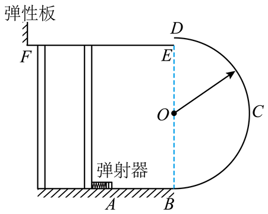

# Physics - 题目 2405

**ID**: 266f820d7ff54c52818bb1fae8ced723
**年级**: Grade 12
**难度**: Medium-Hard
**题型**: Calculation

## 题目
如图所示，一弹射游戏装置由安装在水平台面上的固定弹射器、水平直轨道 $AB$ 、圆心为 $O$ 的竖直半圆轨道 $BCD$ 、水平直轨道 $EF$ 及弹性板等组成。​​​​​​​‌半圆轨道最高点 $D$ 与水平直轨道右端点 $E$ 处在同一竖直线上，且 $D$ 点略高于 $E$ 点。已知可视为质点的滑块的质量 $m=0.2{\rm{k}}{\rm{g}}$ ，轨道 $BCD$ 的半径 $R=0.4{\rm{m}}$ ，轨道 $EF$ 的长度 $l=1.2{\rm{m}}$ ，滑块与轨道 $EF$ 间的动摩擦因数 $μ=0.2$ ，其余各部分轨道均光滑。游戏时滑块从 $A$ 点弹出，与弹簧分离后经过半圆轨道并滑上水平直轨道 $EF$ 。弹簧的弹性势能最大值 $E{{}_{{\rm{p}}{\rm{m}}}}=3.2{\rm{J}}$ ，弹射器中滑块与弹簧相互作用时，机械能损失忽略不计，滑块与弹性板作用后以相同速率弹回，不计滑块通过 $D$、$E$ 之间的能量损失，重力加速度 $g$ 取 $10{\rm{m}}{\rm{/}}{\rm{s}}{^{2}}$ 。（1）若滑块第一次恰好能通过 $D$ 点，求最初状态下弹簧的弹性势能 $E{{}_{{\rm{p}}0}}$ ；（2）若弹簧的弹性势能 $E{{}_{{\rm{p}}{{1}}}}=3{\rm{J}}$ ，求滑块第一次运动到与圆心 $O$ 等高的 $C$ 点时所受的弹力 $F{{}_{{\rm{N}}}}$ ；（3）若滑块最终静止在水平直轨道 $EF$ 上，求弹簧的弹性势能 $E{{}_{{\rm{p}}}}$ 的范围。

## 解答

1. （1）滑块第一次恰好通过D点时，由重力提供向心力，则有 $mg=m\frac {v{{}_{D}^{2}}}{R}$
2. 又由机械能守恒定律，有 $E{{}_{{\rm{p}}0}}=mg·2R+\frac {1}{2}mv{{}_{{\rm{D}}}^{2}}$
3. 联立解得 $E{{}_{{\rm{p}}0}}=2{\rm{J}}$
4. （2）滑块从A运动到轨道BCD上与圆心O等高处C，由机械能守恒定律得 $E{{}_{{\rm{p}}1}}=mgR+\frac {1}{2}mv{{}_{C}^{2}}$
5. 在C点，轨道的弹力提供向心力，由牛顿第二定律得 $F{{}_{{\rm{N}}}}=m\frac {v{{}_{C}^{2}}}{R}$
6. 联立解得 $F{{}_{{\rm{N}}}}=11{\rm{N}}$
7. 弹力方向由C指向O。
8. （3）若滑块恰能通过半圆轨道最高点D，则有 $x{{}_{{\rm{m}}{\rm{i}}{\rm{n}}}}=\frac {v{{}_{D}^{2}}}{2μg}=1{\rm m}$
9. 若滑块以最大弹性势能弹出时，能停在水平直轨道EF上，设在EF上滑行的最大路程为 $x{{}_{{\rm{m}}{\rm{a}}{\rm{x}}}}$
10. 则有 $E{{}_{{\rm{p}}{\rm{m}}}}={\rm μm}gx{{}_{{\rm{m}}{\rm{a}}{\rm{x}}}}+2mgR$
11. 代入数据解得 $x{{}_{{\rm{m}}{\rm{a}}{\rm{x}}}}=4{\rm{m}}$
12. 在轨道EF上往返一次损失的能量为 $ΔE={\rm μm}g·2l=0.96{\rm{J}}$
13. 可知，若滑块最终静止在水平直轨道EF上，如下两种情况满足要求：
14. ① $1{\rm{m}}⩽x⩽2.4{\rm{m}}$ ，则有 $E{{}_{{\rm{p}}}}={\rm μm}gx+2mgR$
15. 解得 $2{\rm{J}}⩽E{{}_{{\rm{p}}}}⩽2.56{\rm{J}}$
16. ② $3.4{\rm{m}}⩽x⩽4{\rm{m}}$ ，则有 $E{{}_{{\rm{p}}}}={\rm μm}gx+2mgR$
17. 且 $E{{}_{{\rm{p}}{\rm{m}}}}=3.2{\rm{J}}$
18. 联立解得 $2.96{\rm{J}}⩽E{{}_{{\rm{p}}}}⩽3.2{\rm{J}}$

## 知识点

**中文**:
  - 弹簧问题中机械能守恒定律的应用
  - 竖直面内圆周运动问题

**English**:
  - Spring Problems
  - Circular Motion in Vertical Plane

---
