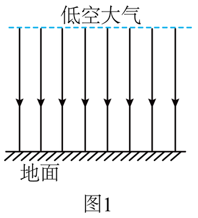
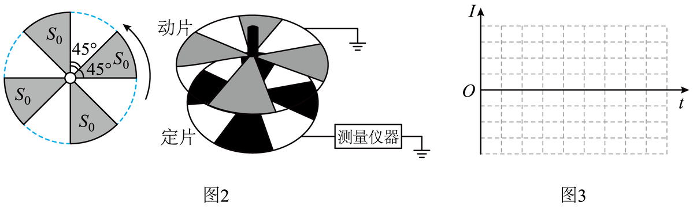

# Physics - 题目 2220

**ID**: 276e50bc255d46c5a1c429cdfdfd6617
**年级**: Grade 12
**难度**: Medium-Hard
**题型**: Calculation

## 题目
大气电场强度是大气电学领域的基本参数，监测大气电场强度对研究大气物理变化、灾害天气预防具有重大意义。​​​​​​​‌通常情况下，地面附近的电场分布如图1所示，低空大气与地球表面可视为平行板电容器。已知静电力常量为k。(1)空气中平行板电容器的电容为 $C=\frac {S}{4πkd}$ ，其中S表示电容器极板的正对面积，d表示板间的距离。a.若地表单位面积上的电荷量为 $σ$ ，请推导地球表面电场强度 $E=4πkσ$ ；b.地面附近某空间的电场强度 $E=130{\rm{V}}/{\rm{m}}$ ，已知地球半径 $R=6.4\times 10{^{6}}{\rm{m}}$ ，静电力常量 $k=9.0\times 10{^{9}}{\rm{N}}\cdot {\rm{m}}{^{2}}/{\rm{C}}{^{2}}$ 。请结合a中结论，估算地球表面带电量的数量级。(2)电场强度计能够探测大气电场强度的变化，其结构可简化为图2：平行且靠近的动片和定片中心在一条竖直轴上，动片在上、定片在下，动片接地且与定片绝缘。动片和定片形状相同，均由4个扇形金属片构成，每个扇形金属片的面积为 $S{{}_{0}}$ 。定片保持静止，动片由马达驱动，以角速度 $ω$ 匀速转动，使得定片被交替地遮挡。定片未被遮挡部分处于大气电场中，由于静电感应，其上产生均匀分布的感应电荷。a.求定片被交替遮挡的周期 $T{{}_{0}}$ ；b.定片上感应电荷随时间的变化会产生周期性的电流，这一电流通过测量仪器就能显示大气电场强度E的数值。从定片被动片完全遮挡开始计时，结合（1）a中结论，推导电流强度1与大气电场强度E的大小关系，并在图3中画出大气电场强度恒定时电流强度I与时间t的图像。

## 解答

1. （1）设地球表面积为 $s$ ，则 $Q=σs=4πR{^{2}}σ$
2. 由电容的定义式 $C=\frac {Q}{U}$
3. 在匀强电场中 $E=\frac {U}{d}$
4. 结合 $C=\frac {s}{4πkd}$
5. 可得地球表面附近的电场强度 $E=4πkσ$
6. 公式变形得 $σ=\frac {E}{4πk}$
7. 代入公式 $Q=σs=4πR{^{2}}σ$
8. 解得 $Q=\frac {ER{^{2}}}{k}\approx 6\times 10{^{5}}{\rm{C}}$
9. 可得地表面的电荷量的数量级为 $10{^{5}}{\rm{C}}$ 。
10. （2）由题意可得 $T{{}_{0}}=\frac {\frac {π}{2}}{ω}=\frac {π}{2ω}$
11. 定片被动片交替遮挡的过程中周期性充、放电。由于匀速转动，定片处于大气电场中的面积均匀减小或均匀增加，使得定片上的电荷量均匀减小或均匀增加，产生的电流大小恒定。
12. 设在极短时间 $Δt$ 内，定片的一个扇形从动片下方露出或遮住的面积为 $Δs$ ，且此变化面积上的电荷量为 $\Delta Q$ ，单位面积上的电荷量为 $σ{^{^{′}}}$ ，则有 $I=\frac {ΔQ}{Δt}=\frac {4Δsσ{^{^{′}}}}{Δt}$
13. 从零时刻开始，定片的一个扇形露出或者遮挡的面积最大为 $s{{}_{0}}$ ，则有 $\frac {Δs}{ωΔt}=\frac {s{{}_{0}}}{\frac {π}{4}}$
14. 结合（1）可得 $I=\frac {4ωs{{}_{0}}}{π{^{2}}k}E$
15. 电流强度 $I$ 与时间 $t$ 的图像如图所示。
16. 

## 知识点

**中文**:
  - 平行板电容器电容大小及其影响因素
  - 电流的形成、理解与微观表达式

**English**:
  - Factors Affecting Capacitance of Parallel Plate Capacitors
  - Formation, Understanding, and Microscopic Expression of Current

---
