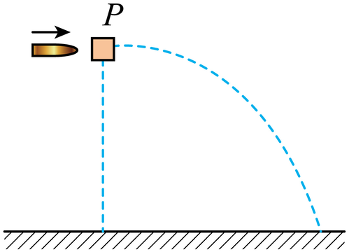

# Physics - 题目 1430

**ID**: 2b125ea7822f4f12a1a6820175eae180
**年级**: Grade 12
**难度**: Medium-Hard
**题型**: Calculation

## 题目
如图，质量为 $m$ 的物块从离地面高度为 $h$ 处由静止释放，同时一颗质量为 $m$ 的子弹在与物块等高处沿水平方向射入物块并留在物块中，物块落地点离 $P$ 点的水平距离也为 $h$ ，不计物块大小，子弹打物块的时间可忽略不计，不计空气阻力，重力加速度为 $g$ 。​​​​​​​‌（1）子弹打物块过程中子弹和物块系统损失的动能为多少？（2）仅改变子弹水平射出的高度，先释放物块再射出子弹，子弹恰好沿水平方向击中物块并留在物块中（碰撞时间极短，且碰撞产生的碰撞力远远大于物块的重力），结果物块落地点离 $P$ 点的水平距离为 $\frac {1}{2}h$ ，则调整后子弹射出的高度为多少？

## 解答

1. （1）由题知，设子弹打入物块后一瞬间，物块的速度为 $v$ ，子弹打入物块前的速度大小为 $v{{}_{0}}$ ，根据动量守恒定律有 $mv{{}_{0}}=2mv$
2. 根据运动学公式有 $v=\frac {h}{t}$ ， $h=\frac {1}{2}gt{^{2}}$
3. 解得 $v{{}_{0}}=\sqrt {2gh},v=\sqrt {\frac {1}{2}gh}$
4. 子弹射入物块过程中子弹和物块系统损失的动能 ${\rm{Δ}}E{{}_{{\rm{k}}}}=\frac {1}{2}mv{{}_{0}^{2}}-\frac {1}{2}\times 2mv{^{2}}=\frac {1}{2}mgh$
5. （2）设物块下落 $d$ 高度时，子弹击中物块，物块的水平速度为 $v$ ，子弹击中物块前，物块沿竖直方向的速度 $v{{}_{1}}=\sqrt {2gd}$
6. 击中后，物块沿竖直方向的速度为 $v{{}_{2}}$ ，竖直方向动量守恒 $mv{{}_{1}}=2mv{{}_{2}}$
7. 解得 $v{{}_{2}}=\frac {1}{2}\sqrt {2gd}$
8. 设子弹击中时物块离地面的高度为 $H=v{{}_{2}}t^{′}+\frac {1}{2}gt{^{{\rm{^{′}}}2}}$
9. 且 $t^{′}=\frac {\frac {1}{2}h}{v}=\sqrt {\frac {h}{2g}}$
10. 又 $h=H+d$
11. 联立解得 $H=\frac {\left ({1+\sqrt {13}}\right )}{8}h$

## 知识点

**中文**:
  - 子弹-木块模型

**English**:
  - Bullet-Block Model

---
