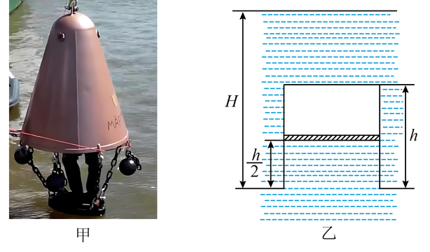

# Physics - 题目 2332

**ID**: 2d8c1ce57c1949e4b0d1b503956cc41b
**年级**: Grade 12
**难度**: Medium-Hard
**题型**: Calculation

## 题目
如图甲所示，潜水钟是一种潜水装置，可输送潜水员下潜，并提供水下逗留和作业的平台以延长潜水时间。​​​​​​​‌将潜水钟简化为如图乙所示的用轻质活塞密封的导热圆筒，圆筒内的横截面积为S=2.5m^{2}，高度h=3.0m。下潜前活塞处于筒口处，封闭气体的压强等于大气压，温度为t=27℃。现将圆筒开口向下，由水面上方沿竖直方向缓慢下潜至作业深度时，活塞恰好位于距筒口 $\frac {1}{2}h$ 处。已知潜水钟内的封闭气体可视为理想气体，不计活塞与圆筒间的摩擦，下潜过程中气体温度保持不变，海水的密度ρ=1.0×10^{3}kg/m^{3}，大气压强p_{0}=1.0×10^{5}Pa，热力学温度与摄氏温度的关系为T=t+273K，重力加速度g=10m/s^{2}。（1）求潜水钟下潜过程中，潜水钟内气体是吸热还是放热，简要说明依据；（2）求在作业深度处，筒口距离海面的深度H；（3）若保持作业深度不变，潜水钟内气体的温度降低后活塞静止在距离筒口 $\frac {8}{15}h$ 处，求此时潜水钟内气体的温度。

## 解答

1. （1）潜水钟下潜过程中，潜水钟内气体的温度不变，故内能不变，即ΔU=0；气体的体积减小，故外界对气体做功，即W>0；根据热力学第一定律有ΔU=W+Q，故Q<0，所以气体放热。
2. （2）设潜水钟下潜至作业深度处时，气体的压强为p，则 $p=p{{}_{0}}+ρg\left ({H-\frac {1}{2}h}\right )$ ，根据玻意耳定律有 $p{{}_{0}}Sh=pS\times \frac {1}{2}h$ ，解得H=11.5m。
3. （3）气体初始温度为T=300K，活塞静止在距离筒口 $\frac {8}{15}h$ 处时，气体的压强为 $p^{′}=p{{}_{0}}+ρg\left ({H-\frac {8}{15}h}\right )$ ，根据理想气体状态方程有 $\frac {p{{}_{0}}Sh}{T}=\frac {p^{′}S\left ({h-\frac {8}{15}h}\right )}{T^{′}}$ ，解得 $T^{′}=278.6{\rm{K}}$ 。

## 知识点

**中文**:
  - 利用理想状态方程解决问题
  - 气体等温变化与玻意耳定律
  - 热力学第一定律及其应用

**English**:
  - Problem Solving using Ideal Gas Law
  - Isothermal Change and Boyle's Law
  - First Law of Thermodynamics and Applications

---
