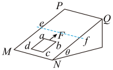

# Physics - 题目 2011

**ID**: 2e3d075e7e4841759a47b252e5acf600
**年级**: Grade 12
**难度**: Medium-Hard
**题型**: Calculation

## 题目
如图所示，光滑斜面 $PMNQ$ 的倾角为 $θ$ ，斜面上放置一个同种材料制成粗细均匀的矩形导线框 $abcd$ ，其中 $ab$ 边长L， $bc$ 边长为 $2L$ ，线框质量为m，电阻为R， $ef$ 与 $MN$ 之间存在磁感应强度为B，方向垂直于斜面向上的有界匀强磁场（图中未画出）， $ef$ 为磁场的边界且 $ef/\mskip-4mu/MN$ ， $ef$ 到 $PQ$ 间距离大于 $2L$ ，导线框在平行于斜面向上且大小为 $F=mg$ 的恒力作用下从静止开始运动，运动过程中 $ab$ 边始终与底边 $MN$ 保持平行， $ab$ 边刚离开磁场时导线框做匀速运动，求：（1）导线框离开磁场过程中通过导线某一截面的电荷量q；（2）导线框离开磁场时速度v的大小；（3）导线框离开磁场的过程中 $ab$ 边产生的热量Q。​​​​​​​‌

## 解答

1. （1）根据
2. $E=BLv$
3. $I=\frac {E}{R}$
4. $q=It$
5. $2L=vt$
6. 得电荷量为
7. $q=\frac {2BL{^{2}}}{R}$
8. （2）导线框刚离开磁场时做匀速运动，沿斜面方向由力的平衡条件有
9. $F=mg{\sin}θ+F{{}_{安}}$
10. 由法拉第电磁感应定律有
11. $E=BLv$
12. $F{{}_{安}}=BIL$
13. $I=\frac {E}{R}$
14. 联立得
15. $v=\frac {mgR}{B{^{2}}L{^{2}}}(1-{\sin}θ)$
16. （3）设导线框离开磁场的过程中产生的总热量为 $Q{{}_{总}}$ ，由能量守恒定律可知
17. $Q{{}_{总}}=F\cdot 2L-mg\cdot 2L{\sin}θ$
18. 由电阻定律可知， $ab$ 边的电阻 $r=\frac {1}{6}R$ 所以导线框离开磁场的过程中 $ab$ 边产生的热量
19. $Q=\frac {1}{6}Q{{}_{总}}$
20. 解得
21. $Q=\frac {1}{3}mgL(1-{\sin}θ)$

## 知识点

**中文**:
  - 线框模型

**English**:
  - Wire Frame Model

---
