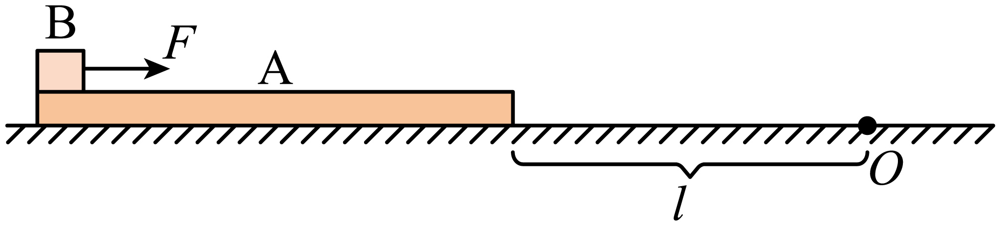

# Physics - 题目 686

**ID**: 3032757b20954d549bfbfe53fd17e8ad
**年级**: Grade 12
**难度**: Medium-Hard
**题型**: Calculation

## 题目
如图所示，质量M= 1 kg、足够长的木板A静止在水平地面上，地面与木板A之间的动摩擦因数μ_{1}= 0.2，在A的左端放置一质量m= 1 kg的铁块B（可视为质点），B与A间的动摩擦因数μ_{2}= 0.6，现用一水平恒力F作用在B上，初始时木板A右端距O点（l= 9 m，当木板A右端到达O点时撤去外力F。​​​​​​​‌重力加速度取g= 10 m/s^{2}，滑动摩擦力等于最大静摩擦力。(1)要保持A、B一起做匀加速运动，求力F的取值范围；(2)若F= 10 N，求整个过程中铁块相对木板滑行的距离；(3)若F= 12 N，求从初始到A、B都相对地面静止过程，整个系统产生的热量。

## 解答

1. （1）要保持A、B一起做匀加速运动，整体法可知，拉力的最小值F_{min}需满足 $F{{}_{{\rm{m}}{\rm{i}}{\rm{n}}}}>μ{{}_{1}}(M+m)g=4{\rm{N}}$ ，分析可知二者匀加速运动，当AB间摩擦达到最大值静摩擦力时拉力最大为F_{max}，对整体研究 $F{{}_{{\rm \max }}}-μ{{}_{1}}\left ({M+m}\right )g=\left ({M+m}\right )a$ ，隔离B研究，有 $F{{}_{{\rm \max }}}-μ{{}_{2}}mg=ma$ ，联立解得 $F{{}_{{\rm \max }}}=8{\rm{N}}$ ，里F的范围为 $4{\rm{N}}<F⩽8{\rm{N}}$
2. （2）分析可知，F= 10 N时，二者已相对滑动，由牛顿第二定律可知，B的加速度为 $a{{}_{{\rm{B}}}}=\frac {F-μ{{}_{2}}mg}{m}=4{\rm{m}}{\rm{/}}{\rm{s}}{^{{{2}}}}$ ，同理A的加速度为 $a{{}_{{\rm{A}}}}=\frac {μ{{}_{2}}mg-μ{{}_{1}}\left ({m+M}\right )g}{M}=2{\rm{m}}{\rm{/}}{\rm{s}}{^{{{2}}}}$ ，则木板A右端到达O点时，有 $l=\frac {1}{2}a{{}_{{\rm{A}}}}t{^{2}}$ ，解得 $t=3{\rm{s}}$ ，此时A的速度 $v{{}_{{\rm{A}}}}=a{{}_{{\rm{A}}}}t=6{\rm{m}}{\rm{/}}{\rm{s}}$ ，此时B的位移 $x{{}_{{\rm{B}}}}=\frac {1}{2}a{{}_{{\rm{B}}}}t{^{2}}=18{\rm{m}}$ ，此时B的速度 $v{{}_{{\rm{B}}}}=a{{}_{{\rm{B}}}}t=12{\rm{m}}{\rm{/}}{\rm{s}}$ ，该过程铁块相对木板滑行的距离 $Δx{{}_{1}}=x{{}_{{\rm{B}}}}-l=9{\rm{m}}$ ，撤去F后，A继续加速运动，且加速度为和之前一样为 $a{{}_{{\rm{A}}}}=2{\rm{m}}{\rm{/}}{\rm{s}}{^{{{2}}}}$ ，撤去F后，B做减速运动，且加速度大小为 $a{{}_{{\rm{B}}1}}=\frac {μ{{}_{2}}mg}{m}=6{\rm{m}}{\rm{/}}{\rm{s}}{^{{{2}}}}$ ，设经过t_{1}时间，二者共速，则有 $v{{}_{共}}=v{{}_{{\rm{A}}}}+a{{}_{{\rm{A}}}}t{{}_{1}}=v{{}_{{\rm{B}}}}-a{{}_{{\rm{B}}{{1}}}}t{{}_{1}}$ ，解得 $v{{}_{共}}=7.5{\rm{m}}/{\rm{s}}，t{{}_{1}}=0.75{\rm{s}}$ ，则该过程二者相对位移 $Δx{{}_{2}}=\left |{\frac {v{{}_{共}^{2}}-v{{}_{{\rm{B}}}^{2}}}{2a{{}_{{\rm{B}}1}}}}\right |-\left |{\frac {v{{}_{共}^{2}}-v{{}_{{\rm{A}}}^{2}}}{2a{{}_{{\rm{A}}}}}}\right |=2.25{\rm{m}}$ ，因为μ_{2}>μ_{1}，共速后二者相对静止一起匀减速，求整个过程中铁块相对木板滑行的距离 $Δx{{}_{总}}=Δx{{}_{1}}+Δx{{}_{2}}=11.25{\rm{m}}$
3. （3）若F= 12 N时，由牛顿第二定律可知，B的加速度为 $a{{}_{{\rm{B}}2}}=\frac {F-μ{{}_{2}}mg}{m}=6{\rm{m}}{\rm{/}}{\rm{s}}{^{{{2}}}}$ ，同理A的加速度为 $a{{}_{{\rm{A}}}}=\frac {μ{{}_{2}}mg-μ{{}_{1}}\left ({m+M}\right )g}{M}=2{\rm{m}}{\rm{/}}{\rm{s}}{^{{{2}}}}$ ，则木板A右端到达O点时，有 $l=\frac {1}{2}a{{}_{{\rm{A}}}}t{^{2}}$ ，解得 $t=3{\rm{s}}$ ，此时B的位移 $x{{}_{{\rm{B}}1}}=\frac {1}{2}a{{}_{{\rm{B}}}}t{^{2}}=27{\rm{m}}$ ，撤去F后，A、B最终速度减为零，则从初始到A、B都相对地面静止过程，整个系统产生的热量，由能量守恒可知 $Q{{}_{热}}=Fx{{}_{{\rm{B}}1}}=324{\rm{J}}$

## 知识点

**中文**:
  - 板块模型中的能量守恒问题

**English**:
  - Energy Conservation in Plate Models

---
