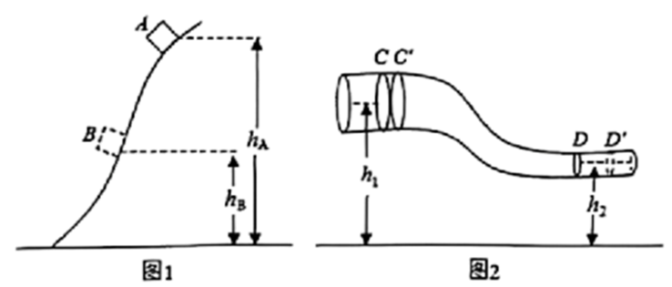

# Physics - 题目 1189

**ID**: 30877f1b3d044f7794b9c2a49f7df815
**年级**: Grade 12
**难度**: Medium-Hard
**题型**: Calculation

## 题目
追寻守恒量是物理学的重要研究内容。​​​​​​​‌探索守恒量时，除了实验手段，也常借助已有理论来进行分析。已知重力加速度为g。（1）如图1所示，A和B两位置分别距离地面高度为 $h{{}_{A}}$ 和 $h{{}_{B}}$ ，质量为m的物体（可视为质点）在A和B两位置的速度大小分别为 $v{{}_{A}}$ 和 $v{{}_{B}}$ 。以地面为参考平面，若斜坡光滑，请利用功和能的关系，证明物体从A到B的过程机械能守恒。（2）供暖系统、自来水系统都是通过管道运送液体的。管内液体稳定流动时具有这样的特点：a、管内各处液体体积无法压缩且密度均相同；b、管内各处液体流速不随时间改变。如图2所示，选取横截面C和横截面D之间的液体为研究对象，当C处液体流动很小一段距离，到达 $C^{′}$ 时，D处液体正好流动到 $D^{′}$ 处。已知液体密度为 $ρ{\rm ，\mathit{C}}$ 处的压强为 $p{{}_{1}}$ 、流速为 $u{{}_{1}}$ 、高度为 $h{{}_{1}}{\rm ，\mathit{D}}$ 处的压强为 $p{{}_{2}}$ 、流速为 $u{{}_{2}}$ 、高度为 $h{{}_{2}}{\rm ，\mathit{C}}$ 处管道半径为R，C与 $C^{′}$ 间距离为d，且R、d均远远小于 $h{{}_{2}}$ 。不计管道对液体的阻力，不考虑液体的黏滞性。在C、D间的液体流动至 $C^{′}$ 、 $D^{′}$ 的过程中：①求横截面C左侧液体对研究对象所做的功 $W{{}_{1}}$ ；②求重力对研究对象所做的功 $W{{}_{{\rm{G}}}}$ ；③研究表明，可运用动能定理对C、D间的液体进行分析。请依据动能定理探索压强p、流速u、高度h是否也存在着某种守恒的关系。若存在，请写出关系式；若不存在，请说明理由。

## 解答

1. （1）以地面为参考平面，物体在A位置的机械能为 $E{{}_{A}}=mgh{{}_{A}}+\frac {1}{2}mv{{}_{A}^{2}}$
2. 物体在B位置的机械能为 $E{{}_{B}}=mgh{{}_{B}}+\frac {1}{2}mv{{}_{B}^{2}}$
3. 物体从A位置运动到B位置的过程，根据动能定理得 $mg（h{{}_{A}}-h{{}_{B}}）=\frac {1}{2}mv{{}_{B}^{2}}-\frac {1}{2}mv{{}_{A}^{2}}$
4. 可得 $mgh{{}_{A}}+\frac {1}{2}mv{{}_{A}^{2}}=mgh{{}_{B}}+\frac {1}{2}mv{{}_{B}^{2}}$
5. 则有 $E{{}_{A}}=E{{}_{B}}$ ，即物体从A到B的过程机械能守恒。
6. （2）①横截面C左侧液体对研究对象所做的功为 $W{{}_{1}}=F{{}_{1}}d=p{{}_{1}}\cdot πR{^{2}}\cdot d$
7. 其中 $F{{}_{1}}=p{{}_{1}}\cdot πR{^{2}}$
8. 解得 $W{{}_{1}}=πR{^{2}}p{{}_{1}}d$
9. ②C、D间液体流动至 $C^{′}$ 、 $D^{′}$ 间，可等效为 $C^{′}$ 、D间液体位置不变，C、 $C^{′}$ 间液体流动至D、 $D^{′}$ 间。C、 $C^{′}$ 间的液体质量为 ${\rm{Δ}}m=ρ{\rm{Δ}}V$
10. 其中 ${\rm{Δ}}V=Sd=πR{^{2}}d$
11. 所以 ${\rm{Δ}}m=πR{^{2}}ρd$
12. 重力对研究对象所做的功为 $W{{}_{{\rm{G}}}}={\rm{Δ}}mg\cdot {\rm{Δ}}h$
13. 其中 ${\rm{Δ}}h=h{{}_{1}}-h{{}_{2}}$
14. 解得 $W{{}_{{\rm{G}}}}=πR{^{2}}ρdg(h{{}_{1}}-h{{}_{2}})$
15. ③在相同的时间内，流过C处截面水的体积与流过D处截面水的体积相同。由C、 $C^{′}$ 间液体体积为 $ΔV=πR{^{2}}d$
16. 可得 $W{{}_{1}}=p{{}_{1}}ΔV$
17. 设D处管道横截面积为 $S{{}_{2}}{\rm ，\mathit{D}}$ 、 $D^{′}$ 间距离为x，则D、 $D^{′}$ 间液体体积为 ${\rm{Δ}}V{{}_{D}}=S{{}_{2}}x={\rm{Δ}}V=πR{^{2}}d$
18. 横截面D右侧液体对研究对象所做的功为 $W{{}_{2}}=-p{{}_{2}}S{{}_{2}}x=-p{{}_{2}}ΔV$
19. 重力对研究对象所做的功为 $W{{}_{{\rm{G}}}}=πR{^{2}}ρdg(h{{}_{1}}-h{{}_{2}})={\rm{Δ}}Vρg(h{{}_{1}}-h{{}_{2}})$
20. 根据动能定理可得 $W{{}_{{\rm{G}}}}+W{{}_{1}}+W{{}_{2}}=\frac {1}{2}{\rm{Δ}}mu{{}_{2}^{2}}-\frac {1}{2}{\rm{Δ}}mu{{}_{1}^{2}}$
21. 联立可得 $p{{}_{1}}+ρgh{{}_{1}}+\frac {1}{2}ρu{{}_{1}^{2}}=p{{}_{2}}+ρgh{{}_{2}}+\frac {1}{2}ρu{{}_{2}^{2}}$
22. 由此可知压强p、流速u、高度h存在着守恒的关系，即 $p+ρgh+\frac {1}{2}ρu{^{2}}$ 为守恒量。

## 知识点

**中文**:
  - 单一物体机械能守恒定律的应用
  - 应用动能定理求解多阶段、多过程问题

**English**:
  - Applications for Single Body
  - Multi-stage/Multi-process Problems

---
