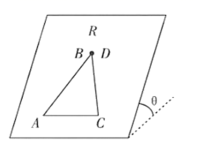

# Physics - 题目 878

**ID**: 324d92e2222647b796a945705f4437ea
**年级**: Grade 12
**难度**: Medium-Hard
**题型**: Calculation

## 题目
如图所示，在与水平面成θ=30°的斜面上固定两根等长的光滑直导轨AB、CD，其下端A、C的间距为L，在其上端交点处接入一阻值为R的电阻（视为质点），整个装置置于一磁感应强度大小为B、方向垂直斜面向下的匀强磁场（图中未画出）中。​​​​​​​‌现让一长度也为L的导体棒从AC处以初速度v_{0}沿垂直AC的方向向上运动，到AB、CD的中点处时恰好停下，且在此过程中电阻上产生的焦耳热为导体棒初动能的一半。已知导体棒的质量为m，导体棒和导轨阻值均可忽略，重力加速度为g，求：(1)导体棒刚开始运动时，电阻上消耗的电功率；(2)导体棒运动过程中，通过电阻的电荷量。

## 解答

1. (1)导体棒刚开始运动时，感应电动势
2. E=BLv_{0}
3. 回路中的感应电流
4. $I=\frac {E}{R}$
5. 则电阻的电功率
6. $P=I{^{2}}R=\frac {B{^{2}}L{^{2}}v{{}_{0}^{2}}}{R}$
7. (2)导体棒运动过程，取整个装置为一系统，由能量守恒定律:
8. $\frac {1}{2}mv{{}_{0}^{2}}{\rm{=}}Q{{}_{电}}+mgx{\sin}θ$
9. 且
10. $Q{{}_{电}}{\rm{=}}\frac {1}{4}mv{{}_{0}^{2}}$
11. 解得
12. $x=\frac {v{{}_{0}^{2}}}{2g}$ ……①
13. 导体棒运动的全过程中，又有
14. 平均感应电动势
15. ${\overline{E}}{\rm{=}}N\frac {ΔΦ}{Δt}=\frac {BΔS}{Δt}$
16. 平均感应电流
17. ${\overline{I}}{\rm{=}}\frac {{\overline{E}}}{R}$
18. 电荷量
19. $q={\overline{I}}Δt=\frac {BΔS}{R}$ ……②
20. 其中
21. $ΔS{\rm{=}}\frac {\left ({L{\rm{+}}\frac {L}{2}}\right )x}{2}=\frac {3Lx}{4}$ ……③
22. 由①②③解得
23. $q=\frac {3BLv{{}_{0}^{2}}}{8gR}$

## 知识点

**中文**:
  - 单杆模型
  - 导体切割磁感线产生感应电动势（电流）的分析与计算
  - 电磁感应现象中的功能问题
  - 安培力的大小

**English**:
  - Single Rod Model
  - Analysis and Calculation of Cutting Magnetic Field Lines
  - Work-Energy Problems in EM Induction
  - Magnitude of Ampere Force

---
