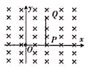

# Physics - 题目 1855

**ID**: 340183bbe7b342b0b29f49fa4b0f2f21
**年级**: Grade 12
**难度**: Medium-Hard
**题型**: Calculation

## 题目
如图所示，平面直角坐标系xOy内有方向垂直纸面向里、磁感应强度大小为B的匀强磁场，有一粒子源能从O点在纸面内均匀地向各个方向同时发射速率为v、质量为m、电荷量为q的带正电的粒子，PQ是在纸面内垂直于x轴放置的厚度不计的挡板，挡板P端的坐标为 $\left ({\frac {mv}{qB},0}\right )$ ，粒子打在挡板上会被吸收，且挡板足够长。​​​​​​​‌不计带电粒子的重力与粒子间的相互作用。求：(1)粒子在磁场中运动的轨道半径和到达挡板的最短时间；(2)能够垂直打到挡板上的粒子在磁场中的运动时间和打到挡板上的位置坐标；(3)最终打在挡板左侧的粒子数与打在挡板右侧的粒子数之比。

## 解答

1. (1)粒子在磁场中运动，由洛伦兹力提供向心力，有
2. $qvB=\frac {mv{^{2}}}{r}$
3. 解得
4. $r=\frac {mv}{qB}$
5. 由题意可知，轨迹圆心为O_{1}，打到挡板P点上的粒子在磁场中运动的时间最短，由几何关系可知：△O_{1}OP为等边三角形，则
6. $t{{}_{1}}=\frac {T}{6}$ ， $T=\frac {2πr}{v}$
7. 解得
8. $t{{}_{1}}=\frac {{\rm{π}}m}{3qB}$
9. 
10. (2)由几何关系可知：粒子垂直打到挡板右侧上的M点，轨迹圆心在P点，则M点的坐标为 $\left ({\frac {mv}{qB},\frac {mv}{qB}}\right )$ ，运动时间为
11. $t{{}_{2}}=\frac {3T}{4}=\frac {3{\rm{π}}m}{2qB}$
12. (3)由几何关系可知：粒子打到挡板左侧的范围在P与M之间，打到P点时轨迹对应圆心为O_{1}，打到挡板左侧M点时轨迹对应圆心为O_{3}， $\angle O{{}_{1}}OO{{}_{3}}=30^\circ $ ，粒子打到右侧挡板的范围在P与Q之间打到P点时轨迹对应圆心为O_{2}，打到点时轨迹对应圆心为O_{1}， $\angle O{{}_{1}}OO{{}_{2}}=120^\circ $ ，所以打在挡板左侧的粒子数与打在挡板右侧的粒子数之比为
13. $\frac {n{{}_{1}}}{n{{}_{2}}}=\frac {30}{120}=\frac {1}{4}$

## 知识点

**中文**:
  - 带电粒子在有界磁场中运动的临界极值问题

**English**:
  - Critical Extremum Problems in Bounded Magnetic Fields

---
