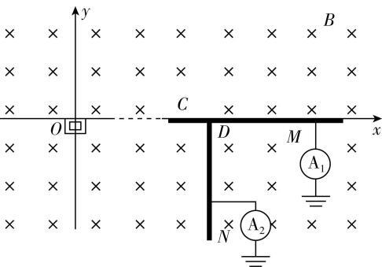

# Physics - 题目 2880

**ID**: 34db6925a5e247fb8926b98be10aaded
**年级**: Grade 12
**难度**: Medium-Hard
**题型**: Calculation

## 题目
（18分）如图为研究光电效应的装置示意图，位于坐标原点 $O$ 的光电效应发生器可产生大量在 $xOy$ 平面内运动的光电子，并沿各个方向进入 $x$ 轴上方区域。​​​​​​​‌空间中存在垂直 $xOy$ 平面向里、磁感应强度大小为 $B$ 的匀强磁场。 $x$ 轴上放置一长度足够的金属薄板 $M$ ，其左端 $C$ 点到 $O$ 点的距离为 ${x}_{0}({x}_{0}$ 大小未知)。长度足够的金属薄板 $N$ 平行 $y$ 轴放置，其上端 $D$ 点同样位于 $x$ 轴，到 $O$ 点的距离为 $\frac{3}{2}{x}_{0}$ 。两金属板间绝缘，电子打到金属板后经导线、微安表 ${\mathrm{A}}_{1}$ 、 ${\mathrm{A}}_{2}$ 后流入地面。已知光电效应截止频率为 ${\nu }_{0}$ ，普朗克常量为 $ℎ$ ，电子质量为 $m$ 、电荷量为 $e$ 。入射光频率逐渐增大至 $2{\nu }_{0}$ 时，微安表 ${\mathrm{A}}_{1}$ 开始出现示数。不计电子的重力及相互作用，不考虑电子间的碰撞，未能打到 $M$ 、 $N$ 板的其他电子被装置的接地外罩屏蔽（图中没有画出）。（1） 求 $C$ 点所处位置的横坐标 ${x}_{0}$ ；（2） 入射光频率超过 ${\nu }_{1}$ 时，微安表 ${\mathrm{A}}_{2}$ 开始出现示数，求临界频率 ${\nu }_{1}$ 的大小；（3） 求入射光频率增大到 ${\nu }_{2}$ 为 $6{\nu }_{0}$ 的过程中，打到 $N$ 板的电子在磁场中运动时间的范围。

## 解答

1. （1） 根据题意可知光电效应逸出功为 ${W}_{0}=ℎ{\nu }_{0}$ （1分）
2. 入射光频率为 $2{\nu }_{0}$ 时，逸出光电子的最大初动能
3. ${E}_{\mathrm{k}\mathrm{m}1}=ℎ×2{\nu }_{0}-{W}_{0}=ℎ{\nu }_{0}$ （1分）
4. 对应电子速度为 ${v}_{0}$ ，满足 ${E}_{\mathrm{k}\mathrm{m}1}=\frac{1}{2}m{v}_{0}^{2}$ ,
5. 可得 ${v}_{0}=\sqrt{\frac{2ℎ{\nu }_{0}}{m}}$ （1分）
6. 速度为 ${v}_{0}$ 、沿 $y$ 轴正方向射出的电子经磁场偏转后垂直 $x$ 轴打在 $C$ 点，由洛伦兹力提供向心力，则有 $e{v}_{0}B=m\frac{{v}_{0}^{2}}{{r}_{0}}$ （1分）
7. 由几何关系可知， $C$ 点到 $O$ 点的距离 ${x}_{0}=2{r}_{0}$ ，
8. 联立解得 ${x}_{0}=\frac{2m{v}_{0}}{eB}=\frac{2}{eB}\sqrt{2mℎ{\nu }_{0}}$ （1分）
9. （2） 恰有电子打到 $N$ 板时，光电效应产生的电子中，速度最大、轨道半径最大的电子轨迹过 $C$ 点且与 $N$ 板相切。设该电子射入磁场时速度与 $x$ 轴正方向夹角为 $\theta $  ，圆周运动半径为 ${r}_{1}$ ，则由几何条件可知 ${x}_{0}=2{r}_{1}\sin \theta $  ， $\frac{3}{2}{x}_{0}={r}_{1}+{r}_{1}\sin \theta $  （2分）
10. 则 ${r}_{1}={x}_{0}$ （1分）
11. 由洛伦兹力提供向心力，则有 $e{v}_{1}B=m\frac{{v}_{1}^{2}}{{r}_{1}}$
12. 联立解得电子速度 ${v}_{1}=2{v}_{0}=2\sqrt{\frac{2ℎ{\nu }_{0}}{m}}$ （1分）
13. 则由 $\frac{1}{2}m{v}_{1}^{2}=ℎ\cdot {\nu }_{1}-{W}_{0}$ ，
14. 可知 ${\nu }_{1}=5{\nu }_{0}$ （1分）
15. （3） 由旋转圆知识可知，能够打到 $N$ 板的电子在轨道半径相同的情况下，轨道与$N$板相切时运动时间最长，轨道过$C$点时运动时间最短（点拨：半径相同的情况下，可看电子运动的弦长），
16. ①对于轨道与 $N$ 板相切的所有电子，随着电子轨迹半径减小，运动时间增长，则电子的轨迹过 $C$ 点且与 $N$ 板相切时，运动时间最长，由（2）可知，该电子射入磁场时速度方向与 $x$ 轴正方向夹角 $\theta $  满足 $\sin \theta =\frac{{x}_{0}}{2{r}_{1}}=\frac{1}{2}$ ，即 $\theta =\frac{\mathrm{\pi }}{6}$ （1分）
17. 电子做圆周运动的周期为 $T=\frac{2\mathrm{\pi }{r}_{1}}{{v}_{1}}=\frac{2\mathrm{\pi }m}{eB}$ （1分）
18. 易知所有电子做圆周运动的周期均相同，
19. 则打到 $N$ 板的电子最长运动时间为 ${t}_{\max }=\frac{\theta +\frac{\mathrm{\pi }}{2}}{2\mathrm{\pi }}T=\frac{2\mathrm{\pi }m}{3eB}$ （1分）
20. ②对于轨道过 $C$ 点的所有电子，随着电子轨迹半径增大，运动时间缩短，则电子的轨迹过 $C$ 点且运动半径最大时，运动时间最短，对应电子速度最大，即为 $6{\nu }_{0}$ 光子产生的动能最大的电子，该电子速度满足 $\frac{1}{2}m{v}_{2}^{2}=ℎ{\nu }_{2}-{W}_{0}=5ℎ{\nu }_{0}$ ，
21. 解得 ${v}_{2}=\sqrt{\frac{10ℎ{\nu }_{0}}{m}}=\sqrt{5}{v}_{0}$ （1分）
22. 由 $e{v}_{2}B=m\frac{{v}_{2}^{2}}{{r}_{2}}$ ,
23. 可知该电子运动半径为 ${r}_{2}=\frac{m\sqrt{5}{v}_{0}}{eB}=\sqrt{5}{r}_{0}=\frac{\sqrt{5}}{2}{x}_{0}$ （1分）
24. 设该电子射入磁场时与 $x$ 轴正方向夹角为 $\alpha $  ，打到 $N$ 板时速度与 $y$ 轴负向的夹角为 $\beta $  ，如图所示，
25. 
26. 则$\sin \alpha =\frac{\frac{{x}_{0}}{2}}{{r}_{2}}=\frac{1}{\sqrt{5}}$ （点拨：圆心在 $OC$ 的中垂线上）， $\cos \beta =\frac{\frac{3{x}_{0}}{2}-\frac{{x}_{0}}{2}}{{r}_{2}}=\frac{2}{\sqrt{5}}$ （1分）
27. 由 $\sin \hat{}2\alpha +\cos \hat{}2\beta =1$ ，可知 $\alpha =\beta $  ，
28. 由几何关系可知该电子做圆周运动的轨迹对应的圆心角为 $\frac{\mathrm{\pi }}{2}$ （1分）
29. 则打到 $N$ 板的电子最短运动时间为 ${t}_{\min }=\frac{\frac{\mathrm{\pi }}{2}}{2\mathrm{\pi }}T=\frac{\mathrm{\pi }m}{2eB}$ （1分）
30. 即打到 $N$ 板的电子运动时间范围是 $\frac{\mathrm{\pi }m}{2eB}⩽t⩽\frac{2\mathrm{\pi }m}{3eB}$ 。
31. 【试题解构】（1）由光电效应现象，有 ${E}_{\mathrm{k}}=ℎ\nu -{W}_{0}$ ，可得光电子的入射速度。
32. $\mathrm{a}$ .临界分析：微安表 ${\mathrm{A}}_{1}$ 开始出现示数，说明光电子恰好打到 $C$ 点
33. $\mathrm{b}$ .受力分析：光电子进入磁场后只受洛伦兹力，在磁场中做匀速圆周运动
34. $\mathrm{c}$ .运动分析：由 ${E}_{\mathrm{k}}=ℎ\nu -{W}_{0}$ 知，频率 $\nu $ 越大，速度 $v$ 越大，则电子的轨道半径越大，而光电子的入射速度有各个方向，当 $OC$ 弦为直径时，半径最小，速度最小，即对应临界状态，如图甲所示，由几何关系可得 $C$ 点到 $O$ 点的距离 ${x}_{0}=2{r}_{0}$
35. 
36. 甲
37. （2）频率增大时，速度增大，半径增大，光电子会打到 $N$ 板上。
38. $\mathrm{a}$ .临界分析：微安表 ${\mathrm{A}}_{2}$ 开始出现示数，光电子需要未到 $M$ 板，且能打到 $N$ 板，则临界状态是恰好通过 $C$ 点且与 $N$ 板相切
39. $\mathrm{b}$ .几何分析：如图甲，设光电子入射方向与 $x$ 轴正方向夹角为 $\theta $  ，圆周运动半径为 ${r}_{1}$ ，由几何条件有 ${x}_{0}=2{r}_{1}\sin \theta $  ， $\frac{3}{2}{x}_{0}={r}_{1}+{r}_{1}\sin \theta $
40. （3） $\mathrm{a}$ .临界分析：由（2）知，电子能打到 $N$ 板上的临界条件是恰好过 $C$ 点且与 $N$ 板相切
41. $\mathrm{b}$ .过程分析：求时间的范围，临界条件已知，则判断两临界条件分别对应的时间即可

## 知识点

**中文**:
  - 光电效应规律的综合应用
  - 带电粒子在有界磁场中运动的临界极值问题

**English**:
  - Comprehensive Application of Photoelectric Effect
  - Critical Extremum Problems in Bounded Magnetic Fields

---
