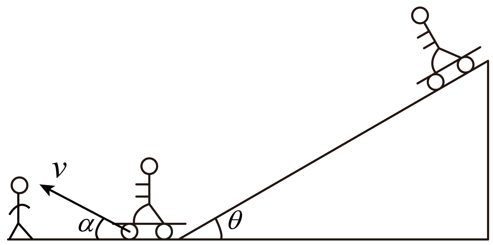

# Physics - 题目 473

**ID**: 3657a32c42eb45f0b6b540a78a5e0612
**年级**: Grade 12
**难度**: Medium-Hard
**题型**: Calculation

## 题目
如图所示，倾角 $θ=37{}^\circ $ 的斜坡与光滑水平面平滑连接，斜坡长度 $l=4{\rm{m}}$ 。​​​​​​​‌质量为 $50{\rm{k}}{\rm{g}}$ 的滑板爱好者站在质量为 ${\rm{5}}{\rm{k}}{\rm{g}}$ 的滑板上，从斜面顶端由静止开始下滑，刚滑到水平面时立刻用力蹬滑板，以 $v=6{\rm{m}}{\rm{/}}{\rm{s}}$ 的速度沿与滑板运动方向成 $α=37{}^\circ $ 角斜向上跳离滑板。已知滑板与斜坡间的动摩擦因数 $μ=0.5$ ，取重力加速度 $g=10{\rm{m}}/{\rm{s}}{^{2}},{\sin}37{}^\circ =0.6,{\cos}37{}^\circ =0.8$ ，求：（1）人的着地点距斜坡底端的距离；（2）跳离滑板过程中人做的功。

## 解答

1. （1）人跳离车后做斜抛运动，竖直方向有
2. $v{\sin}α=gt{{}_{1}}$
3. 水平方向
4. $x=2vt{{}_{1}}{\cos}α$
5. 解得
6. $x=3.456{\rm{m}}$
7. （2）设滑板质量为M，人的质量为m，从斜坡上滑下做匀加速直线运动，由牛顿第二定律得
8. $(M+m)g{\sin}θ-μ(M+m)g{\cos}θ=(M+m)a$
9. 设滑到底端的速度为 $v{{}_{0}}$ ，有
10. $v{{}_{0}^{2}}=2al$
11. 人跳车过程水平方向动量守恒
12. $(M+m)v{{}_{0}}=mv{\cos}α+Mv{{}_{1}}$
13. 跳离滑板过程中由能量守恒得
14. $W=\frac {1}{2}mv{^{2}}+\frac {1}{2}Mv{{}_{1}^{2}}-\frac {1}{2}(M+m)v{{}_{0}^{2}}$
15. 解得
16. $W=500{\rm{J}}$

## 知识点

**中文**:
  - 动量与牛顿定律的综合考查

**English**:
  - Integration of Momentum and Newton's Laws

---
