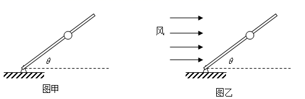

# Physics - 题目 1318

**ID**: 3829da9109694233825ce957f236348c
**年级**: Grade 12
**难度**: Medium-Hard
**题型**: Calculation

## 题目
风洞实验室中可以产生水平向右、大小可调节的风力．如图甲所示，现将质量为1kg的小球套在足够长与水平方向夹角θ=37°的细直杆上，放入风洞实验室．小球孔径略大于细杆直径．假设小球所受最大静摩擦力等于滑动摩擦力大小．（取g=10m/s^{2}，sin37^{0}=0.​​​​​​​‌6，cos37^{0}=0.8)（1）若在无风情况下小球由静止开始经0.5s沿细杆运动了0.25m，求小球与细杆间的动摩擦因数及滑动摩擦力做的功；（2）如图乙所示，若小球静止在细杆上，求风力大小；（3）请分析在不同恒定风力作用下小球由静止释放后的运动情况．

## 解答

1. （1）由s= $\frac {1}{2}$ at^{2}可得a=2m/s^{2}，
2. 根据牛顿第二定律可得F_{N}=mgcos37^{0}
3. Mgsin37^{0}-F_{f}=ma   其中F_{f}=μF_{N}
4. 解得μ=0.5 ； W_{f}=-μmgssin37^{0}=-1J
5. （2）风较小时摩擦力沿杆向上： $mg{\rm{s}}{\rm{i}}{\rm{n}}37{^{0}}=F{{}_{f}}+F{\rm{c}}{\rm{o}}{\rm{s}}37{^{0}}$
6. $F{{}_{N}}=mg{\rm{c}}{\rm{o}}{\rm{s}}37{^{0}}+F\sin 37{^{0}}$
7. F_{f}=μF_{N}
8. 解得F=1.82N；
9. 风较大时摩擦力沿杆向下： $F{{}_{f}}+mg{\rm{s}}{\rm{i}}{\rm{n}}37{^{0}}=F{\rm{c}}{\rm{o}}{\rm{s}}37{^{0}}$
10. $F{{}_{N}}=mg{\rm{c}}{\rm{o}}{\rm{s}}37{^{0}}+F\sin 37{^{0}}$
11. F_{f}=μF_{N}
12. 解得F=20N；
13. 若小球静止在杆上满足：0.82N≤F≤20N小球静止；
14. （3）若风力：1.82N≤F≤20N  小球静止；
15. 若风力：F>20N  小球沿杆向上作初速度为零的匀加速直线运动；
16. 若风力：F<1.82N 小球沿杆向下作初速度为零的匀加速直线运动.

## 知识点

**中文**:
  - 斜面模型与等时圆模型

**English**:
  - Inclined Plane Model and Isochronous Circle Model

---
