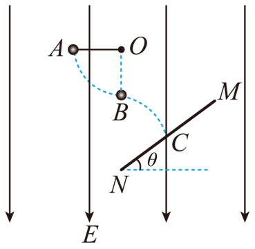

# Physics - 题目 1656

**ID**: 385eba95b0bb4810bf545af2eab9d848
**年级**: Grade 12
**难度**: Medium-Hard
**题型**: Calculation

## 题目
如图所示，空间有场强E=1.0×10^{3}V/m竖直向下的电场，长L=0.4m不可伸长的轻绳固定于O点，另一端系一质量m=0.05kg带电q=+5×10^{－}^{4}C的小球，拉起小球至绳水平后在A点无初速度释放，当小球运动至O点的正下方B点时，绳恰好断裂，小球继续运动并垂直打在同一竖直平面且与水平面成 $θ$ = $30^\circ $ 、无限大的挡板MN上的C点。​​​​​​​‌试求：(1)绳子至少受多大的拉力才能被拉断；(2)A、C两点的电势差。

## 解答

1. (1)对小球从A→B由动能定理有
2. $(mg+qE)L=\frac {1}{2}mv{{}_{B}^{2}}$
3. 在B点时有
4. $F-(mg+qE)=m\frac {v{{}_{B}^{2}}}{L}$
5. 代入数据可解得
6. $F=3{\rm{N}}$
7. 即绳子至少受3N的拉力才能被拉断；
8. (2)由(1)分析得
9. $v{{}_{B}}=\sqrt {\frac {2(mg+qE)L}{m}}=4{\rm{m}}{\rm{/}}{\rm{s}}$
10. 小球离开B点后做类平抛运动，到达C点时小球垂直撞在斜面上，则
11. $v{{}_{C}}=\frac {v{{}_{B}}}{{\sin}30^\circ }=8{\rm{m}}{\rm{/}}{\rm{s}}$
12. 对小球从A点到达C点过程，应用动能定理有
13. $qU{{}_{AC}}+mgh{{}_{AC}}=\frac {1}{2}mv{{}_{C}^{2}}$
14. 又
15. $U{{}_{AC}}=Eh{{}_{AC}}$
16. 联立解得
17. $U{{}_{AC}}=1600{\rm{V}}$

## 知识点

**中文**:
  - 带电粒子（物体）在重力场和电场组成的复合场中的运动

**English**:
  - Motion in Gravity and Electric Composite Fields

---
