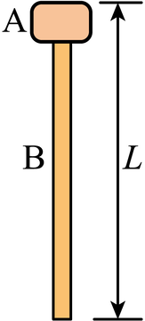

# Physics - 题目 2265

**ID**: 38af1953b0d3470fbc556ea505da4c5c
**年级**: Grade 12
**难度**: Medium-Hard
**题型**: Calculation

## 题目
锄头在农业生产中有重要应用，其由铁质锄刃与木质长柄组成。​​​​​​​‌一个锄头的示意图如图所示，锄刃A（可视为质点）和长柄B的质量满足 $m{{}_{{\rm{A}}}}=5m{{}_{{\rm{B}}}}=2.5{\rm{k}}{\rm{g}}$ ，长柄的长度 $L=1{\rm{m}}{\rm ，A}$ 、B之间的滑动摩擦力 $f=2m{{}_{{\rm{A}}}}g$ ，初始状态下A位于B的最上端，最大静摩擦力等于滑动摩擦力，取重力加速度大小 $g=10{\rm{m}}{\rm{/}}{\rm{s}}{^{2}}$ ，不计空气阻力。（1）若农业生产者小王使整个锄头竖直放置于下端距离地面 $H{{}_{0}}$ 高度处，然后给长柄B施加一大小为 $2m{{}_{{\rm{B}}}}g$ 、方向竖直向下的恒力，当B撞击地面后立即停止运动，锄刃A恰好可滑到地面，求 $H{{}_{0}}$ ；（2）小王在操作过程中发现若用力过大锄刃会脱离长柄，引发安全事故。若使锄刃不会脱离长柄，求小王施加的竖直向下的恒力F的最大值；（3）若小王使锄头由下端距离地面h处自由下落，长柄撞击地面后会以大小不变的速率反弹。若锄头反复撞击地面后锄刃A恰好没有滑离长柄B，求h。

## 解答

1. （1）在下落过程中，假定AB一起向下运动，以整体为研究对象  $\left ({m{{}_{{\rm{A}}}}+m{{}_{{\rm{B}}}}}\right )g+2m{{}_{{\rm{B}}}}g=\left ({m{{}_{{\rm{A}}}}+m{{}_{{\rm{B}}}}}\right )a{{}_{1}}$
2. 锄刃A达到的最大加速度： $a{{}_{{\rm{A}}}}=\frac {f+m{{}_{{\rm{A}}}}g}{m{{}_{{\rm{A}}}}}=30{\rm{m}}{\rm{/}}{\rm{s}}{^{{{2}}}}$
3. 解得  $a{{}_{1}}=\frac {40}{3}{\rm{m}}{\rm{/}}{\rm{s}}{^{{{2}}}}$ ，因为  $a{{}_{{{1}}}}<a{{}_{{\rm{A}}}}{\rm ，AB}$ 一起运动成立
4. 设撞击地面时的速度为 $v$ ， $v{^{2}}=2a{{}_{1}}H{{}_{0}}$
5. B停止后，A滑动过程  $f-m{{}_{{\rm{A}}}}g=m{{}_{{\rm{A}}}}a{{}_{2}}$ ， $v{^{2}}=2a{{}_{2}}L$
6. 由以上各式可得  $H{{}_{0}}=0.75{\rm{m}}$
7. （2）要使A不脱离B，需保证B的加速度不大于A能达到的最大加速度（否则A会相对滑动脱离）
8. A的最大加速度： $a{{}_{{\rm{A}}}}=\frac {f+m{{}_{{\rm{A}}}}g}{m{{}_{{\rm{A}}}}}=30{\rm{m}}{\rm{/}}{\rm{s}}{^{{{2}}}}$
9. 研究长柄B  $F+m{{}_{{\rm{B}}}}g-f=m{{}_{{\rm{B}}}}a{{}_{{\rm{B}}}}$ ， $a{{}_{{\rm{B}}}}⩽a{{}_{{\rm{A}}}}$
10. 解得  $F⩽60{\rm{N}}$ ，即最大值为 $60{\rm{N}}$
11. （3）锄头反复撞击地面过程中，因要克服摩擦力做功，锄头能上升的最大高度越来越低，每次反弹的速度也会越来越小，反复撞击地面后锄刃A恰好没有滑离长柄B，最终都静止在地面上，在整个运动过程中，系统减小的机械能等于系统克服摩擦力做功
12. $m{{}_{{\rm{A}}}}g\left ({h+L}\right )+m{{}_{{\rm{B}}}}g\times h=fL$
13. 解得  $h=\frac {5}{6}{\rm{m}}$

## 知识点

**中文**:
  - 两类动力学问题

**English**:
  - Two Types of Dynamics Problems

---
