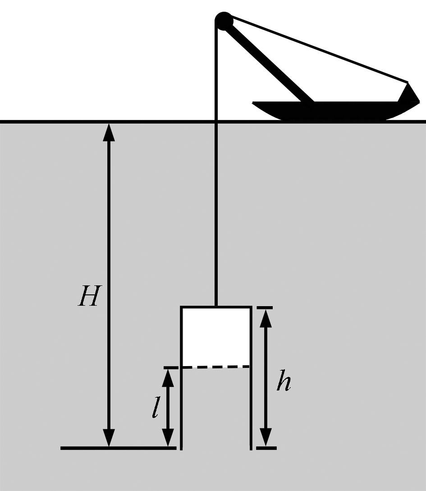

# Physics - 题目 2707

**ID**: 3adfdfa103af4d55a4a87cc7e877c977
**年级**: Grade 12
**难度**: Medium-Hard
**题型**: Calculation

## 题目
潜水钟是一种水下救生设备，它是一个底部开口、上部封闭的容器，外形与钟相似。​​​​​​​‌潜水钟在水下时其内部上方空间里存有空气，以满足潜水员水下避险的需要。为计算方便，将潜水钟简化为截面积为S、高度为h、开口向下的圆筒；工作母船将潜水钟由水面上方开口向下吊放至深度为H的水下，如图所示。已知水的密度为ρ，重力加速度大小为g，大气压强为 ${\rm \mathit{p}\mathit{_{0}}，\mathit{H}}\gg {\rm \mathit{h}}$ ，忽略温度的变化和水密度随深度的变化。（1）求进入圆筒内水的高度l；（2）保持H不变，压入空气使筒内的水全部排出，求压入的空气在其压强为p_{0}时的体积。

## 解答

1. （1）设潜水钟在水面上方时和放入水下后筒内气体的体积分别为V_{0}和V_{1}，放入水下后筒内气体的压强为p_{1}，由玻意耳定律和题给条件有
2. p_{1}V_{1}=p_{0}V_{0}①
3. V_{0}=hS    ②
4. V_{1}=（h–l）S    ③
5. p_{1}=p_{0}+ρg（H–l）    ④
6. 联立以上各式并考虑到 ${\rm \mathit{H}}\gg {\rm \mathit{h}，\mathit{h}}$  >l，解得
7. $l=\frac {ρgH}{p{{}_{0}}+ρgH}h$⑤
8. （2）设水全部排出后筒内气体的压强为p_{2}；此时筒内气体的体积为V_{0}，这些气体在其压强为p_{0}时的体积为V_{3}，由玻意耳定律有
9. p_{2}V_{0}=p_{0}V_{3 }⑥
10. 其中
11. p_{2}=p_{0}+ ρgH    ⑦
12. 设需压入筒内的气体体积为V，依题意
13. V=V_{3}–V_{0 }⑧
14. 联立②⑥⑦⑧式得
15. $V=\frac {ρgSHh}{p{{}_{0}}}$     ⑨

## 知识点

**中文**:
  - 气体等温变化与玻意耳定律

**English**:
  - Isothermal Change and Boyle's Law

---
