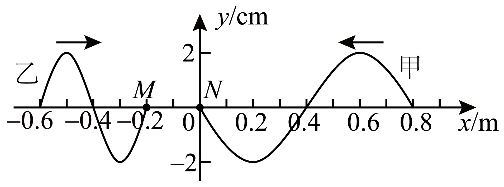

# Physics - 题目 2752

**ID**: 3da3be1bff7e4ff99adc388cd8214821
**年级**: Grade 12
**难度**: Medium-Hard
**题型**: Calculation

## 题目
甲、乙两列简谐横波分别沿 $x$ 轴负方向和正方向传播，两波源分别位于 $x=0.8{\rm{m}}$ 处和 $x=-0.6{\rm{m}}$ 处，两列波的波速大小相等，波源的振幅均为 $2{\rm{c}}{\rm{m}}$ ，两列波在 $t=0$ 时刻的波形如图所示，此时平衡位置在 $x=-0.2{\rm{m}}$ 和 $x=0{\rm{m}}$ 处的 $M$ 、 $N$ 两质点刚要开始振动。​​​​​​​‌已知甲波的周期为 $0.8{\rm{s}}$ ，求：（1）乙波传播到 $N$ 质点所需要的时间；（2）在 $0\sim 2.5{\rm{s}}$ 时间内， $N$ 质点沿 $y$ 轴正方向速度最大的时刻。

## 解答

1. （1）甲波的波长为 $λ{{}_{甲}}=0.8{\rm{m}}$ ，甲波的周期为 $T{{}_{甲}}=0.8{\rm{s}}$ ，则波速为
2. $v=\frac {λ{{}_{甲}}}{T{{}_{甲}}}=1{\rm{m}}/{\rm{s}}$
3. 两波波速大小相等，则乙波传播到 $N$ 质点所需要的时间为
4. $t=\frac {x{{}_{MN}}}{v}=0.2{\rm{s}}$
5. （2）由题图可知乙波的波长为 $λ{{}_{乙}}=0.4{\rm{m}}$ ，则乙波的周期为
6. $T{{}_{乙}}=\frac {λ{{}_{乙}}}{v}=0.4{\rm{s}}$
7. 甲波使 $N$ 质点沿 $y$ 轴正方向速度最大，应有
8. $t{{}_{甲}}=(a+\frac {1}{2})T{{}_{甲}}$ （ $a=0$ ， $1$ ， $2$ ……）
9. 乙波使 $N$ 质点沿 $y$ 轴正方向速度最大，应有
10. $t{{}_{乙}}=t+(b+\frac {1}{2})T{{}_{乙}}$ （ $b=0$ ， $1$ ， $2$ ……）
11. 在 $0\sim 2.5{\rm{s}}$ 时间内，欲使两列波相遇后 $N$ 质点沿 $y$ 轴正方向速度最大，则必有
12. $t=t{{}_{甲}}=t{{}_{乙}}$
13. $a$、$b$ 只能取整数，可得
14. $a=0$ 、 $b=0$ 时， $t=0.4{\rm{s}}$
15. $a=1$ 、 $b=2$ 时， $t=1.2{\rm{s}}$
16. $a=2$ 、 $b=4$ 时， $t=2.0{\rm{s}}$
17. 在 $0\sim 2.5{\rm{s}}$ 时间内， $N$ 质点沿 $y$ 轴正方向速度最大时刻分别为 $0.4{\rm{s}}$ 、 $1.2{\rm{s}}$ 和 $2.0{\rm{s}}$ 。

## 知识点

**中文**:
  - 波的图像及其应用
  - 波的干涉

**English**:
  - Wave Graphs and Applications
  - Interference of Waves

---
