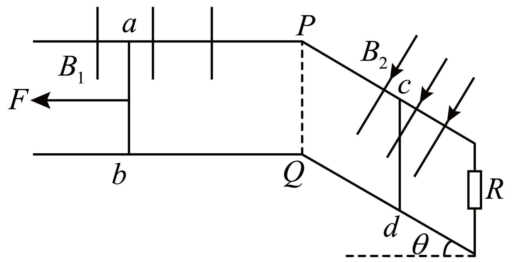

# Physics - 题目 740

**ID**: 3db984fbdedc4261983c65c00661e350
**年级**: Grade 12
**难度**: Medium-Hard
**题型**: Calculation

## 题目
平行直导轨由水平部分和倾斜部分组成，导轨间距L＝0.5  m，PQ是分界线，倾斜部分倾角为θ＝30°，PQ右侧有垂直于斜面向下的匀强磁场B_{2}＝1 T，PQ左侧存在着垂直 于水平面但方向未知、大小也为 1 T 的匀强磁场B_{1}，如图所示。​​​​​​​‌质量m＝0.1 kg、接入电路的电阻r＝0.1 Ω 的两根金属细杆ab和cd垂直放于该导轨上，其中ab杆光滑，cd杆与导轨间的动摩擦因数为μ＝ $\frac {\sqrt {3}}{2}$ 导轨底端接有R＝0.1 Ω 的电阻。开始时ab、cd均静止于导轨上。现对ab杆施加一水平向左的恒定外力F，使其向左运动，当ab杆向左运动的位移为x时开始做匀 速直线运动，此时cd刚要开始沿斜面向上运动（仍保持静止），再经t＝0.4 s 撤去外力F，最后ab杆静止在水平导轨上。整个过程中电阻R的发热量为Q＝1.0 J。设最大静摩擦力等于滑动摩 擦力。（g＝10 m/s^{2}，不计空气阻力）(1)判断B_{1 }磁场的方向；(2)刚撤去外力F时ab杆的速度v的大小；(3)求ab杆的最大加速度a的大小和加速过程中的位移x的大小。

## 解答

1. (1)根据题意知当ab棒向左运动的位移为x时开始做匀速直线运动，此时cd刚要开始沿斜面向上运动，cd所受到的安培力沿斜面向上，由左手定则知，流过cd棒的电流由d→c，流过ab棒的电流为a→b，ab棒所受到的安培力水平向右，根据左手定则，B_{1}磁场的方向竖直向下；
2. (2)对cd棒
3. ${{}_{ }}F{{}_{A}}＝mg{\rm{s}}{\rm{i}}{\rm{n}}θ+{\rm μm}g{\rm{c}}{\rm{o}}{\rm{s}}θ=1\times \frac {1}{2}{\rm{N}}+\frac {\sqrt {3}}{2}\times 1\times \frac {\sqrt {3}}{2}{\rm{N}}＝1.25{\rm{N}}$
4. F_{A}=B_{2}IL
5. 得
6. $I＝\frac {F{{}_{A}}}{B{{}_{2}}L}＝\frac {1.25}{1\times 0.5}{\rm{A}}＝{\rm{2}}{\rm{.}}{\rm{5}}{\rm{A}}$
7. 因为R=r，所以流过R的电流为2.5A
8. 总电流
9. I_{总}＝5A
10. 电路总电阻
11. R_{总}=R_{并}+r＝0.15Ω
12. ab产生的电动势
13. $E＝I{{}_{总}}R{{}_{总}}＝5\times 0.15{\rm{V}}＝0.75{\rm{V}}$
14. 对ab杆
15. E＝B_{1}Lv
16. 解得
17. $v＝\frac {\hspace{-0.5em}\begin{array}{l}E\end{array}\hspace{-0.5em}}{B{{}_{1}}L}＝\frac {0.75}{1\times 0.5}{\rm{m}}{\rm{/}}{\rm{s}}＝{\rm{1}}{\rm{.}}{\rm{5}}{\rm{m}}{\rm{/}}{\rm{s}}$
18. (3)匀速运动的位移
19. x′=v△t=1.5×0.4 m =0.6m
20. ab棒匀速运动时，
21. $F=F^{′}{{{}_{A}}}=B{{}_{1}}I{{}_{总}}L=1\times 5\times 0.5{\rm{N}}=2.5{\rm{N}}$
22. 所以水平恒力F=2.5N
23. 刚开始时，速度为0，感应电动势为0，安培力为0，杆ab的加速度最大
24. $a＝\frac {F}{m}＝\frac {2.5}{0.1}{\rm{m}}{\rm{/}}{\rm{s}}{^{{\rm{2}}}}＝{\rm{2}}{\rm{5}}{\rm{m}}{\rm{/}}{\rm{s}}{^{{\rm{2}}}}$
25. 通过电阻R和cd棒的电流总相等，总是通过ab棒电流一半，回路产生的焦耳热
26. $Q＝Q{{}_{ab}}+Q{{}_{cd}}+Q{{}_{R}}＝4{\rm{J}}+1{\rm{J}}+1{\rm{J}}＝6{\rm{J}}$
27. 根据功能原理
28. F•（x+x′）=Q
29. 代入数据
30. 2.5×（x+0.6）=6
31. 解得
32. x=1.8m

## 知识点

**中文**:
  - 双杆模型
  - 电磁感应定律的应用
  - 电磁感应现象中的功能问题

**English**:
  - Double Rod Model
  - Applications of Faraday's Law
  - Work-Energy Problems in EM Induction

---
