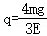
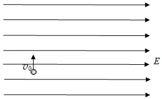

# Physics - 题目 1533

**ID**: 3dc60f5e09ea4dc2a2805e396ab070bd
**年级**: Grade 12
**难度**: Medium-Hard
**题型**: Calculation

## 题目
一个质量为m带正电的小球处于水平方向的匀强电场中，电场强度的大小为E，小球的带电量，将小球以初速度v_{0}竖直向上抛出，如图所示。​​​​​​​‌重力加速度为g。求：（1）小球经过多长时间到达最高点：（2）小球运动到与出发点等高的水平面时与出发点的距离；（3）小球运动过程中的最小速度的大小。

## 解答

1. 解：（1）小球竖直方向做匀减速运动，运动到最高点的时间：
2. （2）小球在水平方向上做初速度为0的匀加速直线运动
3. 由牛顿第二定律得：Eq＝ma
4. 解得：
5. 小球运动到与出发点等高的水平面所用时间为：
6. 此时与出发点的距离为：x＝＝
7. （3）小球在电场中的受力如图所示：
8. 当速度方向与合力方向垂直时，速度最小。
9. 把最小速度沿水平方向和竖直方向分解为v_{x}和v_{y}，则：
10. 解得：
11. 此时：v_{x}＝at＝v_{y}＝v_{0}﹣at＝
12. 最小速度：

## 知识点

**中文**:
  - 匀强电场

**English**:
  - Uniform Electric Field

---
