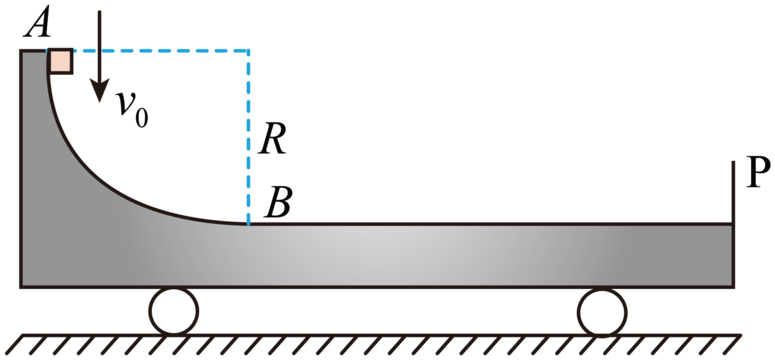

# Physics - 题目 2025

**ID**: 3e56becf00ff4ad6bbf2f80d6524d3c4
**年级**: Grade 12
**难度**: Medium-Hard
**题型**: Calculation

## 题目
如图所示，质量为 $M=3{\rm{k}}{\rm{g}}$ 的小车静止在光滑水平面上，小车左端AB为竖直平面内光滑的四分之一圆弧，半径 $R=0.4{\rm{m}}$ ，圆弧与水平部分BP相切于B点，P为固定在小车右端的弹性挡板，BP长 $L=1{\rm{m}}$ 。​​​​​​​‌质量为 $m=1{\rm{k}}{\rm{g}}$ 的小物块从A点以方向竖直向下的速度 $v{{}_{0}}=5\sqrt {2}{\rm{m}}/{\rm{s}}$ 滑进小车的圆弧部分，小物块与小车水平部分BP间的动摩擦因数 $μ=0.5$ ，重力加速度g取 $10{\rm{m}}/{\rm{s}}{^{2}}$ 。求：（1）与挡板P碰撞前瞬间，小物块的速度大小；（2）挡板P第一次碰撞后，小物块上升至最高点时与A点的竖直距离；（3）小物块最终在小车上离B点的距离以及整个运动过程中小车相对水平面的位移大小。

## 解答

1. （1）设小物块与挡板P碰撞前瞬间速度为 $v{{}_{1}}$ ，小车速度为 $v{{}_{2}}$ ，对小物块和小车系统，在小物块从A点运动至P点的过程中，水平方向动量守恒，得 $0=mv{{}_{1}}-Mv{{}_{2}}$
2. 由能量守恒，得 $mgR+\frac {1}{2}mv{{}_{0}^{2}}-\frac {1}{2}mv{{}_{1}^{2}}-\frac {1}{2}Mv{{}_{2}^{2}}={\rm μm}gL$
3. 联立解得 $v{{}_{1}}=6{\rm{m}}/{\rm{s}}$
4. （2）设小物块上升至最高点时与A点竖直距离为h，对小物块和小车系统，在小物块从A点运动至最高点的过程中，水平方向动量守恒，得 $0=(m+M)v{{}_{共}}$
5. 解得 $v{{}_{共}}=0$
6. 由能量守恒得 $\frac {1}{2}mv{{}_{0}^{2}}=mgh+{\rm μm}g\cdot 2L$
7. 解得 $h=1.5{\rm{m}}$
8. （3）小物块与小车相对运动，因摩擦力做功，系统机械能损失，最终两者相对静止，对小物块和小车系统，从开始到相对静止的过程中，水平方向动量守恒，有 $0=\left ({m+M}\right )v{{}_{共}^{^{′}}}$
9. 解得 $v{{}_{共}^{^{′}}}=0$
10. 由能量守恒，得 $\frac {1}{2}mv{{}_{0}^{2}}+mgR={\rm μm}g\cdot s{{}_{相}}$
11. 解得 $s{{}_{相}}=5.8{\rm{m}}$
12. 有 $s{{}_{相}}=5.8L$ ，故小物块相对小车静止于水平部分离B点的距离 $Δx=6L-s{{}_{相}}=0.2{\rm{m}}$
13. 在整个相对运动过程中，小物块与小车水平方向动量守恒，始终有 $0=m\frac {x{{}_{1}}}{t}-M\frac {x{{}_{2}}}{t}$
14. 整理得 $0=mx{{}_{1}}-Mx{{}_{2}}$
15. 又 $x{{}_{1}}+x{{}_{2}}=R+Δx$
16. 解得小车的位移大小 $x{{}_{2}}=0.15{\rm{m}}$

## 知识点

**中文**:
  - 人船模型
  - 动量和能量的综合应用

**English**:
  - Man-Boat Model
  - Integration of Momentum and Energy

---
