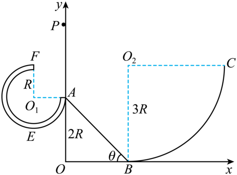

# Physics - 题目 1422

**ID**: 43d7497144274529b9d49fb06aef46cf
**年级**: Grade 12
**难度**: Medium-Hard
**题型**: Calculation

## 题目
如图所示为竖直平面坐标系xOy中的装置。​​​​​​​‌四分之三的光滑细管轨道AEF的半径为R，圆心为 $O{{}_{1}}$ ，接收面ABC由倾角 $θ=45{}\degree $ 的斜面AB和四分之一的圆弧面BC组成，已知斜面上端A点位于原点O的正上方2R处，且紧靠细管口；圆弧面BC的半径为3R，圆心 $O{{}_{2}}$ 在B点的正上方。在y轴上某处将质量为m的小球P（可视为质点）由静止释放，小球进入细管轨道后从最高点F水平抛出。已知小球从释放开始到任意位置均满足： $gy+\frac {1}{2}v{^{2}}=$ 常量（恒定不变），其中y和v分别表示小球所到位置的纵坐标和速度，g为重力加速度，不计空气阻力的影响。（1）若小球在y=5R处由静止释放，求小球经过最低点E时对细管轨道的压力大小；（2）要使小球能打在接收面AB上，求小球释放点的y坐标的范围；（3）请写出小球释放点的竖直坐标y与打在接收面ABC上的水平坐标x之间的函数关系。（不考虑小球打到接收面后的反弹）

## 解答

1. （1）设小球经过最低点E时的速度大小为 $v{{}_{1}}$ ，由于 $gy+\frac {1}{2}v{^{2}}=$ 常量，则 $g\cdot 5R=gR+\frac {1}{2}v{{}_{1}^{2}}$ ，设小球在最低点E时受轨道支持力的大小为 $F{{}_{{\rm{N}}}}$ ，由向心力公式得 $F{{}_{{\rm{N}}}}-mg=m\frac {v{{}_{1}^{2}}}{R}$ ，解得 $F{{}_{{\rm{N}}}}=9mg$ ，根据牛顿第三定律，小球经过最低点E时对细管轨道的压力大小也为9mg。
2. （2）设小球从最高点F水平抛出时速度大小为 $v{{}_{2}}$ 时恰好能打到A点，由平抛运动规律得 $R=v{{}_{2}}t$ ， $R=\frac {1}{2}gt{^{2}}$ ，解得 $v{{}_{2}}=\sqrt {\frac {1}{2}gR}$ ，设小球释放点的坐标为 $y{{}_{1}}$ ，从P点到F点，由于 $gy+\frac {1}{2}v{^{2}}=$ 常量，则 $gy{{}_{1}}=3gR+\frac {1}{2}v{{}_{2}^{2}}$ ，解得 $y{{}_{1}}=\frac {13}{4}R$ ，设小球恰好打到B点，在F点时的速度大小为 $v{{}_{3}}$ ，释放坐标为 $y{{}_{2}}$ ，同理可解得 $v{{}_{3}}=\sqrt {\frac {3}{2}gR}$ ， $y{{}_{2}}=\frac {15}{4}R$ ，要使小球能打在接收面AB上，小球释放点的y坐标的范围为 $\frac {13}{4}R<y<\frac {15}{4}R$ 。
3. （3）当 $0<x<2R$ 时，小球落在斜面AB上，由平抛规律和几何关系得 $x+R=v{{}_{0}}t$ ， $x+R=\frac {1}{2}gt{^{2}}$ ，且 $gy=3gR+\frac {1}{2}v{{}_{0}^{2}}$ ，解得 $y=\frac {1}{4}x+\frac {13}{4}R$ ，当 $2R<x<5R$ 时，小球落在圆弧面BC上，同理得 $x+R=v{{}_{0}}t$ ， $\sqrt {(3R){^{2}}-(x-2R){^{2}}}=\frac {1}{2}gt{^{2}}$ ，且 $gy=3gR+\frac {1}{2}v{{}_{0}^{2}}$ ，解得 $y=3R+\frac {(x+R){^{2}}}{4\sqrt {9R{^{2}}-(x-2R){^{2}}}}$

## 知识点

**中文**:
  - 平抛运动与斜面、圆轨道相结合问题
  - 平抛运动中的临界问题

**English**:
  - Horizontal Projectile on Inclined Planes and Circular Tracks
  - Critical Problems in Horizontal Projectile Motion

---
