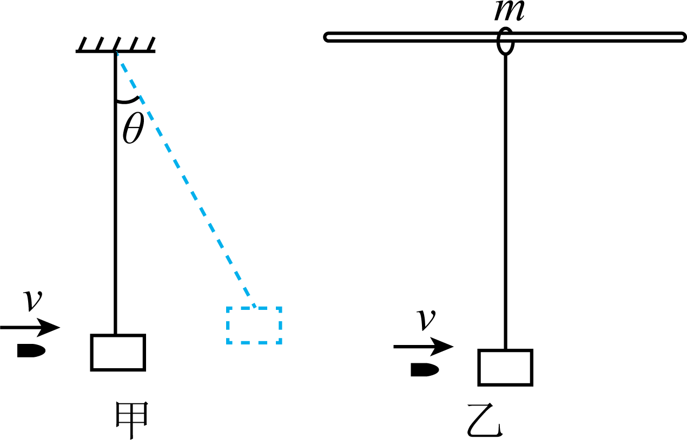

# Physics - 题目 793

**ID**: 462c6e0a14d8456a817fca2c0fbf3dda
**年级**: Grade 12
**难度**: Medium-Hard
**题型**: Calculation

## 题目
如图甲所示，细线下吊着一个质量为 $m{{}_{1}}$ 的静止沙袋，沙袋到细线上端悬挂点的距离为l。​​​​​​​‌一颗质量为 $m{{}_{2}}$ 的子弹在极短时间内水平射入沙袋并留在沙袋中，随着沙袋一起摆动。已知重力加速度大小为g，不计空气阻力。（1）若上端悬挂点固定，且沙袋摆动时摆线的最大偏角 $θ\left ({θ<\frac {π}{2}}\right )$ ，求子弹射入沙袋前的速度大小v；（2）若把细线上端固定在一个质量为m=0.5kg的光滑金属圆环上，圆环套在一个固定的光滑水平杆上、并可沿杆自由滑动，如图乙所示。现已知子弹射入沙袋前的速度大小为v=200m/s，沙袋质量 $m{{}_{1}}=1.98{\rm{k}}{\rm{g}}$ ，子弹质量 $m{{}_{2}}=20{\rm{g}}$ ，沙袋向上摆动的最大角度不超过 $\frac {π}{2}{\rm ，\mathit{g}}$ 取 $10{\rm{m}}{\rm{/}}{\rm{s}}{^{2}}$ 。①求沙袋向上摆动的最大高度 $h{{}_{1}}$ ；②子弹打进沙袋后的运动过程中，沙袋运动到最低点时，求沙袋的速度大小和方向。③若改变题干中已知物理量的数值，则子弹打进沙袋后的运动过程中，当沙袋运动到最低点时，速度方向有没有可能向左？如果没有可能，通过推理证明你的结论；如果有可能，通过推理求出已知量需要满足的条件。

## 解答

1. （1）子弹射入沙袋过程，动量守恒，有 $m{{}_{2}}v=(m{{}_{1}}+m{{}_{2}})v^{′}$
2. 沙袋摆动到最高点时，根据动能定理 $-(m{{}_{1}}+m{{}_{2}})gl(1-{\cos}θ)=0-\frac {1}{2}(m{{}_{1}}+m{{}_{2}})v^{′}{^{2}}$
3. 解得 $v=\frac {m{{}_{1}}+m{{}_{2}}}{m{{}_{2}}}\sqrt {2gl(1-{\cos}θ)}$
4. （2）①子弹射入沙袋过程，动量守恒，有 $m{{}_{2}}v=(m{{}_{1}}+m{{}_{2}})v^{′}$
5. 解得 $v^{′}=2{\rm{m}}{\rm{/}}{\rm{s}}$
6. 沙袋向上摆动的高度最大时，沙袋和圆环的水平速度相同，根据水平方向动量守恒有 $(m{{}_{1}}+m{{}_{2}})v^{′}=(m+m{{}_{1}}+m{{}_{2}})v{{}_{1}}$
7. 解得 $v{{}_{1}}=1.6{\rm{m}}{\rm{/}}{\rm{s}}$
8. 根据系统机械能守恒有 $\frac {1}{2}(m{{}_{1}}+m{{}_{2}})v^{′}{^{2}}=\frac {1}{2}(m{{}_{1}}+m{{}_{2}}+m)v{{}_{1}}{^{2}}+(m{{}_{1}}+m{{}_{2}})gh{{}_{1}}$
9. 解得 $h{{}_{1}}=0.04{\rm{m}}$
10. ②子弹打进沙袋后的运动过程中，沙袋运动到最低点时，相当于环与沙袋完成一次完全弹性碰撞，以右为正方向，根据动量守恒和机械能守恒有 $(m{{}_{1}}+m{{}_{2}})v^{′}=(m{{}_{1}}+m{{}_{2}})v{{}_{2}}+mv{{}_{3}}$ ， $\frac {1}{2}(m{{}_{1}}+m{{}_{2}})v^{′}{^{2}}=\frac {1}{2}(m{{}_{1}}+m{{}_{2}})v{{}_{2}}{^{2}}+\frac {1}{2}mv{{}_{3}}{^{2}}$
11. 解得 $v{{}_{2}}=\frac {m{{}_{1}}+m{{}_{2}}-m}{m{{}_{1}}+m{{}_{2}}+m}v^{′}=1.2{\rm{m}}{\rm{/}}{\rm{s}}$ ， $v{{}_{3}}=\frac {2(m{{}_{1}}+m{{}_{2}})}{m{{}_{1}}+m{{}_{2}}+m}v^{′}=3.2{\rm{m}}{\rm{/}}{\rm{s}}$
12. 沙袋的速度大小为1.2m/s，方向水平向右。
13. ③由以上分析可知 $v{{}_{2}}=\frac {m{{}_{1}}+m{{}_{2}}-m}{m{{}_{1}}+m{{}_{2}}+m}v^{′}$
14. 当 $m{{}_{1}}+m{{}_{2}}-m<0$
15. 沙袋的速度可能向左。

## 知识点

**中文**:
  - 子弹-木块模型
  - 应用动能定理求解连接体问题
  - 求解弹性碰撞问题

**English**:
  - Bullet-Block Model
  - Solving Connected Body Problems
  - Solving Elastic Collision Problems

---
