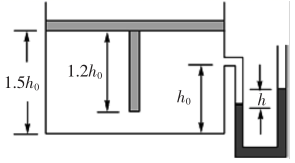

# Physics - 题目 1611

**ID**: 496780374b85418aa01ca714e100928a
**年级**: Grade 12
**难度**: Medium-Hard
**题型**: Calculation

## 题目
如图所示，固定的绝热气缸内有一“T”型绝热活塞（体积可忽略）距气缸底部h_{0}处连接一U形管（管内气体的体积忽略不计）初始时，封闭气体温度为T_{0}，活塞距离气缸底部为1.5h_{0}，两边水银柱存在高度差为h。​​​​​​​‌已知水银的密度为ρ，大气压强为p_{0}，气缸横截面积为S，活塞竖直部分长为1.2h_{0}，重力加速度为g。试问：（1）求活塞质量m；（2）设法缓慢降低气体温度，两水银面相平时温度是多少?

## 解答

1. （1）初始时，缸内气体压强
2. $p{{}_{1}}=p{{}_{0}}+\frac {mg}{S}$
3. 又
4. p_{1}=p_{0}+ρgh
5. 得
6. m=ρhS
7. （2）初态p_{1}=p_{0}+ρghV_{1}=1.5h_{0}ST_{1}=T_{0}
8. 末态p_{2}=p_{0}V_{2}=1.2h_{0}S
9. 由
10. $\frac {p{{}_{1}}V{{}_{1}}}{T{{}_{1}}}=\frac {p{{}_{2}}V{{}_{2}}}{T{{}_{2}}}$
11. 解得
12. $T{{}_{2}}=\frac {4p{{}_{0}}T{{}_{0}}}{5(p{{}_{0}}+ρgh)}$

## 知识点

**中文**:
  - 气体状态变化问题-U型管模型

**English**:
  - Gas State Problems: U-tube Model

---
