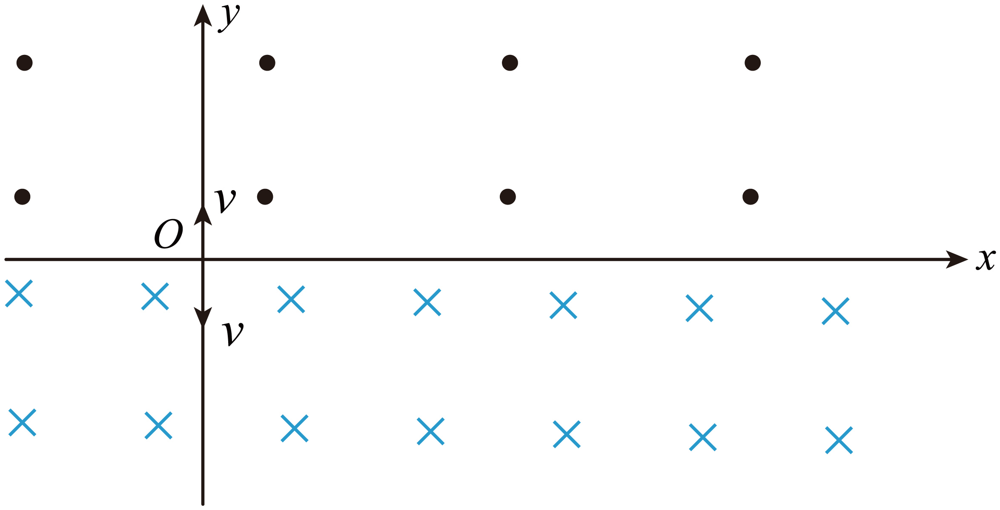

# Physics - 题目 465

**ID**: 4a8cbff1ce2a426fafd14df6e606e974
**年级**: Grade 12
**难度**: Medium-Hard
**题型**: Calculation

## 题目
如图所示的 $xOy$ 坐标平面内， $y>0$ 的区域内存在着垂直于平面向外的匀强磁场，磁感应强度大小为 $B$ ， $y<0$ 的区域内存在着垂直于平面向里的匀强磁场，磁感应强度大小为 $2B$ 。​​​​​​​‌质量为 $m$ 、电荷量为 $q$ 的两个带正电粒子 $a$ 和 $b$ ，均以相同大小的速率 $v$ 从 $O$ 点分别沿 $y$ 轴正向和 $y$ 轴负向同时开始运动，运动过程中两粒子的碰撞为弹性碰撞，碰撞时间忽略不计。设整个磁场区域都处于真空中，不考虑粒子的重力及两粒子之间除碰撞外的相互作用，求(1)粒子分别在 $y>0$ 和 $y<0$ 的区域内运动时的半径之比和周期之比；(2)两粒子运动轨迹交点的坐标；(3)以两粒子在 $O$ 点开始运动时为 $t=0$ 时刻，求两粒子在运动过程中某时刻平行 $y$ 轴方向上相距最远时的距离及对应的时刻。

## 解答

1. （1）由于粒子在磁场中做匀速圆周运动时，洛伦兹力提供向心力，在 $y>0$ 区域内运动时，则有 $Bqv=\frac {mv}{r{{}_{1}}}$
2. 解得 $r{{}_{1}}=\frac {mv}{Bq}$
3. 同理可得，在 $y>0$ 区域内运动时的半径 $r{{}_{2}}=\frac {mv}{2Bq}$
4. 粒子分别在 $y>0$ 和 $y<0$ 的区域内运动时的半径之比 $r{{}_{1}}:r{{}_{2}}=2:1$
5. 根据周期 $T=\frac {2πr}{v}$ 可知，粒子在 $y>0$ 和 $y<0$ 的区域内运动时的周期分别为 $T{{}_{1}}=\frac {2πr{{}_{1}}}{v}$ ， $T{{}_{2}}=\frac {2πr{{}_{2}}}{v}$
6. 解得 $T{{}_{1}}:T{{}_{2}}=2:1$
7. （2）根据上述分析可知 $r{{}_{1}}=\frac {mv}{Bq}$ ， $r{{}_{2}}=\frac {mv}{2Bq}$
8. 当 $t=\frac {T{{}_{1}}+T{{}_{2}}}{2}$ 时，两个粒子发生弹性碰撞，由动量守恒定律可得 $mv-mv=mv{{}_{1}}-mv{{}_{2}}$
9. 根据能量守恒可得 $\frac {1}{2}mv{^{2}}\times 2=\frac {1}{2}mv{{}_{1}^{2}}+\frac {1}{2}mv{{}_{2}^{2}}$
10. 解得 $v{{}_{1}}=v{{}_{2}}=v$
11. 两粒子运动的部分轨迹如图所示
12. 
13. ①交点在x轴上 $x{{}_{1}}=n(2r{{}_{1}}+2r{{}_{2}})=\frac {3nmv}{Bq}(n=1,2,3\cdots )$
14. 坐标为（ $\frac {3nmv}{Bq}$ ，0） $(n=1,2,3\cdots )$
15. ②交点不在x轴上，根据对称性可得 $x{{}_{2}}=r{{}_{1}}+\frac {r{{}_{1}}}{2}+3(n-1)r{{}_{1}}=\frac {(6n-3)mv}{2Bq}(n=1,2,3\cdots )$
16. $y{{}_{2}}=\sqrt {r{{}_{1}^{2}}-(\frac {r{{}_{1}}}{2}){^{2}}}=\frac {\sqrt {3}mv}{2Bq}$
17. 交点坐标为[ $\frac {(6n-3)mv}{2Bq}$ , $\frac {\sqrt {3}mv}{2Bq}](n=1,2,3\cdots )$
18. （3）在 $t⩽\frac {T{{}_{2}}}{2}$ 内，设 $y{{}_{1}}=r{{}_{1}}\sin ω{{}_{1}}t$ ， $y{{}_{2}}=r{{}_{2}}\sin ω{{}_{2}}t$
19. 
20. 结合上述结论可知 $r{{}_{1}}:r{{}_{2}}=2:1$ ， $ω{{}_{1}}:ω{{}_{2}}=1:2$
21. 两粒子在运动过程中沿y方向的距离为 $y=y{{}_{1}}+y{{}_{2}}=r{{}_{1}}\sin ω{{}_{1}}t+\frac {1}{2}r{{}_{1}}\sin 2ω{{}_{2}}t$
22. 对y求导可得 $y{^{^{′}}}=ω{{}_{1}}r{{}_{1}}({\cos}ω{{}_{1}}t+{\cos}2ω{{}_{1}}t)=ω{{}_{1}}r{{}_{1}}({\cos}ω{{}_{1}}t+2{\cos}{^{2}}ω{{}_{1}}t-1)$
23. 令 $y{^{^{′}}}=0$  ，则有 ${\cos}ω{{}_{1}}t+2{\cos}{^{2}}ω{{}_{1}}t-1=0$
24. 解得 $ω{{}_{1}}t{{}_{1}}=\frac {π}{3}$ ， $t{{}_{1}}=\frac {πm}{3Bq}$
25. y最大；
26. 同样在 $\frac {T{{}_{1}}}{2}⩽t⩽\frac {T{{}_{1}}+T{{}_{2}}}{2}$ 内， $t{{}_{2}}=\frac {T{{}_{1}}+T{{}_{2}}}{2}-\frac {πm}{3Bq}=\frac {7πm}{6Bq}$ 时，y最大；
27. 当 $t=\frac {πm}{3Bq}+\frac {T{{}_{1}}+T{{}_{2}}}{2}n=\frac {(9n+2)πm}{6Bq}$ 或 $t=\frac {7πm}{6Bq}+\frac {T{{}_{1}}+T{{}_{2}}}{2}n=\frac {(9n+7)πm}{6Bq}(n=0,1,2\cdots )$ 时，其最大值 $y{{}_{{\rm \max }}}=\frac {3\sqrt {3}mv}{4Bq}$

## 知识点

**中文**:
  - 带电粒子在磁场中做圆周运动的多解问题

**English**:
  - Multi-solution Problems of Circular Motion in Magnetic Fields

---
