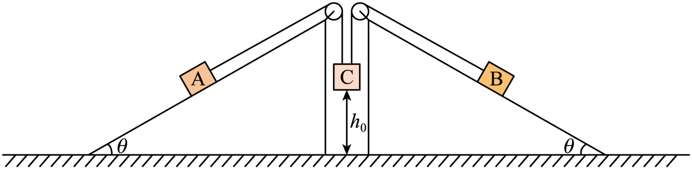

# Physics - 题目 1095

**ID**: 4d0da9c9d3a2457bb421415e10a0b950
**年级**: Grade 12
**难度**: Medium-Hard
**题型**: Calculation

## 题目
如图所示，两个完全相同的直角三角形光滑斜面体固定在水平地面上，倾角均为θ＝30°，斜面体顶端均固定相同的轻质滑轮。​​​​​​​‌两根等长的轻细线均绕过滑轮，一端与放在斜面上的质量均为m的物块A、B相连，另一端与质量为2m的物块C连接。一开始用外力托住物块A、B、C，细线处于拉直状态，此时物块C距离地面高度为 $h{{}_{0}}$ ，同时撤去外力后，物块C开始向下运动。已知物块C触地后速度立即变为零；物块C被提起时，细线瞬间绷直，绷直瞬间细线上的拉力非常大；从细线绷直到物块C再次落地前，细线均保持拉直状态；在整个运动过程中，细线始终不会脱离滑轮，物块A、B不会与滑轮相碰；不计一切摩擦，重力加速度为g，求：（1）物块C开始下落时的加速度大小 $a{{}_{1}}$ ；（2）物块C第一次触地过程中损失的机械能 $ΔE$ ；（3）物块C第一次触地后上升的最大高度 $h{{}_{1}}$ ；（4）物块C从开始下落到最终停止运动所经历的时间t。

## 解答

1. （1）由对称性可知两细线的弹力相等。设为 $T$ ， ${\rm{A}}、$  ${\rm{B}}$ 、 ${\rm{C}}$ 的加速度大小均相等。根据牛顿第二定律，对A有 $T-mg\sin θ=ma{{}_{1}}$
2. 对 ${\rm{C}}$ 有 $2mg-2T=2ma{{}_{1}}$
3. 解得 $a{{}_{1}}=\frac {g}{4}$
4. （2） ${\rm{C}}$ 从开始下落到接触地面前瞬间 $v{{}_{1}^{2}}=2a{{}_{1}}h{{}_{0}}$
5. 解得 $v{{}_{1}}=\sqrt {\frac {gh{{}_{0}}}{2}}$
6. 物块 ${\rm{C}}$ 第一次接触地过程中损失的机械能为 $ΔE=\frac {1}{2}mv{{}_{1}^{2}}$
7. 解得 $ΔE=\frac {1}{2}mgh{{}_{0}}$
8. （3）C触地后，A、B先以初速度大小为 $v{{}_{1}}$ 沿着斜面上滑，速度减到零后下滑，下滑至细线再次绷直前瞬间的速度大小仍为 $v{{}_{1}}$ 。细线绷直瞬间，细线上的拉力非常大，远大于物块的重力，可将 ${\rm{A}}、$  ${\rm{B}}$ 、 ${\rm{C}}$ 与细线组成的系统看成是一维的动量守恒的系统（即把两细线伸直，AB在两细线同一端，C在两细线另一端），设细线再次绷直后瞬间A、B、C的速度大小均为 $v{{}_{2}}$ ，在等效的一维系统中，以 ${\rm{A}}{\rm{B}}$ 的速度方向为正方向，由动量守恒定律得 $2mv{{}_{1}}=4mv{{}_{2}}$
9. 解得 $v{{}_{2}}=\frac {1}{2}\sqrt {\frac {gh{{}_{0}}}{2}}$
10. 此后C以加速度大小为 $a{{}_{1}}=\frac {1}{4}g$ ，向上做匀减速直线运动，则有 $v{{}_{2}^{2}}=2a{{}_{1}}h{{}_{1}}$
11. 解得 $h{{}_{1}}=\frac {h{{}_{0}}}{4}$
12. （4）把C由最高点开始下落到下一次上升到最高点当作一个过程，第1次这个过程C由高度 $h{{}_{0}}$ 开始，第2次这个过程C由高度 $h{{}_{1}}=\frac {h{{}_{0}}}{4}$ 开始，根据（2）（3）的解答过程，可得到第3次这个过程C由高度 $h{{}_{2}}=\frac {h{{}_{1}}}{4}=\frac {h{{}_{0}}}{16}$ 开始，依次类推可得：
13. 第n次开始的高度为 $h{{}_{n}}=(\frac {1}{4}){^{n-1}}h{{}_{0}}$
14. 第1次这个过程的时间包括：
15. ①C由最高点下落时间为 $t{{}_{1}}=\frac {v{{}_{1}}}{a{{}_{1}}}=2\sqrt {\frac {2h{{}_{0}}}{g}}$
16. ②C触地后A、B上滑后下滑至再次绷直的时间，此过程A、B的加速度大小为 $a{{}_{2}}=g\sin θ=\frac {1}{2}g$
17. 所用时间为 $t{{}_{2}}=2\times \frac {v{{}_{1}}}{a{{}_{2}}}=2\sqrt {\frac {2h{{}_{0}}}{g}}$
18. ③C上升至最高点所用时间为 $t{{}_{3}}=\frac {v{{}_{2}}}{a{{}_{1}}}=\sqrt {\frac {2h{{}_{0}}}{g}}$
19. 第1次这个过程的总时间为 $t{{}_{1总}}=t{{}_{1}}+t{{}_{2}}+t{{}_{3}}=5\sqrt {\frac {2h{{}_{0}}}{g}}$
20. 可知这个过程的总时间与开始时的高度的平方根成正比，可得 $t{{}_{n总}}=5\sqrt {\frac {2h{{}_{0}}}{g}}\times (\frac {1}{2}){^{n-1}}$
21. 当 $n\to \infty $ ，应用等比数列求和，可得物块C从开始运动到最终停止所经历的总时间为 $t=t{{}_{1总}}+t{{}_{2总}}+t{{}_{3总}}+\cdot \cdot \cdot =5\sqrt {\frac {2h{{}_{0}}}{g}}\cdot [1+\frac {1}{2}+(\frac {1}{2}){^{2}}+\cdot \cdot \cdot ]=10\sqrt {\frac {2h{{}_{0}}}{g}}$

## 知识点

**中文**:
  - 其他连接体问题中机械能守恒定律的应用
  - 动量定理及其应用
  - 动量和能量的综合应用

**English**:
  - Other Connected Body Problems
  - Applications of Impulse-Momentum Theorem
  - Integration of Momentum and Energy

---
