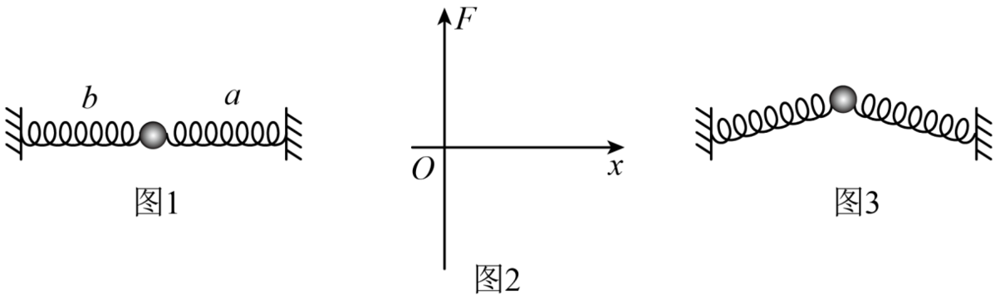

# Physics - 题目 1894

**ID**: 4d68ba5dcde943888ac6823968ff1777
**年级**: Grade 12
**难度**: Medium-Hard
**题型**: Calculation

## 题目
如图1所示，弹簧a和弹簧b为两根相同的弹簧，与可视为质点的小球相连，另外两端固定，小球处于静止状态时两弹簧均处于伸长状态且伸长量为x_{0}，弹簧的劲度系数为k，质量不计，小球的质量为m，整个装置处于光滑的水平面上。​​​​​​​‌现将小球向右缓慢推动一段距离x（x<x_{0}）。（1）求此刻弹簧a弹力的大小和弹簧b弹力的大小。（2）a.用图2中的横轴x表示小球相对于初始位置的位移，纵轴F表示弹簧的弹力（均以水平向右为正方向）。请在图2中画出弹簧a的弹力F_{a}随x变化的F_{a }-x图像，以及弹簧b的弹力F_{b}随x变化的F_{b }-x图像。b. 取小球处于初始位置时系统的弹性势能为零，请利用图2中的图像求出小球被向右推动了距离x时系统的弹性势能E_{P}。（3）如图3所示，将小球在水平面内沿与两弹簧轴线相垂直的方向移动一小段距离y，请通过计算论证，释放后小球是否做简谐运动以及其运动可视为简谐运动的条件。（请对论证过程中用到的物理量加以说明；论证过程中有可能用到的数学知识有：当 $θ$ 很小时， $\sin θ\approx {\tan}θ$ ）

## 解答

1. （1）根据胡克定律得，弹簧a的弹力大小为 $F{{}_{a}}=k\left ({x{{}_{0}}-x}\right )$
2. 弹簧b的弹力大小为 $F{{}_{b}}=k\left ({x{{}_{0}}+x}\right )$
3. （2）弹簧a的弹力F_{a}随x变化的F_{a }-x图像，以及弹簧b的弹力F_{b}随x变化的F_{b }-x图像如下图所示
4. 
5. （2）由答图1图像可知小球被向右推动距离x的过程中，弹簧弹力做的功可通过线下面积求出，其中F_{a}做正功，F_{b}做负功，二者做功的和为 $W=\frac {1}{2}[kx{{}_{0}}+k(x{{}_{0}}-x)]\cdot x-\frac {{{1}}}{{{2}}}[kx{{}_{0}}+k(x{{}_{0}}+x)]\cdot x=-kx{^{2}}$
6. 再由 $W=0-E{{}_{p}}$
7. 可知时小球被向右推动了距离x时系统的弹性势能 $E{{}_{p}}=kx{^{2}}$
8. （3）如答图2所示，设弹簧与弹簧初始位置所在连线的夹角为 $θ$ ，小球偏离初始位置的位移为y，设弹簧的原长为l_{0}，则小球受到两根弹簧的拉力，其合力方向与位移y相反，大小为 $F{{}_{y}}={{2}}k（\frac {y}{\sin θ}-l{{}_{0}}）\sin θ{\rm{=}}{{2}}ky-2kl{{}_{0}}\sin θ$
9. 其中 $\sin θ=\frac {y}{\sqrt {y{^{2}}+(l{{}_{0}}+x{{}_{0}}){^{2}}}}$
10. 由此可知，小球所受的回复力与相对平衡位置的位移y不成正比，即小球的运动不是简谐运动。
11. 但是若 $θ$ 很小（也就是y<<l_{0}+x_{0}）时， $\sin θ\approx {\tan}θ=\frac {y}{l{{}_{0}}+x{{}_{0}}}$
12. 则有 $F{{}_{y}}=\frac {2kx{{}_{0}}}{l{{}_{0}}+x{{}_{0}}}y$
13. 即小球所受的回复力与相对平衡位置的位移y成正比，小球的运动可视为简谐运动。
14. 

## 知识点

**中文**:
  - 简谐运动的回复力和加速度

**English**:
  - Restoring Force and Acceleration in SHM

---
