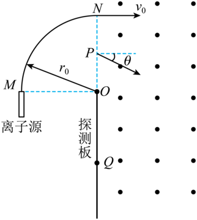

# Physics - 题目 1336

**ID**: 4dced5682eaa476db14287bf6968a627
**年级**: Grade 12
**难度**: Medium-Hard
**题型**: Calculation

## 题目
有一种质谱仪由静电分析器和磁分析器组成，其简化原理如图所示．左侧静电分析器中有方向指向圆心O、与O点等距离各点的场强大小相同的径向电场，右侧的磁分析器中分布着方向垂直于纸面向外的匀强磁场，其左边界与静电分析器的右边界平行，两者间距近似为零．离子源发出两种速度均为v_{0}、电荷量均为q、质量分别为m和0.5m的正离子束，从M点垂直该点电场方向进入静电分析器．在静电分析器中，质量为m的离子沿半径为r_{0}的四分之一圆弧轨道做匀速圆周运动，从N点水平射出，而质量为0.5m的离子恰好从ON连线的中点P与水平方向成θ角射出，从静电分析器射出的这两束离子垂直磁场方向射入磁分析器中，最后打在放置于磁分析器左边界的探测板上，其中质量为m的离子打在O点正下方的Q点．已知OP=0.5r_{0}，OQ=r_{0}，N、P两点间的电势差 $U{{}_{NP}}=\frac {mv{{}_{0}^{2}}}{q}$ ， ${\cos}θ=\sqrt {\frac {4}{5}}$ ，不计重力和离子间相互作用。​​​​​​​‌（1）求静电分析器中半径为r_{0}处的电场强度E_{0}和磁分析器中的磁感应强度B的大小；（2）求质量为0.5m的离子到达探测板上的位置与O点的距离l（用r_{0}表示）；（3）若磁感应强度在（B—△B）到（B＋△B）之间波动，要在探测板上完全分辨出质量为m和0.5m的两束离子，求 $\frac {ΔB}{B}$ 的最大值。

## 解答

1. （1）在静电分析器中，电场力提供向心力，有
2. $qE{{}_{0}}=m\frac {v{{}_{0}^{2}}}{r{{}_{0}}}$
3. 解得
4. $E{{}_{0}}=\frac {mv{{}_{0}^{2}}}{qr{{}_{0}}}$
5. 离子在磁场中做圆周运动，洛伦兹力提供向心力，有
6. $qv{{}_{0}}B=m\frac {v{{}_{0}^{2}}}{r{{}_{0}}}$
7. 解得
8. $B=\frac {mv{{}_{0}}}{qr{{}_{0}}}$
9. （2）对离子，由动能定理
10. $qU{{}_{NP}}=\frac {1}{2}\times 0.5mv{^{2}}-\frac {1}{2}\times 0.5mv{{}_{0}^{2}}$
11. 解得
12. $v=\sqrt {5}v{{}_{0}}$
13. 离子在磁场中做圆周运动，洛伦兹力提供向心力，则有
14. $qvB=0.5m\frac {v{^{2}}}{r}$
15. 解得
16. $r=\frac {\sqrt {5}}{2}r{{}_{0}}$
17. 距离
18. $l=2r{\cos}θ-0.5r{{}_{0}}$
19. 解得
20. $l=1.5r{{}_{0}}$
21. （3）恰好能分辨的条件
22. $\frac {2r{{}_{0}}}{1-\frac {ΔB}{B}}-\frac {2r{\cos}θ}{1+\frac {ΔB}{B}}=\frac {r{{}_{0}}}{2}$
23. 解得
24. $\frac {ΔB}{B}=\sqrt {17}-4\approx 0.12$

## 知识点

**中文**:
  - 质谱仪

**English**:
  - Mass Spectrometer

---
