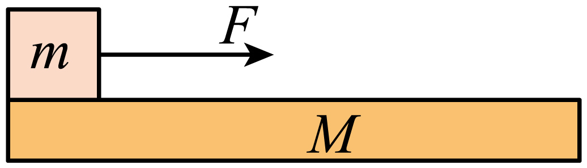

# Physics - 题目 973

**ID**: 4e0039ea83204b4093fa08c21e9b2135
**年级**: Grade 12
**难度**: Medium-Hard
**题型**: Calculation

## 题目
如图所示，在光滑水平面上，质量 $m=1{\rm{k}}{\rm{g}}$ 可视为质点的小物块，静止在质量 $M=2{\rm{k}}{\rm{g}}$ 的长木板左端， $m$ 与 $M$ 间的动摩擦因数 $μ=0.4$ ，现对 $m$ 施加一水平向右的拉力 $F=8{\rm{N}}$ ，作用一段时间 $t{{}_{1}}$ 后立刻撤掉外力 $F$ ，小物体又经时间 $t{{}_{2}}$ 恰好运动到长木板的右端且没从右端落下，重力加速度为 $g=10{\rm{m}}{\rm{/}}{\rm{s}}{^{2}}$ ，求：(1)时间 $t{{}_{1}}$ 与时间 $t{{}_{2}}$ 的比值；(2)若长木板的长度 $L=\frac {4}{3}{\rm{m}}$ ，则在外力 $F$ 作用时间 $t{{}_{1}}$ 内小物块和长木板组成的系统产生的热量大小。​​​​​​​‌

## 解答

1. （1）方法一：
2. 由题得小物块与长木板最终共速，设速度大小为 $v$ ，对小物块列动量定理 $Ft{{}_{1}}-{\rm μm}g\left ({t{{}_{1}}+t{{}_{2}}}\right )=mv-0$
3. 对长木板列动量定理 ${\rm μm}g\left ({t{{}_{1}}+t{{}_{2}}}\right )=Mv-0$
4. 得 $\frac {t{{}_{1}}}{t{{}_{2}}}=\frac {3}{1}$
5. 方法二：
6. 对小物体受力分析列方程 $F-{\rm μm}g=ma{{}_{1}}$
7. 得 $a{{}_{1}}=4{\rm{m}}/{\rm{s}}{^{2}}$
8. 对长木板受力分析列方程 ${\rm μm}g=Ma{{}_{2}}$
9. 得 $a{{}_{2}}=2{\rm{m}}/{\rm{s}}{^{2}}$
10. 小木块先加速后减速最后与长木板共速，长木板一直加速后匀速，小物块减速得加速度 $-{\rm μm}g=ma{{}_{3}}$
11. 得 $a{{}_{3}}=-4{\rm{m}}/{\rm{s}}{^{2}}$
12. 小物块加速阶段最大速度 $v{{}_{1}}=a{{}_{1}}t{{}_{1}}$ 小物块减速阶段 $v=a{{}_{1}}t{{}_{1}}+a{{}_{3}}t{{}_{2}}$
13. 长木板一直加速 $v=a{{}_{2}}\left ({t{{}_{1}}+t{{}_{2}}}\right )$
14. 得 $\frac {t{{}_{1}}}{t{{}_{2}}}=\frac {3}{1}$
15. （2）小物块加速阶段位移 $x{{}_{1}}=\frac {1}{2}a{{}_{1}}t{{}_{1}^{2}}$
16. 小物块减速阶段位移 $x{{}_{2}}=v{{}_{1}}t{{}_{2}}+\frac {1}{2}a{{}_{3}}t{{}_{2}^{2}}$
17. 长木板位移 $x{{}_{3}}=\frac {1}{2}a{{}_{2}}(t{{}_{1}}+t{{}_{2}}){^{2}}$
18. 由 $x{{}_{1}}+x{{}_{2}}-x{{}_{3}}=L$
19. 得 $t{{}_{1}}=1{\rm{s}}$
20. $t{{}_{1}}$ 时间内相对位移 ${\rm{Δ}}x=x{{}_{1}}-\frac {1}{2}a{{}_{2}}t{{}_{1}^{2}}=1{\rm{m}}$
21. $Q={\rm μm}gΔx={{4}}{\rm{J}}$

## 知识点

**中文**:
  - 板块模型中的能量守恒问题

**English**:
  - Energy Conservation in Plate Models

---
