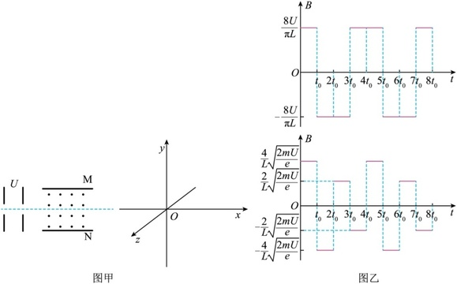

# Physics - 题目 2239

**ID**: 51c77dd9fd634cb293d3c2ac11246f9f
**年级**: Grade 12
**难度**: Medium-Hard
**题型**: Calculation

## 题目
如图甲所示，质量为m、电荷量为e的电子在电压为U的加速电场中从静止开始被加速后，恰好匀速通过板间距离为L的MN板，MN板间存在垂直于纸面向外的匀强磁场和竖直方向的匀强电场，磁感应强度大小为 $\frac {1}{L}\sqrt {\frac {2mU}{e}}$ 。​​​​​​​‌随后电子沿x轴正方向运动，在 $x\geqslant -\frac {3π}{4}L$ 的空间存在与y轴平行的交变电场，在 $x\geqslant 0$ 的空间同时还存在一与y轴平行的交变磁场，取电场和磁场沿 $+y$ 方向为正。电子从 $x=-\frac {3π}{4}L$ 位置进入电场时开始计时，电场和磁场随时间的变化如图乙所示，其中 $t{{}_{0}}=\frac {πL}{4}\sqrt {\frac {m}{2eU}}$ 。忽略电子重力的影响，求：（1）MN两极板间的电势差 $U{{}_{MN}}$ ；（2）电子穿过yOz平面时的速度；（3）电子在 $x\geqslant 0$ 的空间中运动到沿y轴方向最低位置点的坐标。

## 解答

1. （1）由动能定理 $eU=\frac {1}{2}mv{{}_{0}^{2}}$ ，由平衡条件可得 $ev{{}_{0}}\frac {1}{L}\sqrt {\frac {2mU}{e}}=\frac {e\left |{U{{}_{MN}}}\right |}{L}$ ，由于场强向上，则MN两极板间的电势差为 $U{{}_{MN}}=-2U$
2. （2）垂直于电场方向有 $x=\frac {3π}{4}L=v{{}_{0}}t$ ，解得 $t=3t{{}_{0}}$ ，沿电场方向有 $v{{}_{y}}=at{{}_{0}}=\frac {8eU}{πLm}t{{}_{0}}$ ，则电子穿过yOz平面时的速度大小为 $v=\sqrt {v{{}_{0}^{2}}+v{{}_{y}^{2}}}=2\sqrt {\frac {eU}{m}}$ ，方向为x轴正方向夹角为 $θ$ ，满足 ${\tan}θ=\frac {v{{}_{y}}}{v{{}_{0}}}=1$ ，所以 $θ=45{}^\circ $
3. （3）电子到最低点的时间为 $t{{}_{n}}=(4n+2)t{{}_{0}}$ （ $n=1，2,3…$ ），在y轴方向位移为 $y=-2\times \frac {v{{}_{y}}}{2}t{{}_{0}}=-\frac {πL}{4}$ ，由洛伦兹力提供向心力 $ev{{}_{0}}\frac {2}{L}\cdot \sqrt {\frac {2mU}{e}}=m\frac {v{{}_{0}^{2}}}{R{{}_{1}}}$ ，可得 $R{{}_{1}}=\frac {L}{2}$ ， $T{{}_{1}}=\frac {2πR{{}_{1}}}{v{{}_{0}}}$ ， $T{{}_{1}}=4t{{}_{0}}$ ，由洛伦兹力提供向心力 $ev{{}_{0}}\frac {4}{L}\cdot \sqrt {\frac {2mU}{e}}=m\frac {v{{}_{0}^{2}}}{R{{}_{2}}}$ ，可得 $R{{}_{2}}=\frac {L}{4}$ ， $T{{}_{1}}=\frac {2πR{{}_{2}}}{v{{}_{0}}}$ ， $T{{}_{1}}=2t{{}_{0}}$
4. 解得 $x{{}_{n}}=(R{{}_{1}}+4R{{}_{2}})+(n-1)(2R{{}_{1}}+4R{{}_{2}})=2nL-\frac {L}{2}$ （ $n=1,2,3\ldots $ ）， $z{{}_{n}}=R{{}_{1}}+(n-1)\times 2R{{}_{1}}=nL-\frac {L}{2}$ （ $n=1,2,3\ldots $ ），则电子在x≥0的空间中运动到沿y轴方向最低位置点的坐标为 $\left ({2nL-\frac {L}{2}，-\frac {π}{4}L，nL-\frac {L}{2}}\right )$ （ $n=1,2,3\ldots $ ）

## 知识点

**中文**:
  - 带电粒子在周期性变化的电磁场中的运动

**English**:
  - Motion in Periodically Varying EM Fields

---
